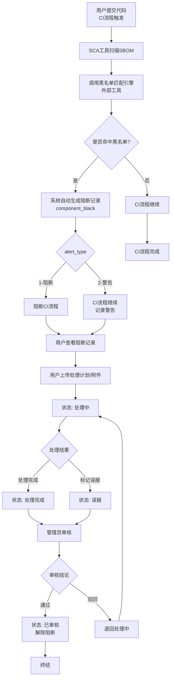
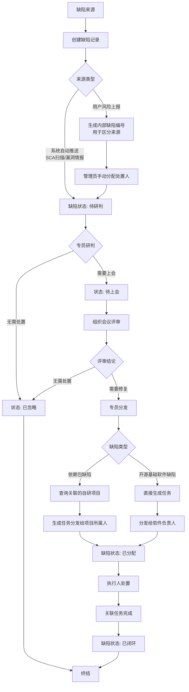
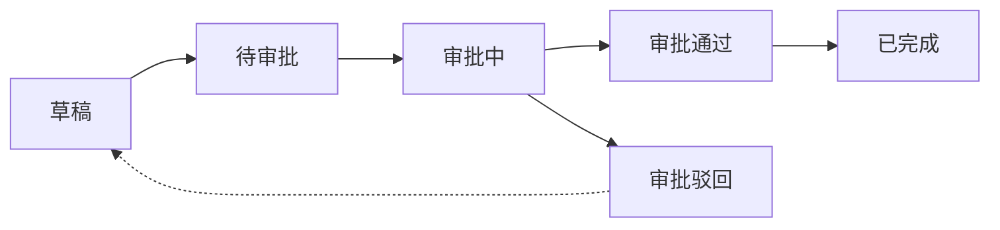
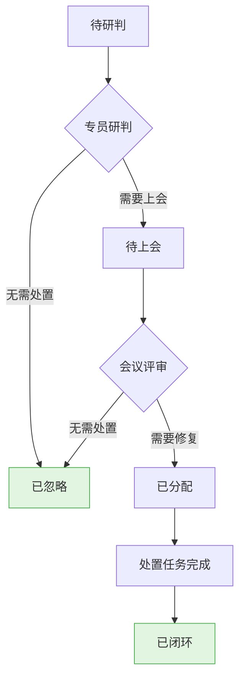
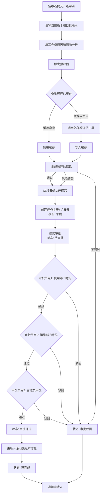
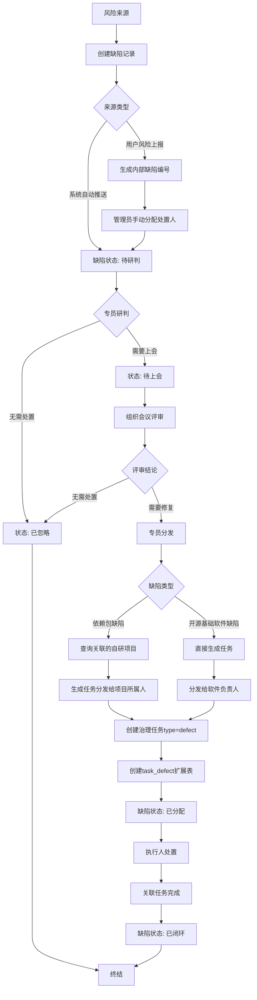

# 开源治理平台 V3 - 后端详细设计文档 V4

> 版本: V4
> 日期: 2026-06-25
> 状态: 正式

---

## 目录

- [第一部分：系统概述](#第一部分系统概述)
- [第二部分：核心模块详细设计](#第二部分核心模块详细设计)
- [第三部分：流程引擎与状态机设计](#第三部分流程引擎与状态机设计)
- [第四部分：数据库设计](#第四部分数据库设计)
- [第五部分：统一权限系统对接](#第五部分统一权限系统对接)
- [第六部分：接口设计规范](#第六部分接口设计规范)
- [第七部分：外部工具集成设计](#第七部分外部工具集成设计)
- [第八部分：流程引擎设计](#第八部分流程引擎设计)
- [第九部分：部署与运维](#第九部分部署与运维)
- [附录](#附录)

---

## 第一部分：系统概述

### 1. 项目背景和目标

开源治理平台 V3 是一款面向企业内部开源软件全生命周期治理的管理系统。平台旨在解决企业在引入、使用、维护开源软件过程中面临的以下核心问题：

- **资产不清**：缺乏对开源基础软件、依赖包、自研项目的统一台账管理
- **风险不可控**：开源组件的安全漏洞、许可证违规、供应链攻击等风险无法及时发现和处置
- **流程不规范**：引入、升级、退出等操作缺乏标准化审批流程
- **决策无依据**：缺乏数据支撑的治理效能评估和供应链安全洞察

平台通过四大角色（开源治理专员、运维部门、使用部门、管理员）协作，覆盖从软件选型、引入审批、风险监测到缺陷处置的完整治理链路。

**核心目标：**
1. 建立统一的开源资产台账，实现资产可视、可控、可追溯
2. 构建风险闭环管理体系，从风险发现到处置闭环全流程管理
3. 规范开源引入、升级、退出审批流程，确保合规可控
4. 提供数据驱动的决策洞察，支撑治理效能评估

### 2. 技术架构

```
┌─────────────────────────────────────────────────────────────┐
│                        前端 (Vue3 + Element Plus)            │
├─────────────────────────────────────────────────────────────┤
│                        Nginx (反向代理)                      │
├─────────────────────────────────────────────────────────────┤
│                    Go 后端服务 (Gin Framework)                │
│  ┌──────────┐ ┌──────────┐ ┌──────────┐ ┌──────────┐        │
│  │ 台账模块  │ │ 风险模块  │ │ 治理模块  │ │ 决策模块  │        │
│  └──────────┘ └──────────┘ └──────────┘ └──────────┘        │
│  ┌──────────┐ ┌──────────┐                                  │
│  │ 文件模块  │ │ 流程引擎  │                                  │
│  └──────────┘ └──────────┘                                  │
├──────────────────────────────┬──────────────────────────────┤
│         TiDB (MySQL兼容)     │       MinIO (对象存储)        │
│  ┌────────────────────────┐  │  ┌────────────────────────┐  │
│  │ 业务数据 / 审批状态机    │  │  │ 源码包 / 附件 / 报告    │  │
│  │ 预评估缓存              │  │  │ 备份文件(本系统管理)    │  │
│  └────────────────────────┘  │  └────────────────────────┘  │
├──────────────────────────────┴──────────────────────────────┤
│                   外部工具服务层 (独立部署)                    │
│  ┌──────────┐ ┌──────────┐ ┌──────────┐ ┌──────────┐        │
│  │ SCA分析  │ │ 预评估   │ │ 漏洞引擎  │ │ 活跃度   │        │
│  └──────────┘ └──────────┘ └──────────┘ └──────────┘        │
│  ┌──────────┐ ┌──────────┐ ┌──────────┐                     │
│  │ 黑名单   │ │ 源码备份  │ │ 通知服务  │                     │
│  └──────────┘ └──────────┘ └──────────┘                     │
├─────────────────────────────────────────────────────────────┤
│                   统一权限系统 (外部系统)                      │
│         提供用户身份认证和权限信息，本系统不维护用户数据        │
└─────────────────────────────────────────────────────────────┘
```

**技术栈说明：**

| 层级 | 技术选型 | 说明 |
|------|---------|------|
| **后端语言** | Go 1.21+ | 高性能、强类型、原生并发 |
| **Web框架** | Gin | 轻量级HTTP框架，中间件生态丰富 |
| **ORM** | GORM | Go生态最成熟的ORM，支持TiDB |
| **数据库** | TiDB 7.x | MySQL兼容的分布式HTAP数据库 |
| **对象存储** | MinIO | S3兼容的自托管对象存储，本系统边界内管理 |
| **认证** | 请求头传递用户信息 | 从统一权限系统获取用户身份，通过请求头传递 |
| **API文档** | Swagger (swaggo) | 自动生成RESTful API文档 |
| **日志** | Zap | 高性能结构化日志 |
| **配置** | Viper | 支持多环境配置管理 |

**重要约束：**
- **不使用 Redis**：所有状态管理通过数据库实现
- **不使用消息队列（MQ）**：所有流程通过同步调用或数据库状态机实现
- **不使用 Elasticsearch（ES）**：搜索通过MySQL LIKE或全文索引实现
- **MinIO存储**：所有文件（源码包、附件、报告、备份文件）存储在MinIO
- **TiDB兼容**：所有SQL语句必须兼容TiDB
- **审批流程同步执行**：不使用异步审批
- **外部工具独立部署**：通过HTTP接口调用，后端只负责接口预留和调用逻辑，调用只打印日志不写数据库
- **备份文件管理**：外部工具完成源码备份到MinIO后，本系统直接在MinIO管理备份文件，用户下载时直接从MinIO获取

### 3. 外部工具集成架构

本系统采用"核心业务内聚 + 专业工具外置"的架构模式。以下功能通过调用外部独立工具服务实现，后端只提供接口预留和调用编排逻辑：

| 外部工具 | 功能描述 | 调用方式 | 处理模式 |
|---------|---------|---------|---------|
| **源码备份工具** | 将开源组件源码备份至MinIO | HTTP REST API | 异步 |
| **SCA分析工具** | 解析SBOM文件，生成依赖分析结果 | HTTP REST API | 同步 |
| **预评估引擎** | 综合评估组件合规性、安全性、健康度 | HTTP REST API | 同步 |
| **黑名单匹配引擎** | 匹配组件是否命中黑名单规则 | HTTP REST API | 同步 |
| **活跃度分析引擎** | 采集和分析开源社区活跃度指标 | HTTP REST API | 同步/异步 |
| **漏洞引擎** | 扫描和匹配组件已知漏洞 | HTTP REST API | 同步 |
| **通知服务** | 发送审批通知、风险通知等 | HTTP REST API | 异步 |

**外部工具调用原则：**
1. 所有外部工具通过独立的HTTP服务提供接口
2. 后端不实现具体业务逻辑，只负责调用编排和结果存储
3. **所有调用只打印日志（使用Go的log包或zap日志库），不写入数据库**
4. 支持同步和异步两种调用模式
5. 失败时自动重试（可配置重试次数和间隔）

### 4. 系统边界说明

**系统内部职责（本系统实现）：**
- 资产台账的CRUD管理
- 流程引擎（状态机管理）
- 审批流程引擎（同步执行）
- 缺陷状态机管理
- 数据统计与报表
- 文件存储管理（MinIO）
- 外部工具调用编排（日志打印）
- **备份文件管理**：外部工具将源码备份到MinIO后，本系统直接管理MinIO中的备份文件，用户下载时直接从MinIO获取
- **预评估缓存管理**：缓存预评估结果，减少重复工具调用
- **权限验证**：基于请求头中的用户信息进行API权限校验

**系统外部职责（由外部工具实现）：**
- 源码备份的具体实现（备份到MinIO）
- SBOM文件解析和SCA分析
- 漏洞扫描和CVE匹配
- 活跃度数据采集和计算
- 黑名单匹配算法
- 预评估综合评分算法
- 通知推送（调用公司通用通知接口）

### 5. 统一权限系统对接

#### 5.1 对接方案

本系统不维护用户、角色、权限相关数据，所有权限信息通过公司统一权限管理系统获取。

#### 5.2 对接流程

1. **用户登录**：
   - 用户通过统一权限系统登录
   - 统一权限系统返回用户身份信息（用户ID、姓名、角色、部门等）
   - 本系统根据角色信息跳转到对应路径（/operator/*、/specialist/*、/admin/*）

2. **权限验证**：
   - 前端：通过路由路径区分角色，不同角色看到不同菜单和按钮
   - 后端：通过请求头中的用户信息（从统一权限系统获取）进行API权限验证

3. **角色映射**：
   - operator（运维者）→ /operator/* 路径
   - specialist（开源治理专员）→ /specialist/* 路径
   - admin（管理员）→ /admin/* 路径

#### 5.3 接口调用规范

所有API请求需要在请求头中携带用户信息：

```
Headers:
X-User-ID: 123456          # 用户ID（从统一权限系统获取）
X-User-Name: 张三          # 用户姓名
X-User-Role: operator      # 用户角色（operator/specialist/admin）
X-User-Dept: 技术研发部    # 用户部门
```

#### 5.4 后端权限验证

后端API通过请求头中的用户信息进行权限验证：

```go
// 权限验证中间件
func AuthMiddleware() gin.HandlerFunc {
    return func(c *gin.Context) {
        userID := c.GetHeader("X-User-ID")
        userRole := c.GetHeader("X-User-Role")
        
        if userID == "" || userRole == "" {
            c.JSON(401, gin.H{"code": 401, "message": "未登录"})
            c.Abort()
            return
        }
        
        // 将用户信息存储到上下文
        c.Set("userID", userID)
        c.Set("userRole", userRole)
        c.Next()
    }
}

// 角色验证中间件
func RoleMiddleware(requiredRoles ...string) gin.HandlerFunc {
    return func(c *gin.Context) {
        userRole := c.GetString("userRole")
        
        for _, role := range requiredRoles {
            if userRole == role {
                c.Next()
                return
            }
        }
        
        c.JSON(403, gin.H{"code": 403, "message": "无权限访问"})
        c.Abort()
    }
}
```

#### 5.5 前端路由控制

前端通过路由路径区分角色：
- `/operator/*` - 运维者可访问
- `/specialist/*` - 开源治理专员可访问
- `/admin/*` - 管理员可访问

按钮显示通过路径判断：
```vue
<el-button v-if="route.path.includes('/admin')">管理员专属按钮</el-button>
```

---

## 第二部分：核心模块详细设计

### 2.1 台账管理

#### 2.2.1 模块功能概述

| 子模块 | 对应数据表 | 说明 |
|--------|-----------|------|
| 开源基础软件 | `project` | 中间件、数据库等大型开源基础软件 |
| 自研项目 | `project_inner` | 企业内部自研项目 |
| 开源依赖包 | `component_snapshot` | 代码级第三方组件、SDK依赖 |
| 可信仓库 | `trusted_package` | 经安全扫描认证的制品包（预留架构） |
| 备份记录 | `backup_record` | MinIO中的备份文件记录（本系统直接管理） |

#### 2.2.2 数据表定义

```sql
-- 开源基础软件表（用户已有表结构，保留不变）
CREATE TABLE `project` (
  `id` bigint(20) NOT NULL AUTO_INCREMENT COMMENT '主键',
  `ACTIVE` int(1) DEFAULT NULL COMMENT '状态: 0-关闭, 1-正常',
  `AUTHOR` varchar(50) DEFAULT NULL COMMENT '作者',
  `PUBLISHER` varchar(100) DEFAULT NULL COMMENT '供应商',
  `_group` varchar(50) DEFAULT NULL COMMENT '项目组织',
  `_name` varchar(50) NOT NULL COMMENT '项目名称',
  `_version` varchar(50) DEFAULT '未知' COMMENT '版本号',
  `DESCRIPTION` varchar(1024) DEFAULT NULL COMMENT '组件描述',
  `CLASSIFIER` varchar(20) DEFAULT NULL COMMENT '组件类型',
  `license` varchar(255) DEFAULT NULL COMMENT '许可证',
  `PURL` varchar(255) DEFAULT NULL COMMENT 'Package-URL',
  `CPE` varchar(255) DEFAULT NULL COMMENT 'Common Platform Enumeration',
  `SWIDTAGID` varchar(255) DEFAULT NULL COMMENT 'SWID标识',
  `DIRECT_DEPENDENCIES` mediumtext COMMENT 'SBOM依赖列表',
  `LAST_BOM_IMPORTED` datetime DEFAULT NULL COMMENT '最后导入时间',
  `LAST_BOM_IMPORTED_FORMAT` varchar(50) DEFAULT NULL COMMENT '导入工具格式',
  `LAST_RISKSCORE` decimal(4,3) DEFAULT '0.000' COMMENT '最后风险评分',
  `UUID` varchar(36) NOT NULL COMMENT 'UUID唯一标识',
  `type` varchar(20) NOT NULL COMMENT '语言类型: java/Python/go等',
  `applicable_level` varchar(50) NOT NULL COMMENT '适用等级 A/B/C/D',
  `maint_dept` varchar(200) NOT NULL COMMENT '维护部门',
  `use_dept` varchar(200) NOT NULL COMMENT '使用部门',
  `country` varchar(50) NOT NULL COMMENT '开源来源国家',
  `create_time` timestamp DEFAULT CURRENT_TIMESTAMP COMMENT '创建时间',
  `create_by` varchar(20) DEFAULT NULL COMMENT '创建者',
  `update_time` timestamp DEFAULT CURRENT_TIMESTAMP ON UPDATE CURRENT_TIMESTAMP COMMENT '更新时间',
  `update_by` varchar(20) DEFAULT NULL COMMENT '更新者',
  PRIMARY KEY (`id`) /*T![clustered_index] CLUSTERED */,
  UNIQUE KEY `PROJECT_UQ_IDX` (`_group`, `_name`, `_version`),
  UNIQUE KEY `PROJECT_UUID_IDX` (`UUID`)
) ENGINE=InnoDB DEFAULT CHARSET=utf8mb4 COLLATE=utf8mb4_bin COMMENT='开源基础软件表';

-- 自研项目表（用户已有表结构，保留不变）
CREATE TABLE `project_inner` (
  `id` bigint(20) NOT NULL AUTO_INCREMENT COMMENT '主键',
  `pro_code` varchar(60) NOT NULL COMMENT '项目编码',
  `active` tinyint(1) DEFAULT '1' COMMENT '状态: 0-关闭, 1-正常',
  `type` varchar(20) NOT NULL COMMENT '语言类型: java/Python/go等',
  `is_boundary` tinyint(1) DEFAULT '0' COMMENT '是否边界系统: 1-是, 0-否',
  `group_name` varchar(20) DEFAULT NULL COMMENT '业务组',
  `dept_name` varchar(64) DEFAULT NULL COMMENT '部门',
  `module_code` varchar(64) NOT NULL COMMENT '模块编码',
  `branch` varchar(80) NOT NULL COMMENT 'Git分支名',
  `current_ID` varchar(64) NOT NULL COMMENT '本次数据标识ID',
  `current_commit_id` varchar(64) DEFAULT NULL COMMENT '当前Commit ID',
  `production_commit_id` varchar(64) DEFAULT NULL COMMENT '生产Commit ID',
  `create_by` varchar(20) DEFAULT NULL COMMENT '创建者',
  `update_by` varchar(20) DEFAULT NULL COMMENT '最后修改人',
  `create_time` timestamp DEFAULT CURRENT_TIMESTAMP COMMENT '创建时间',
  `update_time` timestamp DEFAULT CURRENT_TIMESTAMP ON UPDATE CURRENT_TIMESTAMP COMMENT '更新时间',
  PRIMARY KEY (`id`) /*T![clustered_index] CLUSTERED */,
  UNIQUE KEY `uk_pro_code` (`pro_code`)
) ENGINE=InnoDB DEFAULT CHARSET=utf8mb4 COLLATE=utf8mb4_bin COMMENT='自研项目表';

-- 开源依赖包表（用户已有表结构，保留不变）
CREATE TABLE `component_snapshot` (
  `id` bigint(20) NOT NULL AUTO_INCREMENT COMMENT '主键',
  `current_id` varchar(64) NOT NULL COMMENT '关联source_check表标识',
  `PARENT_COMPONENT_ID` bigint(20) DEFAULT NULL COMMENT '上层依赖组件ID',
  `AUTHOR` varchar(50) DEFAULT NULL COMMENT '作者',
  `PUBLISHER` varchar(100) DEFAULT NULL COMMENT '供应商',
  `_group` varchar(50) DEFAULT NULL COMMENT '组件组织',
  `_name` varchar(100) NOT NULL COMMENT '组件名称',
  `_version` varchar(50) DEFAULT '未知' COMMENT '版本号',
  `DESCRIPTION` varchar(1024) DEFAULT NULL COMMENT '组件描述',
  `CLASSIFIER` varchar(20) DEFAULT NULL COMMENT '组件类型',
  `FILENAME` varchar(255) DEFAULT NULL COMMENT '文件名',
  `EXTENSION` varchar(255) DEFAULT NULL COMMENT '扩展信息',
  `INTERNAL` int(1) DEFAULT NULL COMMENT '是否内部: 0-否, 1-是',
  `MD5` varchar(32) DEFAULT NULL COMMENT 'MD5校验值',
  `SHA1` varchar(40) DEFAULT NULL COMMENT 'SHA1校验值',
  `SHA_256` varchar(64) DEFAULT NULL COMMENT 'SHA256校验值',
  `SHA_384` varchar(96) DEFAULT NULL COMMENT 'SHA384校验值',
  `SHA_512` varchar(128) DEFAULT NULL COMMENT 'SHA512校验值',
  `SHA3_256` varchar(64) DEFAULT NULL COMMENT 'SHA3-256校验值',
  `SHA3_384` varchar(96) DEFAULT NULL COMMENT 'SHA3-384校验值',
  `SHA3_512` varchar(128) DEFAULT NULL COMMENT 'SHA3-512校验值',
  `BLAKE2B_256` varchar(64) DEFAULT NULL COMMENT 'BLAKE2B-256校验值',
  `BLAKE2B_384` varchar(96) DEFAULT NULL COMMENT 'BLAKE2B-384校验值',
  `BLAKE2B_512` varchar(128) DEFAULT NULL COMMENT 'BLAKE2B-512校验值',
  `BLAKE3` varchar(64) DEFAULT NULL COMMENT 'BLAKE3校验值',
  `NOTES` mediumtext COMMENT '详细参考',
  `PURL` varchar(255) DEFAULT NULL COMMENT 'Package-URL',
  `PURLCOORDINATES` varchar(255) DEFAULT NULL COMMENT 'Package-URL Coordinates',
  `CPE` varchar(255) DEFAULT NULL COMMENT 'CPE标识',
  `SWIDTAGID` varchar(255) DEFAULT NULL COMMENT 'SWID标识',
  `DIRECT_DEPENDENCIES` mediumtext COMMENT 'SBOM依赖列表',
  `EXTERNAL_REFERENCES` mediumblob COMMENT '扩展说明',
  `COPYRIGHT` varchar(1024) DEFAULT NULL COMMENT '许可证说明',
  `LICENSE` varchar(255) DEFAULT NULL COMMENT '许可证',
  `LICENSE_ID` bigint(20) DEFAULT NULL COMMENT '关联license表ID',
  `LAST_RISKSCORE` decimal(4,3) DEFAULT '0.000' COMMENT '最后风险评分',
  `PROJECT_ID` bigint(20) DEFAULT NULL COMMENT '关联project_inner表ID',
  PRIMARY KEY (`id`) /*T![clustered_index] CLUSTERED */,
  KEY `idx_current_id` (`current_id`),
  KEY `idx_project_id` (`project_id`),
  KEY `idx_name_version` (`_name`, `_version`),
  KEY `idx_license_id` (`license_id`)
) ENGINE=InnoDB DEFAULT CHARSET=utf8mb4 COLLATE=utf8mb4_bin COMMENT='开源依赖包表';

-- 可信包表（预留架构）
CREATE TABLE `trusted_package` (
  `id` bigint(20) NOT NULL AUTO_INCREMENT COMMENT '主键',
  `name` varchar(100) NOT NULL COMMENT '组件名称',
  `version` varchar(50) NOT NULL COMMENT '版本号',
  `category` varchar(20) NOT NULL COMMENT '分类: middleware-中间件, database-数据库, dependency-依赖包, tool-工具',
  `scan_status` varchar(20) NOT NULL DEFAULT 'pending' COMMENT '扫描状态: pending-待扫描, passed-通过, warning-警告, failed-失败',
  `scan_date` datetime DEFAULT NULL COMMENT '扫描日期',
  `download_count` int(11) DEFAULT '0' COMMENT '下载次数',
  `size` varchar(50) DEFAULT NULL COMMENT '文件大小',
  `checksum` varchar(128) DEFAULT NULL COMMENT 'SHA256校验值',
  `minio_path` varchar(255) DEFAULT NULL COMMENT 'MinIO存储路径',
  `description` varchar(1024) DEFAULT NULL COMMENT '描述',
  `publisher` varchar(100) DEFAULT NULL COMMENT '发布者',
  `status` tinyint(1) NOT NULL DEFAULT '1' COMMENT '状态: 0-下架, 1-上架',
  `create_time` timestamp DEFAULT CURRENT_TIMESTAMP COMMENT '创建时间',
  `create_by` varchar(20) DEFAULT NULL COMMENT '创建者',
  `update_time` timestamp DEFAULT CURRENT_TIMESTAMP ON UPDATE CURRENT_TIMESTAMP COMMENT '更新时间',
  `update_by` varchar(20) DEFAULT NULL COMMENT '更新者',
  PRIMARY KEY (`id`) /*T![clustered_index] CLUSTERED */,
  UNIQUE KEY `uk_name_version` (`name`, `version`),
  KEY `idx_category` (`category`),
  KEY `idx_scan_status` (`scan_status`)
) ENGINE=InnoDB DEFAULT CHARSET=utf8mb4 COLLATE=utf8mb4_bin COMMENT='可信包表';

-- 备份记录表（本系统直接管理MinIO中的备份文件）
CREATE TABLE `backup_record` (
  `id` bigint(20) NOT NULL AUTO_INCREMENT COMMENT '主键',
  `component_name` varchar(100) NOT NULL COMMENT '组件名称',
  `component_version` varchar(50) NOT NULL COMMENT '组件版本',
  `status` varchar(20) NOT NULL DEFAULT 'completed' COMMENT '备份状态: pending-待备份, running-备份中, completed-完成, failed-失败',
  `minio_path` varchar(255) DEFAULT NULL COMMENT 'MinIO存储路径',
  `minio_bucket` varchar(100) DEFAULT 'osm-mngt' COMMENT 'MinIO存储桶',
  `size` varchar(50) DEFAULT NULL COMMENT '文件大小',
  `trigger_type` varchar(20) DEFAULT 'auto' COMMENT '触发方式: auto-自动, manual-手动',
  `backup_source` varchar(50) DEFAULT 'external_tool' COMMENT '备份来源: external_tool-外部工具',
  `error_msg` varchar(512) DEFAULT NULL COMMENT '错误信息',
  `create_time` timestamp DEFAULT CURRENT_TIMESTAMP COMMENT '创建时间',
  `create_by` varchar(20) DEFAULT NULL COMMENT '创建者',
  `update_time` timestamp DEFAULT CURRENT_TIMESTAMP ON UPDATE CURRENT_TIMESTAMP COMMENT '更新时间',
  PRIMARY KEY (`id`) /*T![clustered_index] CLUSTERED */,
  KEY `idx_component` (`component_name`, `component_version`),
  KEY `idx_status` (`status`)
) ENGINE=InnoDB DEFAULT CHARSET=utf8mb4 COLLATE=utf8mb4_bin COMMENT='备份记录表';
```

#### 2.2.3 接口设计

**开源基础软件：**

| 接口 | 方法 | 路径 | 权限 | 说明 |
|------|------|------|------|------|
| 列表查询 | GET | `/api/v1/assets/projects` | admin | 分页查询开源基础软件 |
| 详情查询 | GET | `/api/v1/assets/projects/:id` | admin | 查询软件详情 |
| 创建 | POST | `/api/v1/assets/projects` | admin | 新增开源基础软件 |
| 更新 | PUT | `/api/v1/assets/projects/:id` | admin | 更新软件信息 |
| 删除 | DELETE | `/api/v1/assets/projects/:id` | admin | 软删除 |
| 批量导入 | POST | `/api/v1/assets/projects/import` | admin | Excel批量导入 |
| 批量导出 | GET | `/api/v1/assets/projects/export` | admin | 导出软件列表 |

**自研项目：**

| 接口 | 方法 | 路径 | 权限 | 说明 |
|------|------|------|------|------|
| 列表查询 | GET | `/api/v1/assets/inner-projects` | all | 分页查询自研项目 |
| 详情查询 | GET | `/api/v1/assets/inner-projects/:id` | all | 查询项目详情 |
| 创建 | POST | `/api/v1/assets/inner-projects` | admin | 新增自研项目 |
| 更新 | PUT | `/api/v1/assets/inner-projects/:id` | admin | 更新项目信息 |
| 删除 | DELETE | `/api/v1/assets/inner-projects/:id` | admin | 软删除 |
| 批量导出 | GET | `/api/v1/assets/inner-projects/export` | admin | 导出项目列表 |

**开源依赖包：**

| 接口 | 方法 | 路径 | 权限 | 说明 |
|------|------|------|------|------|
| 列表查询 | GET | `/api/v1/assets/components` | admin | 分页查询依赖包 |
| 详情查询 | GET | `/api/v1/assets/components/:id` | admin | 查询依赖包详情 |
| 批量导入 | POST | `/api/v1/assets/components/import` | admin | 上传SBOM文件批量导入(调用外部SCA工具) |
| 批量导出 | GET | `/api/v1/assets/components/export` | admin | 导出依赖包列表 |

**备份管理（本系统直接管理MinIO中的备份文件）：**

| 接口 | 方法 | 路径 | 权限 | 说明 |
|------|------|------|------|------|
| 列表查询 | GET | `/api/v1/assets/backups` | admin | 分页查询备份记录 |
| 下载备份 | GET | `/api/v1/assets/backups/:id/download` | admin | 下载备份文件(直接从MinIO获取预签名URL) |
| 同步记录 | POST | `/api/v1/assets/backups/sync` | admin | 同步外部工具已完成的备份记录 |

**可信仓库（预留）：**

| 接口 | 方法 | 路径 | 权限 | 说明 |
|------|------|------|------|------|
| 列表查询 | GET | `/api/v1/assets/trusted-packages` | all | 分页查询可信包 |
| 创建 | POST | `/api/v1/assets/trusted-packages` | admin | 上传可信包 |
| 删除 | DELETE | `/api/v1/assets/trusted-packages/:id` | admin | 下架可信包 |
| 下载 | GET | `/api/v1/assets/trusted-packages/:id/download` | all | 下载可信包(从MinIO) |
| Webhook回调 | POST | `/api/v1/assets/webhook/nexus` | 公开 | Nexus事件推送回调 |

---

### 2.3 风险管理

#### 2.3.1 模块功能概述

| 子模块 | 对应数据表 | 说明 |
|--------|-----------|------|
| 黑名单管理 | `component_core` | 维护禁止使用的组件及版本表达式 |
| 黑名单阻断记录 | `component_black` | CI流程中黑名单匹配产生的阻断/警告记录 |
| 许可证信息库 | `license` | 许可证详细信息表（代号、名称、模板等） |
| 许可证分组 | `licensegroup` | 许可证分组及风险分值管理 |
| 许可证分组关联 | `licensegroup_license` | 许可证与分组的关联关系 |
| 许可证清单 | `license_info` | 公司认可的许可证清单及风险等级 |
| 缺陷台账 | `defect_ledger` | 所有安全漏洞、恶意代码、许可证违规等issue信息 |
| 用户风险上报 | `user_risk_report` | 用户零星上报的风险信息 |
| 活跃度监测 | `component_activity` | 开源社区活跃度指标采集 |
| 缺陷-任务映射 | `defect_task_mapping` | 缺陷关联的处置任务 |

#### 2.3.2 黑名单管理（CI流程集成）

**黑名单匹配本质**：持续集成（CI）用户提交代码时的一个自动化检查点

**黑名单匹配流程**：
```
用户提交代码（CI流程）
  ↓
SCA工具扫描SBOM
  ↓
调用黑名单匹配接口（外部工具）
  ↓
发现匹配的黑名单组件
  ↓
系统自动生成阻断记录（component_black）
  ↓
阻断CI流程（根据alert_type：1-阻断 2-警告）
  ↓
用户查看阻断记录并处理
```

**阻断记录处理流程**：
```
用户查看阻断记录
  ↓
用户上传处理计划/结果附件
  ↓
更新处理状态（未处理→处理中→处理完成/误报）
  ↓
管理员审核
  ↓
审核通过 → 解除阻断/标记误报
```

**阻断记录状态**：

| 状态 | 标识 | 说明 | 流转方向 |
|------|------|------|---------|
| 未处理 | `pending` | 系统自动生成的初始状态 | → 处理中 |
| 处理中 | `processing` | 用户正在处理，已上传处理计划 | → 处理完成 或 → 误报 |
| 处理完成 | `resolved` | 用户已处理完成，待管理员审核 | → 已审核（终结） |
| 误报 | `false_positive` | 用户标记为误报，待管理员审核 | → 已审核（终结） |
| 已审核 | `audited` | 管理员审核通过，终结状态 | 终结 |

**阻断记录处理逻辑**：
- **阻断型（alert_type=1）**：CI流程被阻断，必须处理完成后才能继续
- **警告型（alert_type=2）**：CI流程仅警告，不阻断，但需记录跟踪

**阻断处理流程图**：



#### 2.3.3 缺陷台账说明

**缺陷台账本质**：软件有关的issue信息

**缺陷来源**：
1. **系统自动推送**：SCA扫描发现、外部漏洞情报推送
2. **用户风险上报**：用户零星上报的风险

**用户风险上报流程**：
```
用户上报风险 → 系统生成内部缺陷编号（用于区分来源）→ 进入缺陷处理流程
```

**缺陷状态（5个）**：

| 状态 | 标识 | 说明 | 流转方向 |
|------|------|------|---------|
| 待研判 | `pending_analysis` | 系统自动推送的初始状态 | → 已忽略 或 → 待上会 |
| 待上会 | `pending_review` | 专员研判需要上会讨论 | → 已分配 或 → 已忽略 |
| 已分配 | `assigned` | 专员处理完分配，生成处置任务 | → 已闭环 |
| 已忽略 | `ignored` | 终结状态，研判无需处置 | 终结 |
| 已闭环 | `closed` | 终结状态，关联任务完成 | 终结 |

**分发逻辑**：
- **依赖包缺陷** → 查询关联自研项目 → 生成任务分发给项目所属人
- **开源基础软件缺陷** → 直接生成任务 → 分发给软件负责人
- **用户上报的缺陷** → 管理员手动分配处置人

#### 2.3.4 缺陷处理流程图



#### 2.3.5 数据表定义

```sql
-- 黑名单配置表（用户已有表结构，保留不变）
CREATE TABLE `component_core` ( 
  `id` bigint(20) NOT NULL AUTO_INCREMENT COMMENT 'id', 
  `_format` tinyint(2) NOT NULL DEFAULT '1' COMMENT '类型: maven:1、pypi:2、npm:3、yum:4等', 
  `type` varchar(50) DEFAULT NULL COMMENT '类型', 
  `_name` varchar(50) NOT NULL COMMENT '包名', 
  `_group` varchar(50) NOT NULL COMMENT '包分组', 
  `version_exp` varchar(200) NOT NULL COMMENT '匹配表达式', 
  `applicable_level` varchar(50) NOT NULL COMMENT '适用等级', 
  `support_team` varchar(50) NOT NULL COMMENT '技术支持团队', 
  `reason` varchar(400) DEFAULT NULL COMMENT '添加理由', 
  `advise` varchar(400) DEFAULT NULL COMMENT '建议', 
  `_enable` tinyint(1) NOT NULL COMMENT '是否启用, 1: 启用, 0: 禁用', 
  `alert_type` tinyint(2) DEFAULT '1' COMMENT '告警类型 1 阻断 2警告', 
  `create_time` datetime DEFAULT CURRENT_TIMESTAMP COMMENT '创建时间', 
  `create_by` varchar(20) DEFAULT NULL COMMENT '创建者', 
  `update_time` datetime DEFAULT CURRENT_TIMESTAMP ON UPDATE CURRENT_TIMESTAMP COMMENT '修改时间', 
  `update_by` varchar(20) DEFAULT NULL COMMENT '更新者', 
  `level_time` datetime DEFAULT CURRENT_TIMESTAMP COMMENT '风险等级生效时间', 
  `is_boundary` tinyint(1) DEFAULT '2' COMMENT '2:全部 1:边界系统 0非边界系统', 
  PRIMARY KEY (`id`) /*T![clustered_index] CLUSTERED */, 
  UNIQUE KEY `uniq_black_list_idx` (`_format`,`_name`,`_group`,`applicable_level`) 
  ) ENGINE=InnoDB DEFAULT CHARSET=utf8mb4 COLLATE=utf8mb4_bin AUTO_INCREMENT=240001 COMMENT='黑名单配置表'

-- 黑名单阻断记录表（CI流程中自动生成）
CREATE TABLE `component_black` (
  `id` bigint(20) NOT NULL AUTO_INCREMENT COMMENT '主键',
  `blacklist_id` bigint(20) NOT NULL COMMENT '命中的黑名单规则ID(关联component_core表)',
  `component_name` varchar(100) NOT NULL COMMENT '组件名称',
  `component_version` varchar(50) NOT NULL COMMENT '组件版本',
  `component_group` varchar(50) DEFAULT NULL COMMENT '组件组织',
  `project_id` bigint(20) DEFAULT NULL COMMENT '关联的自研项目ID',
  `project_name` varchar(100) DEFAULT NULL COMMENT '关联的自研项目名称',
  `alert_type` tinyint(2) NOT NULL DEFAULT '1' COMMENT '告警类型: 1-阻断, 2-警告',
  `status` varchar(20) NOT NULL DEFAULT 'pending' COMMENT '处理状态: pending-未处理, processing-处理中, resolved-处理完成, false_positive-误报, audited-已审核',
  `handler` varchar(50) DEFAULT NULL COMMENT '处理人',
  `handle_plan` varchar(512) DEFAULT NULL COMMENT '处理计划',
  `handle_result` mediumtext COMMENT '处理结果说明',
  `attachment_url` varchar(512) DEFAULT NULL COMMENT '附件URL(MinIO)',
  `auditor` varchar(50) DEFAULT NULL COMMENT '审核人',
  `audit_opinion` varchar(512) DEFAULT NULL COMMENT '审核意见',
  `audit_time` datetime DEFAULT NULL COMMENT '审核时间',
  `ci_pipeline_id` varchar(100) DEFAULT NULL COMMENT 'CI流水线ID',
  `ci_build_id` varchar(100) DEFAULT NULL COMMENT 'CI构建ID',
  `create_time` timestamp DEFAULT CURRENT_TIMESTAMP COMMENT '创建时间',
  `create_by` varchar(20) DEFAULT NULL COMMENT '创建者',
  `update_time` timestamp DEFAULT CURRENT_TIMESTAMP ON UPDATE CURRENT_TIMESTAMP COMMENT '更新时间',
  `update_by` varchar(20) DEFAULT NULL COMMENT '更新者',
  PRIMARY KEY (`id`) /*T![clustered_index] CLUSTERED */,
  KEY `idx_blacklist_id` (`blacklist_id`),
  KEY `idx_status` (`status`),
  KEY `idx_component` (`component_name`, `component_version`),
  KEY `idx_project_id` (`project_id`),
  KEY `idx_ci_pipeline` (`ci_pipeline_id`)
) ENGINE=InnoDB DEFAULT CHARSET=utf8mb4 COLLATE=utf8mb4_bin COMMENT='黑名单阻断记录表';

-- 许可证表
CREATE TABLE `license` ( 
  `id` bigint(20) NOT NULL AUTO_INCREMENT COMMENT '主键', 
  `_COMMENT` mediumtext DEFAULT NULL COMMENT '详情', 
  `IS_DEPRECATED` int(1) DEFAULT '0' COMMENT '是否过期 0-否 1-是', 
  `FSFLIBRE` int(1) DEFAULT '0' COMMENT 'Free Software Foundation(FSF) Libre 0-否 1-是', 
  `HEADER` mediumtext DEFAULT NULL COMMENT '文件头说明', 
  `LICENSE` varchar(255) NOT NULL COMMENT '许可证代号', 
  `_name` varchar(255) NOT NULL COMMENT '许可证名称', 
  `IS_OSIAPPROVED` int(1) NOT NULL DEFAULT '0' COMMENT '是否OSI审核 0-否 1-是', 
  `SEEALSO` mediumblob DEFAULT NULL COMMENT '另请参阅', 
  `TEMPLATE` mediumtext DEFAULT NULL COMMENT '许可证模板', 
  `_text` mediumtext DEFAULT NULL COMMENT '许可证说明', 
  `UUID` varchar(36) NOT NULL COMMENT 'UUID', 
  `create_time` timestamp DEFAULT CURRENT_TIMESTAMP COMMENT '创建时间', 
  `create_by` varchar(20) DEFAULT NULL COMMENT '创建者', 
  `update_time` timestamp DEFAULT CURRENT_TIMESTAMP ON UPDATE CURRENT_TIMESTAMP COMMENT '更新时间', 
  `update_by` varchar(20) DEFAULT NULL COMMENT '更新者', 
  PRIMARY KEY (`id`) /*T![clustered_index] CLUSTERED */, 
  UNIQUE KEY `LICENSE_LICENSEID_IDX` (`LICENSE`), 
  UNIQUE KEY `LICENSE_UUID_IDX` (`UUID`) 
  ) ENGINE=InnoDB DEFAULT CHARSET=utf8mb4 COLLATE=utf8mb4_bin AUTO_INCREMENT=60002 COMMENT='许可证表';

-- 许可证分组表
CREATE TABLE `licensegroup` ( 
  `id` bigint(20) NOT NULL AUTO_INCREMENT COMMENT '主键', 
  `_name` varchar(50) NOT NULL COMMENT '分组名称', 
  `RISKWEIGHT` int(3) NOT NULL DEFAULT '0' COMMENT '风险分值', 
  `UUID` varchar(36) NOT NULL COMMENT 'UUID', 
  `create_time` timestamp DEFAULT CURRENT_TIMESTAMP COMMENT '创建时间', 
  `create_by` varchar(20) DEFAULT NULL COMMENT '创建者', 
  `update_time` timestamp DEFAULT CURRENT_TIMESTAMP ON UPDATE CURRENT_TIMESTAMP COMMENT '更新时间', 
  `update_by` varchar(20) DEFAULT NULL COMMENT '更新者', 
  PRIMARY KEY (`id`) /*T![clustered_index] CLUSTERED */, 
  UNIQUE KEY `LICENSEGROUP_UUID_IDX` (`UUID`) 
  ) ENGINE=InnoDB DEFAULT CHARSET=utf8mb4 COLLATE=utf8mb4_bin AUTO_INCREMENT=120001 COMMENT='许可证分组';

-- 许可证分组关联表
CREATE TABLE `licensegroup_license` ( 
  `id` bigint(20) NOT NULL AUTO_INCREMENT COMMENT '主键', 
  `licensegroup_id` bigint(20) NOT NULL COMMENT 'licensegroup表主键', 
  `license_id` bigint(20) NOT NULL COMMENT 'license表主键', 
  `create_time` datetime DEFAULT CURRENT_TIMESTAMP COMMENT '创建时间', 
  `create_by` varchar(20) DEFAULT NULL COMMENT '创建者', 
  `update_time` datetime DEFAULT CURRENT_TIMESTAMP ON UPDATE CURRENT_TIMESTAMP COMMENT '更新时间', 
  `update_by` varchar(20) DEFAULT NULL COMMENT '更新者', 
  PRIMARY KEY (`id`) /*T![clustered_index] CLUSTERED */, 
  UNIQUE KEY `uniq_licensegroup_license_idx` (`licensegroup_id`,`license_id`) 
  ) ENGINE=InnoDB DEFAULT CHARSET=utf8 COLLATE=utf8_bin AUTO_INCREMENT=30001 COMMENT='许可证及许可证分组关联表';

-- 许可证信息库（公司认可的许可证清单）
CREATE TABLE `license_info` (
  `id` bigint(20) NOT NULL AUTO_INCREMENT COMMENT '主键',
  `name` varchar(50) NOT NULL COMMENT '许可证简称(如MIT, Apache-2.0)',
  `full_name` varchar(200) NOT NULL COMMENT '许可证全称',
  `category` varchar(30) NOT NULL COMMENT '分类: permissive-宽松型, weak-copyleft-弱传染性, strong-copyleft-强传染性, special-特殊型',
  `risk_level` varchar(20) NOT NULL COMMENT '风险等级: low-低, medium-中, high-高, critical-严重',
  `description` varchar(1024) DEFAULT NULL COMMENT '许可证描述',
  `is_approved` tinyint(1) NOT NULL DEFAULT '0' COMMENT '是否公司认可: 0-否, 1-是',
  `usage_count` int(11) DEFAULT '0' COMMENT '使用次数',
  `create_time` timestamp DEFAULT CURRENT_TIMESTAMP COMMENT '创建时间',
  `update_time` timestamp DEFAULT CURRENT_TIMESTAMP ON UPDATE CURRENT_TIMESTAMP COMMENT '更新时间',
  PRIMARY KEY (`id`) /*T![clustered_index] CLUSTERED */,
  UNIQUE KEY `uk_name` (`name`),
  KEY `idx_risk_level` (`risk_level`)
) ENGINE=InnoDB DEFAULT CHARSET=utf8mb4 COLLATE=utf8mb4_bin COMMENT='许可证信息库';

-- 缺陷台账（issue信息，含用户风险上报）
CREATE TABLE `defect_ledger` (
  `id` bigint(20) NOT NULL AUTO_INCREMENT COMMENT '主键',
  `defect_no` varchar(50) NOT NULL COMMENT '缺陷编号(如DF-2024-0001)',
  `source` varchar(30) NOT NULL COMMENT '来源: sca-scan-SCA扫描, vuln-intel-漏洞情报, user-report-用户上报',
  `title` varchar(255) NOT NULL COMMENT '缺陷标题',
  `risk_type` varchar(30) NOT NULL COMMENT '风险类型: vulnerability-安全漏洞, malware-恶意代码, license-violation-许可证违规, supply-chain-供应链风险, other-其他',
  `risk_level` varchar(20) NOT NULL COMMENT '风险等级: low, medium, high, critical',
  `affected_component` varchar(100) NOT NULL COMMENT '受影响组件',
  `affected_component_type` varchar(20) NOT NULL COMMENT '组件类型: project-开源基础软件, dependency-依赖包',
  `affected_version` varchar(50) DEFAULT NULL COMMENT '受影响版本',
  `cve_id` varchar(50) DEFAULT NULL COMMENT 'CVE编号',
  `description` mediumtext COMMENT '详细描述',
  `discovered_date` datetime NOT NULL COMMENT '发现日期',
  `status` varchar(20) NOT NULL DEFAULT 'pending_analysis' COMMENT '状态: pending_analysis-待研判, pending_review-待上会, assigned-已分配, ignored-已忽略, closed-已闭环',
  `analyze_result` varchar(500) DEFAULT NULL COMMENT '专员研判结果',
  `review_meeting_no` varchar(50) DEFAULT NULL COMMENT '评审会议编号',
  `review_conclusion` varchar(20) DEFAULT NULL COMMENT '评审结论: no_action-无需处置, need_fix-需要修复',
  `dispatch_type` varchar(20) DEFAULT NULL COMMENT '分发类型: dependency-依赖包缺陷, project-开源基础软件缺陷',
  `dispatch_target` varchar(50) DEFAULT NULL COMMENT '分发目标人员',
  `dispatch_dept` varchar(100) DEFAULT NULL COMMENT '分发目标部门',
  `dispatch_time` datetime DEFAULT NULL COMMENT '分发时间',
  `dispatcher` varchar(20) DEFAULT NULL COMMENT '分发人',
  `related_task_id` bigint(20) DEFAULT NULL COMMENT '关联的处置任务ID',
  `analyze_by` varchar(50) DEFAULT NULL COMMENT '研判人',
  `analyze_time` datetime DEFAULT NULL COMMENT '研判时间',
  `review_by` varchar(50) DEFAULT NULL COMMENT '评审人',
  `review_time` datetime DEFAULT NULL COMMENT '评审时间',
  `close_time` datetime DEFAULT NULL COMMENT '闭环时间',
  `create_time` timestamp DEFAULT CURRENT_TIMESTAMP COMMENT '创建时间',
  `update_time` timestamp DEFAULT CURRENT_TIMESTAMP ON UPDATE CURRENT_TIMESTAMP COMMENT '更新时间',
  PRIMARY KEY (`id`) /*T![clustered_index] CLUSTERED */,
  UNIQUE KEY `uk_defect_no` (`defect_no`),
  KEY `idx_status` (`status`),
  KEY `idx_risk_level` (`risk_level`),
  KEY `idx_source` (`source`),
  KEY `idx_affected_component` (`affected_component`),
  KEY `idx_related_task_id` (`related_task_id`)
) ENGINE=InnoDB DEFAULT CHARSET=utf8mb4 COLLATE=utf8mb4_bin COMMENT='缺陷台账';

-- 缺陷-任务映射表
CREATE TABLE `defect_task_mapping` (
  `id` bigint(20) NOT NULL AUTO_INCREMENT COMMENT '主键',
  `defect_id` bigint(20) NOT NULL COMMENT '缺陷ID',
  `defect_no` varchar(50) NOT NULL COMMENT '缺陷编号',
  `task_id` bigint(20) NOT NULL COMMENT '关联任务ID',
  `task_no` varchar(50) NOT NULL COMMENT '任务编号',
  `mapping_type` varchar(20) NOT NULL COMMENT '映射类型: auto-自动, manual-手动',
  `create_time` timestamp DEFAULT CURRENT_TIMESTAMP COMMENT '创建时间',
  PRIMARY KEY (`id`) /*T![clustered_index] CLUSTERED */,
  KEY `idx_defect_id` (`defect_id`),
  KEY `idx_task_id` (`task_id`),
  UNIQUE KEY `uk_defect_task` (`defect_id`, `task_id`)
) ENGINE=InnoDB DEFAULT CHARSET=utf8mb4 COLLATE=utf8mb4_bin COMMENT='缺陷-任务映射表';

-- 用户风险上报表
CREATE TABLE `user_risk_report` (
  `id` bigint(20) NOT NULL AUTO_INCREMENT COMMENT '主键',
  `report_no` varchar(50) NOT NULL COMMENT '上报编号(如UR-2024-0001)',
  `reporter` varchar(50) NOT NULL COMMENT '上报人',
  `reporter_dept` varchar(100) NOT NULL COMMENT '上报部门',
  `title` varchar(255) NOT NULL COMMENT '风险标题',
  `risk_type` varchar(30) NOT NULL COMMENT '风险类型: vulnerability-安全漏洞, malware-恶意代码, license-violation-许可证违规, supply-chain-供应链风险, other-其他',
  `risk_level` varchar(20) NOT NULL COMMENT '风险等级: low, medium, high, critical',
  `affected_component` varchar(100) NOT NULL COMMENT '受影响组件',
  `affected_component_type` varchar(20) NOT NULL COMMENT '组件类型: project-开源基础软件, dependency-依赖包',
  `affected_version` varchar(50) DEFAULT NULL COMMENT '受影响版本',
  `description` mediumtext COMMENT '详细描述',
  `attachment_url` varchar(512) DEFAULT NULL COMMENT '附件URL(MinIO)',
  `related_defect_id` bigint(20) DEFAULT NULL COMMENT '关联的缺陷ID(系统生成内部缺陷编号后)',
  `status` varchar(20) NOT NULL DEFAULT 'pending' COMMENT '状态: pending-待处理, processed-已处理, rejected-已驳回',
  `reject_reason` varchar(512) DEFAULT NULL COMMENT '驳回原因',
  `processed_by` varchar(50) DEFAULT NULL COMMENT '处理人',
  `processed_time` datetime DEFAULT NULL COMMENT '处理时间',
  `create_time` timestamp DEFAULT CURRENT_TIMESTAMP COMMENT '创建时间',
  `update_time` timestamp DEFAULT CURRENT_TIMESTAMP ON UPDATE CURRENT_TIMESTAMP COMMENT '更新时间',
  PRIMARY KEY (`id`) /*T![clustered_index] CLUSTERED */,
  UNIQUE KEY `uk_report_no` (`report_no`),
  KEY `idx_status` (`status`),
  KEY `idx_related_defect_id` (`related_defect_id`)
) ENGINE=InnoDB DEFAULT CHARSET=utf8mb4 COLLATE=utf8mb4_bin COMMENT='用户风险上报表';

-- 组件活跃度数据表
CREATE TABLE `component_activity` (
  `id` bigint(20) NOT NULL AUTO_INCREMENT COMMENT '主键',
  `component_name` varchar(100) NOT NULL COMMENT '组件名称',
  `component_version` varchar(50) DEFAULT NULL COMMENT '组件版本',
  `stars` int(11) DEFAULT '0' COMMENT 'GitHub Stars数',
  `forks` int(11) DEFAULT '0' COMMENT 'Forks数',
  `open_issues` int(11) DEFAULT '0' COMMENT '未关闭Issue数',
  `closed_issues` int(11) DEFAULT '0' COMMENT '已关闭Issue数',
  `commits_last_month` int(11) DEFAULT '0' COMMENT '上月提交数',
  `contributors` int(11) DEFAULT '0' COMMENT '贡献者数量',
  `last_release` date DEFAULT NULL COMMENT '最近发布日期',
  `health_score` decimal(5,2) DEFAULT '0.00' COMMENT '健康度评分(0-100)',
  `trend_data` mediumtext COMMENT '趋势数据(JSON格式)',
  `sync_time` timestamp DEFAULT CURRENT_TIMESTAMP COMMENT '同步时间',
  PRIMARY KEY (`id`) /*T![clustered_index] CLUSTERED */,
  UNIQUE KEY `uk_component_version` (`component_name`, `component_version`),
  KEY `idx_health_score` (`health_score`)
) ENGINE=InnoDB DEFAULT CHARSET=utf8mb4 COLLATE=utf8mb4_bin COMMENT='组件活跃度数据表';
```

#### 2.3.6 接口设计

**黑名单管理：**

| 接口 | 方法 | 路径 | 权限 | 说明 |
|------|------|------|------|------|
| 列表查询 | GET | `/api/v1/risk/blacklist` | admin | 分页查询黑名单 |
| 创建 | POST | `/api/v1/risk/blacklist` | admin | 新增黑名单项 |
| 更新 | PUT | `/api/v1/risk/blacklist/:id` | admin | 更新黑名单项 |
| 删除 | DELETE | `/api/v1/risk/blacklist/:id` | admin | 删除黑名单项 |

**黑名单阻断记录（CI流程）：**

| 接口 | 方法 | 路径 | 权限 | 说明 |
|------|------|------|------|------|
| 阻断记录列表 | GET | `/api/v1/risk/blacklist-records` | all | 分页查询阻断记录 |
| 阻断记录详情 | GET | `/api/v1/risk/blacklist-records/:id` | all | 查询阻断记录详情 |
| 上传处理计划 | PUT | `/api/v1/risk/blacklist-records/:id/handle` | all | 上传处理计划/附件 |
| 标记误报 | PUT | `/api/v1/risk/blacklist-records/:id/false-positive` | all | 标记为误报 |
| 管理员审核 | PUT | `/api/v1/risk/blacklist-records/:id/audit` | admin | 审核阻断记录 |
| CI阻断检查 | POST | `/api/v1/risk/blacklist/check` | 外部调用 | CI流程中调用，检查是否阻断 |

**许可证管理：**

| 接口 | 方法 | 路径 | 权限 | 说明 |
|------|------|------|------|------|
| 许可证列表 | GET | `/api/v1/licenses` | admin | 分页查询许可证 |
| 许可证详情 | GET | `/api/v1/licenses/:id` | admin | 查询许可证详情 |
| 新增许可证 | POST | `/api/v1/licenses` | admin | 新增许可证 |
| 更新许可证 | PUT | `/api/v1/licenses/:id` | admin | 更新许可证 |
| 删除许可证 | DELETE | `/api/v1/licenses/:id` | admin | 删除许可证 |
| 许可证分组列表 | GET | `/api/v1/license-groups` | admin | 查询许可证分组列表 |
| 新增分组 | POST | `/api/v1/license-groups` | admin | 新增许可证分组 |
| 更新分组 | PUT | `/api/v1/license-groups/:id` | admin | 更新许可证分组 |
| 关联许可证到分组 | POST | `/api/v1/license-groups/:id/licenses` | admin | 关联许可证 |
| 取消关联 | DELETE | `/api/v1/license-groups/:id/licenses/:license_id` | admin | 取消关联 |
| 许可证清单列表 | GET | `/api/v1/risk/license-infos` | admin | 查询公司认可的许可证清单 |

**缺陷台账：**

| 接口 | 方法 | 路径 | 权限 | 说明 |
|------|------|------|------|------|
| 缺陷列表 | GET | `/api/v1/risk/defects` | admin/specialist | 分页查询缺陷列表 |
| 缺陷详情 | GET | `/api/v1/risk/defects/:id` | admin/specialist | 查询缺陷详情 |
| 专员研判 | PUT | `/api/v1/risk/defects/:id/analyze` | specialist | 专员研判(→已忽略或→待上会) |
| 会议评审 | PUT | `/api/v1/risk/defects/:id/review` | specialist | 会议评审 |
| 分发缺陷 | POST | `/api/v1/risk/defects/:id/dispatch` | specialist | 分发缺陷生成处置任务 |
| 缺陷闭环 | PUT | `/api/v1/risk/defects/:id/close` | specialist | 标记缺陷已闭环 |

**风险上报：**

| 接口 | 方法 | 路径 | 权限 | 说明 |
|------|------|------|------|------|
| 风险上报列表 | GET | `/api/v1/risk/reports` | all | 分页查询风险上报 |
| 创建上报 | POST | `/api/v1/risk/reports` | all | 用户上报风险 |
| 处理上报 | PUT | `/api/v1/risk/reports/:id/process` | admin/specialist | 处理上报(生成缺陷编号) |

**活跃度监测：**

| 接口 | 方法 | 路径 | 权限 | 说明 |
|------|------|------|------|------|
| 活跃度列表 | GET | `/api/v1/risk/activity` | admin | 查询活跃度列表 |
| 手动同步 | POST | `/api/v1/risk/activity/sync` | admin | 手动触发活跃度同步 |

---

### 2.4 治理中心

#### 2.4.1 模块功能概述

治理中心管理开源软件全生命周期的审批流程和任务管理，采用**主表+扩展表**模式设计，符合数据库第三范式：

| 子模块 | 说明 | 对应扩展表 |
|--------|------|-----------|
| 任务管理 | 统一任务视图 | `governance_task`（主表） |
| 引入审批 | 引入申请（含预评估和报告预览） | `task_introduce` |
| 升级评审 | 版本升级申请 | `task_upgrade` |
| 退出审批 | 组件退出申请 | `task_withdraw` |
| 缺陷处置 | 缺陷处置任务 | `task_defect` |
| 审批流程 | 审批节点和历史 | `approval_node` + `approval_history` |

#### 2.4.2 引入申请流程（含预评估触发和报告预览）

**前端交互流程：**
1. 用户选择组件（可多选）
2. 自动触发预评估
3. 显示评估结果
4. 点击提交 → 弹出评估报告**预览**对话框
5. 用户确认 → 继续提交
6. 用户可选择下载报告（**可选**）

#### 2.4.3 数据表定义

```sql
-- 治理任务主表（通用字段，符合第三范式）
CREATE TABLE `governance_task` (
  `id` bigint(20) NOT NULL AUTO_INCREMENT COMMENT '主键',
  `task_no` varchar(50) NOT NULL COMMENT '任务编号(如TASK-2024-0001)',
  `type` varchar(20) NOT NULL COMMENT '任务类型: introduce-引入, upgrade-升级, withdraw-退出, defect-缺陷处置',
  `title` varchar(255) NOT NULL COMMENT '任务标题',
  `applicant` varchar(50) NOT NULL COMMENT '申请人',
  `applicant_dept` varchar(100) NOT NULL COMMENT '申请部门',
  `status` varchar(20) NOT NULL DEFAULT 'draft' COMMENT '状态: draft-草稿, pending-待审批, processing-审批中, approved-审批通过, rejected-审批驳回, completed-已完成',
  `priority` varchar(20) NOT NULL DEFAULT 'normal' COMMENT '优先级: normal-普通, urgent-紧急',
  `current_step` varchar(50) NOT NULL DEFAULT '' COMMENT '当前审批步骤描述',
  `description` mediumtext COMMENT '任务描述',
  `deadline` date DEFAULT NULL COMMENT '期望完成日期',
  `assigned_to` varchar(50) DEFAULT NULL COMMENT '当前处理人',
  `approval_data` mediumtext COMMENT '审批节点数据(JSON)',
  `create_time` timestamp DEFAULT CURRENT_TIMESTAMP COMMENT '创建时间',
  `create_by` varchar(20) DEFAULT NULL COMMENT '创建者',
  `update_time` timestamp DEFAULT CURRENT_TIMESTAMP ON UPDATE CURRENT_TIMESTAMP COMMENT '更新时间',
  `update_by` varchar(20) DEFAULT NULL COMMENT '更新者',
  PRIMARY KEY (`id`) /*T![clustered_index] CLUSTERED */,
  UNIQUE KEY `uk_task_no` (`task_no`),
  KEY `idx_type` (`type`),
  KEY `idx_status` (`status`),
  KEY `idx_applicant` (`applicant`),
  KEY `idx_assigned_to` (`assigned_to`)
) ENGINE=InnoDB DEFAULT CHARSET=utf8mb4 COLLATE=utf8mb4_bin COMMENT='治理任务主表';

-- 引入申请扩展表
CREATE TABLE `task_introduce` (
  `id` bigint(20) NOT NULL AUTO_INCREMENT COMMENT '主键',
  `task_id` bigint(20) NOT NULL COMMENT '关联任务主表ID',
  `component_id` bigint(20) DEFAULT NULL COMMENT '组件ID(关联project表)',
  `component_name` varchar(100) NOT NULL COMMENT '组件名称',
  `component_version` varchar(50) NOT NULL COMMENT '组件版本',
  `license_type` varchar(100) DEFAULT NULL COMMENT '许可证类型',
  `introduce_reason` mediumtext COMMENT '引入原因',
  `use_scenario` mediumtext COMMENT '使用场景',
  `project_names` mediumtext COMMENT '关联项目列表(JSON数组)',
  `pre_eval_cache_id` bigint(20) DEFAULT NULL COMMENT '关联预评估缓存ID',
  `pre_eval_conclusion` varchar(20) DEFAULT NULL COMMENT '预评估结论: pass-通过, warning-风险警告, reject-不通过',
  `pre_eval_report` mediumtext COMMENT '预评估报告(JSON)',
  `eval_report_url` varchar(512) DEFAULT NULL COMMENT '评估报告MinIO路径',
  `create_time` timestamp DEFAULT CURRENT_TIMESTAMP COMMENT '创建时间',
  `update_time` timestamp DEFAULT CURRENT_TIMESTAMP ON UPDATE CURRENT_TIMESTAMP COMMENT '更新时间',
  PRIMARY KEY (`id`) /*T![clustered_index] CLUSTERED */,
  UNIQUE KEY `uk_task_id` (`task_id`),
  KEY `idx_component_name` (`component_name`),
  KEY `idx_pre_eval_cache_id` (`pre_eval_cache_id`)
) ENGINE=InnoDB DEFAULT CHARSET=utf8mb4 COLLATE=utf8mb4_bin COMMENT='引入申请扩展表';

-- 升级申请扩展表
CREATE TABLE `task_upgrade` (
  `id` bigint(20) NOT NULL AUTO_INCREMENT COMMENT '主键',
  `task_id` bigint(20) NOT NULL COMMENT '关联任务主表ID',
  `component_id` bigint(20) DEFAULT NULL COMMENT '组件ID(关联project表)',
  `component_name` varchar(100) NOT NULL COMMENT '组件名称',
  `current_version` varchar(50) NOT NULL COMMENT '当前版本',
  `target_version` varchar(50) NOT NULL COMMENT '目标版本',
  `upgrade_reason` mediumtext COMMENT '升级原因',
  `impact_analysis` mediumtext COMMENT '影响分析',
  `test_report_link` varchar(255) DEFAULT NULL COMMENT '测试报告链接',
  `breaking_changes` mediumtext COMMENT '破坏性变更(JSON数组)',
  `security_fixes` mediumtext COMMENT '安全修复列表(JSON数组)',
  `compatibility_risk` varchar(512) DEFAULT NULL COMMENT '兼容性风险',
  `rollback_plan` mediumtext COMMENT '回滚方案',
  `pre_eval_cache_id` bigint(20) DEFAULT NULL COMMENT '关联预评估缓存ID',
  `pre_eval_conclusion` varchar(20) DEFAULT NULL COMMENT '预评估结论',
  `create_time` timestamp DEFAULT CURRENT_TIMESTAMP COMMENT '创建时间',
  `update_time` timestamp DEFAULT CURRENT_TIMESTAMP ON UPDATE CURRENT_TIMESTAMP COMMENT '更新时间',
  PRIMARY KEY (`id`) /*T![clustered_index] CLUSTERED */,
  UNIQUE KEY `uk_task_id` (`task_id`),
  KEY `idx_component_name` (`component_name`)
) ENGINE=InnoDB DEFAULT CHARSET=utf8mb4 COLLATE=utf8mb4_bin COMMENT='升级申请扩展表';

-- 退出申请扩展表
CREATE TABLE `task_withdraw` (
  `id` bigint(20) NOT NULL AUTO_INCREMENT COMMENT '主键',
  `task_id` bigint(20) NOT NULL COMMENT '关联任务主表ID',
  `component_id` bigint(20) DEFAULT NULL COMMENT '组件ID(关联project表)',
  `component_name` varchar(100) NOT NULL COMMENT '组件名称',
  `withdraw_reason` mediumtext COMMENT '退出原因',
  `replacement_component` varchar(255) DEFAULT NULL COMMENT '替代组件',
  `alternative_plan` mediumtext COMMENT '替代方案',
  `code_cleanup_plan` mediumtext COMMENT '代码清理计划',
  `affected_projects` mediumtext COMMENT '受影响项目(JSON数组)',
  `create_time` timestamp DEFAULT CURRENT_TIMESTAMP COMMENT '创建时间',
  `update_time` timestamp DEFAULT CURRENT_TIMESTAMP ON UPDATE CURRENT_TIMESTAMP COMMENT '更新时间',
  PRIMARY KEY (`id`) /*T![clustered_index] CLUSTERED */,
  UNIQUE KEY `uk_task_id` (`task_id`),
  KEY `idx_component_name` (`component_name`)
) ENGINE=InnoDB DEFAULT CHARSET=utf8mb4 COLLATE=utf8mb4_bin COMMENT='退出申请扩展表';

-- 缺陷处置扩展表
CREATE TABLE `task_defect` (
  `id` bigint(20) NOT NULL AUTO_INCREMENT COMMENT '主键',
  `task_id` bigint(20) NOT NULL COMMENT '关联任务主表ID',
  `defect_id` bigint(20) NOT NULL COMMENT '关联缺陷ID',
  `defect_no` varchar(50) NOT NULL COMMENT '缺陷编号',
  `defect_type` varchar(30) NOT NULL COMMENT '缺陷类型',
  `affected_component` varchar(100) NOT NULL COMMENT '受影响组件',
  `fix_plan` mediumtext COMMENT '修复方案',
  `need_fix` tinyint(1) DEFAULT NULL COMMENT '是否需要处置: 1-是, 0-否',
  `fix_reason` varchar(512) DEFAULT NULL COMMENT '不需要处置原因',
  `production_change_no` varchar(50) DEFAULT NULL COMMENT '生产变更号',
  `production_ticket_text` mediumtext COMMENT '工单文本',
  `create_time` timestamp DEFAULT CURRENT_TIMESTAMP COMMENT '创建时间',
  `update_time` timestamp DEFAULT CURRENT_TIMESTAMP ON UPDATE CURRENT_TIMESTAMP COMMENT '更新时间',
  PRIMARY KEY (`id`) /*T![clustered_index] CLUSTERED */,
  UNIQUE KEY `uk_task_id` (`task_id`),
  KEY `idx_defect_id` (`defect_id`),
  KEY `idx_defect_no` (`defect_no`)
) ENGINE=InnoDB DEFAULT CHARSET=utf8mb4 COLLATE=utf8mb4_bin COMMENT='缺陷处置扩展表';

-- 审批节点记录表
CREATE TABLE `approval_node` (
  `id` bigint(20) NOT NULL AUTO_INCREMENT COMMENT '主键',
  `task_id` bigint(20) NOT NULL COMMENT '关联任务ID',
  `node_name` varchar(100) NOT NULL COMMENT '节点名称(如使用部门意见)',
  `node_order` int(11) NOT NULL COMMENT '节点顺序',
  `approver` varchar(50) DEFAULT NULL COMMENT '审批人',
  `status` varchar(20) NOT NULL DEFAULT 'pending' COMMENT '状态: pending-待审批, approved-通过, rejected-驳回, not_required-不需要',
  `opinion` varchar(1024) DEFAULT NULL COMMENT '审批意见',
  `approved_at` datetime DEFAULT NULL COMMENT '审批时间',
  `create_time` timestamp DEFAULT CURRENT_TIMESTAMP COMMENT '创建时间',
  PRIMARY KEY (`id`) /*T![clustered_index] CLUSTERED */,
  KEY `idx_task_id` (`task_id`),
  KEY `idx_approver` (`approver`),
  KEY `idx_task_order` (`task_id`, `node_order`)
) ENGINE=InnoDB DEFAULT CHARSET=utf8mb4 COLLATE=utf8mb4_bin COMMENT='审批节点记录表';

-- 审批历史表
CREATE TABLE `approval_history` (
  `id` bigint(20) NOT NULL AUTO_INCREMENT COMMENT '主键',
  `task_id` bigint(20) NOT NULL COMMENT '关联任务ID',
  `task_no` varchar(50) NOT NULL COMMENT '任务编号',
  `node_id` bigint(20) NOT NULL COMMENT '审批节点ID',
  `node_name` varchar(100) NOT NULL COMMENT '节点名称',
  `approver` varchar(50) NOT NULL COMMENT '审批人',
  `action` varchar(20) NOT NULL COMMENT '操作: approve-通过, reject-驳回',
  `opinion` varchar(1024) DEFAULT NULL COMMENT '审批意见',
  `create_time` timestamp DEFAULT CURRENT_TIMESTAMP COMMENT '操作时间',
  PRIMARY KEY (`id`) /*T![clustered_index] CLUSTERED */,
  KEY `idx_task_id` (`task_id`),
  KEY `idx_task_no` (`task_no`)
) ENGINE=InnoDB DEFAULT CHARSET=utf8mb4 COLLATE=utf8mb4_bin COMMENT='审批历史表';

-- 审批策略配置表
CREATE TABLE `approval_policy` (
  `id` bigint(20) NOT NULL AUTO_INCREMENT COMMENT '主键',
  `task_type` varchar(20) NOT NULL COMMENT '任务类型: introduce/upgrade/withdraw/defect',
  `grade` varchar(10) DEFAULT NULL COMMENT '适用等级: A/B/C/D, NULL表示全部',
  `nodes` mediumtext NOT NULL COMMENT '审批节点配置(JSON)',
  `sla_hours` int(11) DEFAULT NULL COMMENT 'SLA时限(小时)',
  `status` tinyint(1) NOT NULL DEFAULT '1' COMMENT '状态: 0-禁用, 1-启用',
  `create_time` timestamp DEFAULT CURRENT_TIMESTAMP COMMENT '创建时间',
  `update_time` timestamp DEFAULT CURRENT_TIMESTAMP ON UPDATE CURRENT_TIMESTAMP COMMENT '更新时间',
  PRIMARY KEY (`id`) /*T![clustered_index] CLUSTERED */,
  UNIQUE KEY `uk_task_type_grade` (`task_type`, `grade`)
) ENGINE=InnoDB DEFAULT CHARSET=utf8mb4 COLLATE=utf8mb4_bin COMMENT='审批策略配置表';

-- 预评估缓存表（混合策略）
CREATE TABLE `pre_eval_cache` (
  `id` bigint(20) NOT NULL AUTO_INCREMENT COMMENT '主键',
  `component_id` bigint(20) DEFAULT NULL COMMENT '组件ID',
  `component_name` varchar(100) NOT NULL COMMENT '组件名称',
  `component_version` varchar(50) NOT NULL COMMENT '组件版本',
  `eval_result_json` mediumtext COMMENT '评估结果JSON',
  `eval_time` timestamp NOT NULL COMMENT '评估时间',
  `expire_time` timestamp NOT NULL COMMENT '过期时间(默认7天后)',
  `is_valid` tinyint(1) NOT NULL DEFAULT '1' COMMENT '是否有效: 0-无效, 1-有效',
  `create_time` timestamp DEFAULT CURRENT_TIMESTAMP COMMENT '创建时间',
  `update_time` timestamp DEFAULT CURRENT_TIMESTAMP ON UPDATE CURRENT_TIMESTAMP COMMENT '更新时间',
  PRIMARY KEY (`id`) /*T![clustered_index] CLUSTERED */,
  KEY `idx_component` (`component_name`, `component_version`),
  KEY `idx_expire_time` (`expire_time`),
  KEY `idx_is_valid` (`is_valid`)
) ENGINE=InnoDB DEFAULT CHARSET=utf8mb4 COLLATE=utf8mb4_bin COMMENT='预评估缓存表';
```

#### 2.4.4 接口设计

| 接口 | 方法 | 路径 | 权限 | 说明 |
|------|------|------|------|------|
| 我的任务列表 | GET | `/api/v1/governance/tasks/my` | all | 查询当前用户的任务 |
| 全局任务列表 | GET | `/api/v1/governance/tasks` | admin | 查询所有任务 |
| **审批详情查询** | GET | `/api/v1/tasks/{task_id}/detail` | all | 查询任务详情(含任务+扩展表+审批记录) |
| 暂存 | PUT | `/api/v1/governance/tasks/:id/draft` | all | 暂存任务数据 |
| 提交 | POST | `/api/v1/governance/tasks/:id/submit` | all | 提交任务进入审批流 |
| 审批 | POST | `/api/v1/governance/tasks/:id/approve` | specialist/admin | 审批任务 |
| 审批历史 | GET | `/api/v1/governance/tasks/:id/approval-history` | all | 查询审批历史 |
| 引入列表 | GET | `/api/v1/governance/introductions` | admin | 引入申请列表 |
| 创建引入 | POST | `/api/v1/governance/introductions` | all | 创建引入申请 |
| 预评估触发 | POST | `/api/v1/governance/introductions/pre-eval` | all | 触发预评估(自动查询缓存) |
| 下载报告 | GET | `/api/v1/governance/introductions/:id/report` | all | 下载评估报告(可选) |
| 升级列表 | GET | `/api/v1/governance/upgrades` | admin | 升级申请列表 |
| 创建升级 | POST | `/api/v1/governance/upgrades` | all | 创建升级申请 |
| 退出列表 | GET | `/api/v1/governance/withdrawals` | admin | 退出申请列表 |
| 创建退出 | POST | `/api/v1/governance/withdrawals` | all | 创建退出申请 |

---

### 2.5 可信仓库（预留架构）

可信仓库模块管理经安全扫描认证的制品包，预留与Nexus等制品库的对接架构。

| 接口 | 方法 | 路径 | 权限 | 说明 |
|------|------|------|------|------|
| 列表查询 | GET | `/api/v1/assets/trusted-packages` | all | 分页查询可信包 |
| 创建 | POST | `/api/v1/assets/trusted-packages` | admin | 上传可信包 |
| 删除 | DELETE | `/api/v1/assets/trusted-packages/:id` | admin | 下架可信包 |
| 下载 | GET | `/api/v1/assets/trusted-packages/:id/download` | all | 下载可信包 |

---

### 2.6 决策与洞察

| 接口 | 方法 | 路径 | 权限 | 说明 |
|------|------|------|------|------|
| 违规拦截统计 | GET | `/api/v1/decision/block-stats` | admin | 获取月度拦截次数趋势 |
| 缺陷修复效能 | GET | `/api/v1/decision/repair-efficiency` | admin | 获取部门MTTR和逾期统计 |
| 资产健康度分布 | GET | `/api/v1/decision/health-distribution` | admin | 获取资产健康状态分布 |
| 核心依赖 Top N | GET | `/api/v1/decision/core-dependencies?n=10` | admin | 获取使用最频繁的组件 |
| 版本碎片化 Top N | GET | `/api/v1/decision/version-fragmentation?n=10` | admin | 获取版本最混乱的组件 |
| 高风险项目 Top N | GET | `/api/v1/decision/high-risk-projects?n=10` | admin | 获取漏洞最多的项目 |
| 导出洞察报告 | GET | `/api/v1/decision/export` | admin | 导出决策洞察报告 |

---

## 第三部分：流程引擎与状态机设计

### 3.1 通用审批状态机



| 状态 | 标识 | 说明 | 允许操作 |
|------|------|------|---------|
| 草稿 | `draft` | 申请创建初期，可编辑和暂存 | 编辑、暂存、提交 |
| 待审批 | `pending` | 提交后进入审批队列 | 审批(第一个节点) |
| 审批中 | `processing` | 审批节点正在审批 | 继续审批、驳回 |
| 审批通过 | `approved` | 所有审批节点通过 | 完成后续操作 |
| 审批驳回 | `rejected` | 任一节点驳回 | 重新提交 |
| 已完成 | `completed` | 审批通过且后续操作完成 | 查看 |

### 3.2 缺陷状态机



**缺陷状态定义（5个）：**

| 状态 | 标识 | 说明 | 流转方向 |
|------|------|------|---------|
| 待研判 | `pending_analysis` | 系统自动推送的初始状态 | → 已忽略 或 → 待上会 |
| 待上会 | `pending_review` | 专员研判需要上会讨论 | → 已分配 或 → 已忽略 |
| 已分配 | `assigned` | 专员处理完分配，生成处置任务 | → 已闭环 |
| 已忽略 | `ignored` | 终结状态，研判无需处置 | 终结 |
| 已闭环 | `closed` | 终结状态，关联任务完成 | 终结 |

### 3.3 各类审批流程图

#### 3.3.1 引入申请审批流程（含预评估触发和报告预览）

```mermaid
flowchart TD
    A[用户选择组件<br/>可多选] --> B[自动触发预评估]
    B --> C{查询预评估缓存}

    C -->|存在有效缓存| D[使用缓存结果]
    C -->|缓存不存在或已过期| E[调用外部预评估工具<br/>打印调用日志]
    E --> F[写入预评估缓存]

    D --> G[汇总预评估结果]
    F --> G

    G --> H[显示评估结果]
    H --> I[用户点击提交]
    I --> J[弹出评估报告预览对话框]
    J --> K{用户确认?}

    K -->|确认| L[用户可选择下载报告(可选)]
    K -->|取消| M[返回修改]

    L --> N[创建任务<br/>写入governance_task主表]
    N --> O[写入task_introduce扩展表]
    O --> P[状态: 草稿]
    P --> Q[提交审批]
    Q --> R[状态: 待审批]

    R --> S{审批节点1: 使用部门意见}
    S -->|通过| T{审批节点2: 运维部门意见}
    S -->|驳回| Z[状态: 审批驳回]

    T -->|通过| U{审批节点3: 管理员审批}
    T -->|驳回| Z

    U -->|通过| V[状态: 审批通过]
    U -->|驳回| Z

    V --> W[组件自动入库<br/>状态: 已完成]
    Z --> X[通知申请人]
    W --> X
    M --> A
```

#### 3.3.2 升级评审流程



#### 3.3.3 退出审批流程

```mermaid
flowchart TD
    A[运维者提交退出申请] --> B[填写退出组件信息]
    B --> C[填写退出原因]
    C --> D[填写替代方案]
    D --> E[填写代码清理计划]
    E --> F[填写受影响项目列表]
    F --> G[创建任务主表+扩展表<br/>状态: 草稿]
    Note over G: 退出申请无需预评估
    G --> H[提交审批<br/>状态: 待审批]
    H --> I{审批节点1: 使用部门意见}
    I -->|通过| J{审批节点2: 运维部门意见}
    I -->|驳回| Z[状态: 审批驳回]
    J -->|通过| K{审批节点3: 管理员审批}
    J -->|驳回| Z
    K -->|通过| L[状态: 审批通过]
    K -->|驳回| Z
    L --> M[更新project表状态为deprecated]
    M --> N[清理关联依赖]
    N --> O[状态: 已完成]
    O --> P[通知申请人]
    Z --> P
```

#### 3.3.4 缺陷处置流程（含分发逻辑）



### 3.4 状态机实现方案

#### 3.4.1 Go状态机设计模式

```go
// internal/state-machine/state_machine.go
package statemachine

type State string
type Event string
type Action func(ctx context.Context, from State, to State, data map[string]any) error

type Transition struct {
    From   State
    To     State
    Event  Event
    Action Action
}

type StateMachine struct {
    transitions  map[State]map[Event]Transition
    currentState State
}

func NewStateMachine(transitions []Transition, initialState State) *StateMachine {
    sm := &StateMachine{
        transitions:  make(map[State]map[Event]Transition),
        currentState: initialState,
    }
    for _, t := range transitions {
        if _, ok := sm.transitions[t.From]; !ok {
            sm.transitions[t.From] = make(map[Event]Transition)
        }
        sm.transitions[t.From][t.Event] = t
    }
    return sm
}

func (sm *StateMachine) Trigger(ctx context.Context, event Event, data map[string]any) error {
    transMap, ok := sm.transitions[sm.currentState]
    if !ok {
        return fmt.Errorf("no transitions defined for state %s", sm.currentState)
    }
    trans, ok := transMap[event]
    if !ok {
        return fmt.Errorf("event %s not valid for state %s", event, sm.currentState)
    }
    if trans.Action != nil {
        if err := trans.Action(ctx, trans.From, trans.To, data); err != nil {
            return err
        }
    }
    sm.currentState = trans.To
    return nil
}

func (sm *StateMachine) CurrentState() State {
    return sm.currentState
}
```

#### 3.4.2 状态转换规则表

**通用审批状态转换规则：**

| 当前状态 | 事件 | 目标状态 | 触发条件 |
|---------|------|---------|---------|
| draft | submit | pending | 用户提交申请 |
| pending | start_review | processing | 第一个审批人开始审批 |
| processing | approve | approved | 所有审批节点通过 |
| processing | reject | rejected | 任一审批节点驳回 |
| approved | complete | completed | 后续操作完成 |
| rejected | resubmit | draft | 申请人重新提交 |

**缺陷状态转换规则：**

| 当前状态 | 事件 | 目标状态 | 触发条件 |
|---------|------|---------|---------|
| pending_analysis | analyze_ignore | ignored | 专员研判无需处置 |
| pending_analysis | analyze_review | pending_review | 专员研判需要上会 |
| pending_review | review_ignore | ignored | 会议评审无需处置 |
| pending_review | review_dispatch | assigned | 会议评审需要修复，专员分发 |
| assigned | complete | closed | 处置任务完成 |

---

## 第四部分：数据库设计

### 4.1 设计原则

1. **主表+扩展表模式**：任务数据使用`governance_task`主表存储通用字段，特有字段存储在独立扩展表中，符合第三范式
2. **预评估缓存策略（混合策略）**：使用`pre_eval_cache`缓存结果，优先查缓存，未命中或过期时调用外部工具，可配置过期时间（默认7天）
3. **外部工具调用日志不写数据库**：只使用Go的log包或zap日志库打印日志
4. **备份文件管理**：外部工具完成备份到MinIO后，本系统直接管理MinIO中的备份文件
5. **所有SQL兼容TiDB**

### 4.2 表清单

| 序号 | 表名 | 说明 | 所属模块 | 备注 |
|------|------|------|---------|------|
| 1 | `project` | 开源基础软件 | 台账管理 | 用户已有 |
| 2 | `project_inner` | 自研项目 | 台账管理 | 用户已有 |
| 3 | `component_snapshot` | 开源依赖包 | 台账管理 | 用户已有 |
| 4 | `component_core` | 黑名单配置 | 风险管理 | 用户已有 |
| 5 | `component_black` | 黑名单阻断记录 | 风险管理 | CI流程自动生成 |
| 6 | `license` | 许可证表 | 风险管理 | 许可证详细信息 |
| 7 | `licensegroup` | 许可证分组 | 风险管理 | 分组及风险分值 |
| 8 | `licensegroup_license` | 许可证分组关联 | 风险管理 | 许可证与分组关联 |
| 9 | `license_info` | 许可证清单 | 风险管理 | 公司认可的许可证 |
| 10 | `specialist_resource_mapping` | 人员-资源映射 | 风险管理 | 业务表，专员可维护的负责人映射 |
| 11 | `defect_ledger` | 缺陷台账/issue信息 | 风险管理 | |
| 12 | `defect_task_mapping` | 缺陷关联任务 | 风险管理 | |
| 13 | `user_risk_report` | 用户风险上报 | 风险管理 | |
| 14 | `governance_task` | 任务主表 | 治理中心 | 主表+扩展表模式 |
| 15 | `task_introduce` | 引入申请扩展表 | 治理中心 | |
| 16 | `task_upgrade` | 升级申请扩展表 | 治理中心 | |
| 17 | `task_withdraw` | 退出申请扩展表 | 治理中心 | |
| 18 | `task_defect` | 缺陷处置扩展表 | 治理中心 | |
| 19 | `approval_node` | 审批节点 | 治理中心 | |
| 20 | `approval_history` | 审批历史 | 治理中心 | |
| 21 | `approval_policy` | 审批策略配置 | 治理中心 | |
| 22 | `pre_eval_cache` | 预评估缓存 | 治理中心 | 混合策略 |
| 23 | `component_activity` | 组件活跃度 | 风险管理 | |
| 24 | `trusted_package` | 可信包 | 台账管理 | 预留架构 |
| 25 | `backup_record` | 备份记录 | 台账管理 | 本系统管理MinIO |
| 26 | `notification_config` | 通知配置 | 基础设施 | |

**共计26张表**

### 4.3 表关系说明

**许可证分组关系**：
```
licensegroup（许可证分组）
  ↓ 1:N
licensegroup_license（分组关联）
  ↓ N:1
license（许可证）

component_snapshot.LICENSE_ID → license.id
component_snapshot.LICENSE → license.LICENSE
```

**许可证与组件的关系**：
- `component_snapshot`表中的`LICENSE`字段关联`license`表的`LICENSE`字段（许可证代号）
- `component_snapshot`表中的`LICENSE_ID`字段关联`license`表的`id`字段（主键）
- `license`通过`licensegroup_license`关联到`licensegroup`，实现许可证分组管理

**黑名单阻断记录关系**：
```
component_core（黑名单配置）
  ↓ 1:N
component_black（阻断记录）
  ↓ N:1
project_inner（自研项目，可选关联）
```

**许可证分组用途说明**：
许可证分组用于许可证合规评估和风险计算。通过将许可证归类到不同分组，并为每个分组设置风险分值，系统可以在预评估和引入审批时快速判断组件的许可证合规性。

**常见分组示例**：
| 分组名称 | 包含许可证 | 风险分值 | 说明 |
|---------|-----------|---------|------|
| 宽松型许可证 | MIT、Apache-2.0、BSD等 | 10 | 商业友好，可自由使用 |
| 弱Copyleft型 | LGPL、MPL等 | 40 | 修改部分需开源，链接不受影响 |
| 强Copyleft型 | GPL-2.0、GPL-3.0等 | 80 | 衍生作品必须开源 |
| 非标准许可证 | 自定义许可证 | 60 | 需人工审核 |
| 过期许可证 | 已废弃的许可证版本 | 90 | 不推荐使用 |

**已删除的表（V3优化）：**
- ~~`external_tool_call_log`~~：外部工具调用只打印日志，不写数据库
- ~~`audit_log`~~：暂不需要审计日志表
- ~~`source_backup`~~：替换为`backup_record`，本系统直接管理
- ~~`sca_parse_record`~~：不单独建表
- ~~`webhook_event`~~：不单独建表
- ~~`tool_library`~~：暂不需要
- ~~`pre_eval_record`~~ + ~~`pre_eval_result`~~：替换为`pre_eval_cache`

### 4.4 索引设计

```sql
-- 唯一性约束索引
ALTER TABLE `project` ADD UNIQUE INDEX `PROJECT_UQ_IDX` (`_group`, `_name`, `_version`);
ALTER TABLE `project` ADD UNIQUE INDEX `PROJECT_UUID_IDX` (`UUID`);
ALTER TABLE `project_inner` ADD UNIQUE INDEX `uk_pro_code` (`pro_code`);
ALTER TABLE `trusted_package` ADD UNIQUE INDEX `uk_name_version` (`name`, `version`);
ALTER TABLE `governance_task` ADD UNIQUE INDEX `uk_task_no` (`task_no`);
ALTER TABLE `defect_ledger` ADD UNIQUE INDEX `uk_defect_no` (`defect_no`);
ALTER TABLE `user_risk_report` ADD UNIQUE INDEX `uk_report_no` (`report_no`);

-- 高频查询索引
ALTER TABLE `governance_task` ADD INDEX `idx_type_status` (`type`, `status`);
ALTER TABLE `governance_task` ADD INDEX `idx_assigned_to_status` (`assigned_to`, `status`);
ALTER TABLE `defect_ledger` ADD INDEX `idx_status_source` (`status`, `source`);
ALTER TABLE `component_snapshot` ADD INDEX `idx_project_id` (`project_id`);
ALTER TABLE `component_snapshot` ADD INDEX `idx_current_id` (`current_id`);
ALTER TABLE `approval_node` ADD INDEX `idx_task_id_order` (`task_id`, `node_order`);
ALTER TABLE `approval_history` ADD INDEX `idx_task_no` (`task_no`);
ALTER TABLE `pre_eval_cache` ADD INDEX `idx_component_expire` (`component_name`, `component_version`, `expire_time`);

-- 全文搜索索引（TiDB支持）
ALTER TABLE `project` ADD FULLTEXT INDEX `ft_project_search` (`_name`, `_group`, `DESCRIPTION`);
ALTER TABLE `component_snapshot` ADD FULLTEXT INDEX `ft_component_search` (`_name`, `_group`, `DESCRIPTION`);
```

### 4.5 数据库初始化脚本

```sql
-- 初始化许可证表
INSERT INTO `license` (`LICENSE`, `_name`, `IS_DEPRECATED`, `IS_OSIAPPROVED`, `FSFLIBRE`, `UUID`, `_text`, `TEMPLATE`) VALUES
('MIT', 'MIT License', 0, 1, 1, 'uuid-mit-001', '最宽松的开源许可证之一，允许自由使用、复制、修改、合并、出版发行、散布、再授权及贩售软件及其副本', 'Permission is hereby granted, free of charge, to any person obtaining a copy...'),
('Apache-2.0', 'Apache License 2.0', 0, 1, 1, 'uuid-apache-001', 'Apache基金会开源许可证，提供专利授权，允许自由使用、分发', 'Apache License Version 2.0, January 2004...'),
('GPL-2.0', 'GNU General Public License 2.0', 0, 1, 1, 'uuid-gpl2-001', 'GNU通用公共许可证2.0，强传染性', 'GNU GENERAL PUBLIC LICENSE Version 2, June 1991...'),
('GPL-3.0', 'GNU General Public License 3.0', 0, 1, 1, 'uuid-gpl3-001', 'GNU通用公共许可证3.0，强传染性', 'GNU GENERAL PUBLIC LICENSE Version 3, 29 June 2007...'),
('LGPL-2.1', 'GNU Lesser General Public License 2.1', 0, 1, 1, 'uuid-lgpl21-001', 'GNU宽松通用公共许可证，弱传染性', 'GNU LESSER GENERAL PUBLIC LICENSE Version 2.1, February 1999...'),
('MPL-2.0', 'Mozilla Public License 2.0', 0, 1, 1, 'uuid-mpl2-001', 'Mozilla公共许可证2.0，文件级传染性', 'Mozilla Public License Version 2.0...'),
('BSD-2-Clause', 'BSD 2-Clause "Simplified" License', 0, 1, 1, 'uuid-bsd2-001', 'BSD简化版许可证', 'Redistribution and use in source and binary forms...'),
('BSD-3-Clause', 'BSD 3-Clause "New" or "Revised" License', 0, 1, 1, 'uuid-bsd3-001', 'BSD标准版许可证', 'Redistribution and use in source and binary forms...'),
('ISC', 'ISC License', 0, 1, 1, 'uuid-isc-001', 'ISC互联网系统协会许可证', 'Permission to use, copy, modify, and/or distribute this software...'),
('AGPL-3.0', 'GNU Affero General Public License 3.0', 0, 1, 1, 'uuid-agpl3-001', 'GNU Affero通用公共许可证3.0，网络使用也需开源', 'GNU AFFERO GENERAL PUBLIC LICENSE Version 3...');

-- 初始化许可证分组
INSERT INTO `licensegroup` (`_name`, `RISKWEIGHT`, `UUID`) VALUES
('宽松型许可证', 10, 'uuid-lg-permissive'),
('弱Copyleft型', 40, 'uuid-lg-weak-copyleft'),
('强Copyleft型', 80, 'uuid-lg-strong-copyleft'),
('非标准许可证', 60, 'uuid-lg-non-standard'),
('过期许可证', 90, 'uuid-lg-deprecated');

-- 初始化许可证分组关联
INSERT INTO `licensegroup_license` (`licensegroup_id`, `license_id`) VALUES
-- 宽松型许可证分组
((SELECT id FROM licensegroup WHERE _name='宽松型许可证'), (SELECT id FROM license WHERE LICENSE='MIT')),
((SELECT id FROM licensegroup WHERE _name='宽松型许可证'), (SELECT id FROM license WHERE LICENSE='Apache-2.0')),
((SELECT id FROM licensegroup WHERE _name='宽松型许可证'), (SELECT id FROM license WHERE LICENSE='BSD-2-Clause')),
((SELECT id FROM licensegroup WHERE _name='宽松型许可证'), (SELECT id FROM license WHERE LICENSE='BSD-3-Clause')),
((SELECT id FROM licensegroup WHERE _name='宽松型许可证'), (SELECT id FROM license WHERE LICENSE='ISC')),
-- 弱Copyleft型分组
((SELECT id FROM licensegroup WHERE _name='弱Copyleft型'), (SELECT id FROM license WHERE LICENSE='MPL-2.0')),
((SELECT id FROM licensegroup WHERE _name='弱Copyleft型'), (SELECT id FROM license WHERE LICENSE='LGPL-2.1')),
-- 强Copyleft型分组
((SELECT id FROM licensegroup WHERE _name='强Copyleft型'), (SELECT id FROM license WHERE LICENSE='GPL-2.0')),
((SELECT id FROM licensegroup WHERE _name='强Copyleft型'), (SELECT id FROM license WHERE LICENSE='GPL-3.0')),
((SELECT id FROM licensegroup WHERE _name='强Copyleft型'), (SELECT id FROM license WHERE LICENSE='AGPL-3.0'));

-- 初始化许可证信息库
INSERT INTO `license_info` (`name`, `full_name`, `category`, `risk_level`, `description`, `is_approved`) VALUES
('MIT', 'MIT License', 'permissive', 'low', '最宽松的开源许可证之一', 1),
('Apache-2.0', 'Apache License 2.0', 'permissive', 'low', 'Apache基金会开源许可证，提供专利授权', 1),
('BSD-2-Clause', 'BSD 2-Clause License', 'permissive', 'low', 'BSD简化版许可证', 1),
('BSD-3-Clause', 'BSD 3-Clause License', 'permissive', 'low', 'BSD标准版许可证', 1),
('ISC', 'ISC License', 'permissive', 'low', 'ISC互联网系统协会许可证', 1),
('MPL-2.0', 'Mozilla Public License 2.0', 'weak-copyleft', 'medium', 'Mozilla公共许可证，文件级传染性', 1),
('LGPL-2.1', 'GNU Lesser GPL 2.1', 'weak-copyleft', 'medium', 'GNU宽松通用公共许可证', 1),
('GPL-2.0', 'GNU General Public License 2.0', 'strong-copyleft', 'high', 'GPL标准许可证，强传染性', 0),
('GPL-3.0', 'GNU General Public License 3.0', 'strong-copyleft', 'high', 'GPL最新版本许可证，强传染性', 0),
('AGPL-3.0', 'GNU Affero GPL 3.0', 'strong-copyleft', 'critical', '网络使用也需开源，最强传染性', 0);

-- 初始化审批策略
INSERT INTO `approval_policy` (`task_type`, `grade`, `nodes`, `sla_hours`) VALUES
('introduce', 'A', '[{"name":"使用部门意见","order":1},{"name":"运维部门意见","order":2},{"name":"管理员审批","order":3}]', 72),
('introduce', 'B', '[{"name":"使用部门意见","order":1},{"name":"运维部门意见","order":2},{"name":"管理员审批","order":3}]', 96),
('introduce', 'C', '[{"name":"使用部门意见","order":1},{"name":"运维部门意见","order":2}]', 120),
('introduce', 'D', '[{"name":"使用部门意见","order":1}]', 168),
('upgrade', NULL, '[{"name":"使用部门意见","order":1},{"name":"运维部门意见","order":2},{"name":"管理员审批","order":3}]', 72),
('withdraw', NULL, '[{"name":"使用部门意见","order":1},{"name":"运维部门意见","order":2},{"name":"管理员审批","order":3}]', 168),
('defect', 'critical', '[{"name":"使用部门意见","order":1},{"name":"运维部门意见","order":2},{"name":"管理员审批","order":3}]', 24),
('defect', 'high', '[{"name":"使用部门意见","order":1},{"name":"运维部门意见","order":2},{"name":"管理员审批","order":3}]', 48);
```

### 4.6 通知配置表

```sql
CREATE TABLE `notification_config` (
  `id` bigint(20) NOT NULL AUTO_INCREMENT COMMENT '主键',
  `event_type` varchar(50) NOT NULL COMMENT '事件类型: task_submitted-任务提交, task_approved-审批通过, task_rejected-审批驳回, defect_pushed-缺陷推送, defect_assigned-缺陷分配',
  `channels` varchar(255) NOT NULL COMMENT '通知渠道(JSON数组)',
  `recipients` varchar(255) NOT NULL COMMENT '接收者规则(JSON数组)',
  `enabled` tinyint(1) NOT NULL DEFAULT '1' COMMENT '是否启用: 0-禁用, 1-启用',
  `create_time` timestamp DEFAULT CURRENT_TIMESTAMP COMMENT '创建时间',
  `update_time` timestamp DEFAULT CURRENT_TIMESTAMP ON UPDATE CURRENT_TIMESTAMP COMMENT '更新时间',
  PRIMARY KEY (`id`) /*T![clustered_index] CLUSTERED */,
  UNIQUE KEY `uk_event_type` (`event_type`)
) ENGINE=InnoDB DEFAULT CHARSET=utf8mb4 COLLATE=utf8mb4_bin COMMENT='通知配置表';
```

---

## 第五部分：接口设计规范

### 5.1 RESTful标准

**URL规范：**
- 使用小写字母和连字符：`/api/v1/assets/software-library`
- 资源名使用复数：`/api/v1/users`、`/api/v1/tasks`
- 嵌套资源不超过两层：`/api/v1/tasks/:id/approval-history`

**HTTP方法：**

| 方法 | 操作 | 幂等性 |
|------|------|--------|
| GET | 查询资源 | 是 |
| POST | 创建资源 | 否 |
| PUT | 全量更新 | 是 |
| PATCH | 部分更新 | 是 |
| DELETE | 删除资源 | 是 |

### 5.2 统一响应格式

```json
// 成功响应
{ "code": 0, "message": "success", "data": { ... } }

// 分页响应
{ "code": 0, "message": "success", "data": { "list": [...], "total": 100, "page": 1, "pageSize": 20 } }

// 错误响应
{ "code": 40001, "message": "用户名或密码错误", "data": null }
```

### 5.3 统一错误码

| 错误码 | 说明 | HTTP状态码 |
|--------|------|-----------|
| 0 | 成功 | 200 |
| 40001 | 未提供用户信息 | 401 |
| 40002 | 用户信息无效 | 401 |
| 40003 | 权限不足 | 403 |
| 40004 | 资源不存在 | 404 |
| 40005 | 参数校验失败 | 400 |
| 40006 | 资源冲突(唯一约束) | 409 |
| 40007 | 操作被拒绝(状态不允许) | 400 |
| 40008 | 缺陷状态流转不合法 | 400 |
| 40009 | 任务状态流转不合法 | 400 |
| 50001 | 数据库操作失败 | 500 |
| 50002 | MinIO操作失败 | 500 |
| 50004 | 外部工具调用失败 | 502 |

### 5.4 分页参数规范

| 参数 | 类型 | 必填 | 默认值 | 说明 |
|------|------|------|--------|------|
| page | int | 否 | 1 | 页码 |
| pageSize | int | 否 | 20 | 每页数量, 最大100 |
| keyword | string | 否 | - | 模糊搜索关键词 |
| sortBy | string | 否 | create_time | 排序字段 |
| sortOrder | string | 否 | desc | 排序方向 |

### 5.5 外部工具调用接口规范（预留）

**调用协议：**
- 所有外部工具通过HTTP REST API调用
- 使用JSON作为请求和响应格式
- 支持同步和异步两种模式
- **调用日志只打印到日志文件，不写入数据库**

**同步调用格式：**
```json
POST {external_tool_url}/api/v1/{action}
{ "request_id": "uuid-xxx", "params": { ... } }

Response:
{ "request_id": "uuid-xxx", "status": "success", "data": { ... }, "error": null }
```

### 5.6 黑名单CI阻断检查接口

**接口说明**：CI流程中调用此接口，检查提交的组件是否命中黑名单规则。如果命中阻断型规则，返回阻断信息并阻止CI流程继续。

```
POST /api/v1/risk/blacklist/check
```

**请求参数：**
```json
{
  "components": [
    {
      "name": "log4j-core",
      "version": "2.14.0",
      "group": "org.apache.logging.log4j",
      "format": "maven"
    }
  ],
  "ci_pipeline_id": "pipeline-20240315-001",
  "ci_build_id": "build-12345",
  "project_id": 100,
  "project_name": "订单系统",
  "is_boundary": true
}
```

**响应格式：**
```json
{
  "code": 0,
  "message": "success",
  "data": {
    "is_blocked": true,
    "hit_rules": [
      {
        "blacklist_id": 1001,
        "component_name": "log4j-core",
        "component_version": "2.14.0",
        "alert_type": 1,
        "reason": "存在严重安全漏洞CVE-2021-44228",
        "advise": "请升级到2.17.0或更高版本"
      }
    ]
  }
}
```

**响应字段说明：**
- `is_blocked`：是否阻断CI流程（true-阻断，false-放行）
- `hit_rules`：命中的黑名单规则列表
- `alert_type`：1-阻断，2-警告

### 5.7 黑名单阻断记录处理接口

**5.7.1 查询阻断记录列表**
```
GET /api/v1/risk/blacklist-records?page=1&pageSize=20&status=pending&component_name=log4j
```

**响应格式：**
```json
{
  "code": 0,
  "message": "success",
  "data": {
    "list": [
      {
        "id": 1,
        "blacklist_id": 1001,
        "component_name": "log4j-core",
        "component_version": "2.14.0",
        "component_group": "org.apache.logging.log4j",
        "project_id": 100,
        "project_name": "订单系统",
        "alert_type": 1,
        "status": "pending",
        "ci_pipeline_id": "pipeline-20240315-001",
        "ci_build_id": "build-12345",
        "handler": null,
        "handle_plan": null,
        "create_time": "2024-03-15T10:00:00Z",
        "update_time": "2024-03-15T10:00:00Z"
      }
    ],
    "total": 1,
    "page": 1,
    "pageSize": 20
  }
}
```

**5.7.2 上传处理计划**
```
PUT /api/v1/risk/blacklist-records/:id/handle
```

**请求参数：**
```json
{
  "handle_plan": "计划升级到log4j-core 2.17.0",
  "attachment_url": "attachments/blacklist/handle-plan-001.pdf"
}
```

**5.7.3 标记误报**
```
PUT /api/v1/risk/blacklist-records/:id/false-positive
```

**请求参数：**
```json
{
  "handle_result": "该组件仅用于测试环境，不进入生产环境"
}
```

**5.7.4 管理员审核**
```
PUT /api/v1/risk/blacklist-records/:id/audit
```

**请求参数：**
```json
{
  "audit_result": "approved",
  "audit_opinion": "处理方案合理，同意解除阻断"
}
```

### 5.8 审批详情接口

**接口说明**：点击每个审批详情时，后端返回完整的申请信息和审批记录。

```
GET /api/v1/tasks/{task_id}/detail
```

**响应格式：**

```json
{
  "code": 0,
  "message": "success",
  "data": {
    "task": {
      "id": 1,
      "task_no": "TASK-2024-0001",
      "type": "introduce",
      "title": "引入Apache Pulsar消息队列",
      "applicant": "张三",
      "applicant_dept": "技术研发部",
      "status": "processing",
      "priority": "normal",
      "current_step": "运维部门意见审批中",
      "description": "订单系统需要高性能消息队列",
      "deadline": "2024-04-01",
      "assigned_to": "李四",
      "create_time": "2024-03-15T10:00:00Z",
      "update_time": "2024-03-16T14:30:00Z"
    },
    "task_detail": {
      "component_name": "Apache Pulsar",
      "component_version": "3.1.2",
      "license_type": "Apache-2.0",
      "introduce_reason": "订单系统需要高性能消息队列支撑",
      "use_scenario": "订单系统消息队列",
      "project_names": ["订单系统", "支付系统"],
      "pre_eval_conclusion": "pass",
      "eval_report_url": "reports/introduce/TASK-2024-0001/report.pdf"
    },
    "approval_nodes": [
      {
        "id": 1,
        "node_name": "使用部门意见",
        "node_order": 1,
        "approver": "王五",
        "status": "approved",
        "opinion": "同意引入",
        "approved_at": "2024-03-15T16:00:00Z"
      },
      {
        "id": 2,
        "node_name": "运维部门意见",
        "node_order": 2,
        "approver": "李四",
        "status": "pending",
        "opinion": null,
        "approved_at": null
      },
      {
        "id": 3,
        "node_name": "管理员审批",
        "node_order": 3,
        "approver": "赵六",
        "status": "pending",
        "opinion": null,
        "approved_at": null
      }
    ],
    "approval_history": [
      {
        "id": 1,
        "task_no": "TASK-2024-0001",
        "node_name": "使用部门意见",
        "approver": "王五",
        "action": "approve",
        "opinion": "同意引入",
        "create_time": "2024-03-15T16:00:00Z"
      }
    ]
  }
}
```

**实现说明：**
1. 根据`task.type`字段查询对应的扩展表（`task_introduce`/`task_upgrade`/`task_withdraw`/`task_defect`）
2. 将扩展表数据作为`task_detail`返回
3. `approval_nodes`返回当前所有审批节点的状态
4. `approval_history`返回已完成的审批操作记录

### 5.9 许可证管理接口设计

#### 5.9.1 许可证CRUD接口

**5.9.1.1 新增许可证**
```
POST /api/v1/licenses
```

**请求参数：**
```json
{
  "LICENSE": "MIT",
  "_name": "MIT License",
  "IS_DEPRECATED": 0,
  "IS_OSIAPPROVED": 1,
  "FSFLIBRE": 1,
  "HEADER": "Permission is hereby granted...",
  "TEMPLATE": "Permission is hereby granted, free of charge...",
  "_text": "最宽松的开源许可证之一",
  "_COMMENT": "MIT许可证详情",
  "SEEALSO": "https://opensource.org/licenses/MIT",
  "UUID": "uuid-mit-new"
}
```

**响应格式：**
```json
{
  "code": 0,
  "message": "success",
  "data": {
    "id": 60001,
    "LICENSE": "MIT",
    "_name": "MIT License",
    "create_time": "2024-03-15T10:00:00Z"
  }
}
```

**5.9.1.2 查询许可证列表**
```
GET /api/v1/licenses?page=1&pageSize=20&keyword=MIT&IS_OSIAPPROVED=1
```

**响应格式：**
```json
{
  "code": 0,
  "message": "success",
  "data": {
    "list": [
      {
        "id": 60001,
        "LICENSE": "MIT",
        "_name": "MIT License",
        "IS_DEPRECATED": 0,
        "IS_OSIAPPROVED": 1,
        "FSFLIBRE": 1,
        "create_time": "2024-03-15T10:00:00Z"
      }
    ],
    "total": 1,
    "page": 1,
    "pageSize": 20
  }
}
```

**5.9.1.3 查询许可证详情**
```
GET /api/v1/licenses/:id
```

**响应格式：**
```json
{
  "code": 0,
  "message": "success",
  "data": {
    "id": 60001,
    "LICENSE": "MIT",
    "_name": "MIT License",
    "IS_DEPRECATED": 0,
    "IS_OSIAPPROVED": 1,
    "FSFLIBRE": 1,
    "HEADER": "Permission is hereby granted...",
    "TEMPLATE": "Permission is hereby granted, free of charge...",
    "_text": "最宽松的开源许可证之一",
    "_COMMENT": "MIT许可证详情",
    "SEEALSO": "https://opensource.org/licenses/MIT",
    "UUID": "uuid-mit-001",
    "create_time": "2024-03-15T10:00:00Z",
    "update_time": "2024-03-15T10:00:00Z"
  }
}
```

**5.9.1.4 更新许可证**
```
PUT /api/v1/licenses/:id
```

**5.9.1.5 删除许可证**
```
DELETE /api/v1/licenses/:id
```

#### 5.9.2 许可证分组管理接口

**5.9.2.1 新增许可证分组**
```
POST /api/v1/license-groups
```

**请求参数：**
```json
{
  "_name": "宽松型许可证",
  "RISKWEIGHT": 10
}
```

**响应格式：**
```json
{
  "code": 0,
  "message": "success",
  "data": {
    "id": 120001,
    "_name": "宽松型许可证",
    "RISKWEIGHT": 10,
    "UUID": "uuid-lg-permissive",
    "create_time": "2024-03-15T10:00:00Z"
  }
}
```

**5.9.2.2 查询许可证分组列表**
```
GET /api/v1/license-groups?page=1&pageSize=20
```

**响应格式：**
```json
{
  "code": 0,
  "message": "success",
  "data": {
    "list": [
      {
        "id": 120001,
        "_name": "宽松型许可证",
        "RISKWEIGHT": 10,
        "UUID": "uuid-lg-permissive",
        "license_count": 5,
        "create_time": "2024-03-15T10:00:00Z"
      }
    ],
    "total": 5,
    "page": 1,
    "pageSize": 20
  }
}
```

**5.9.2.3 更新许可证分组**
```
PUT /api/v1/license-groups/:id
```

**请求参数：**
```json
{
  "_name": "宽松型许可证（更新）",
  "RISKWEIGHT": 15
}
```

**5.9.2.4 关联许可证到分组**
```
POST /api/v1/license-groups/:id/licenses
```

**请求参数：**
```json
{
  "license_id": 60001
}
```

**响应格式：**
```json
{
  "code": 0,
  "message": "success",
  "data": {
    "id": 30001,
    "licensegroup_id": 120001,
    "license_id": 60001,
    "create_time": "2024-03-15T10:00:00Z"
  }
}
```

**5.9.2.5 取消关联**
```
DELETE /api/v1/license-groups/:id/licenses/:license_id
```

**响应格式：**
```json
{
  "code": 0,
  "message": "success",
  "data": null
}
```

---

## 第六部分：外部工具集成设计

### 6.1 外部工具调用接口清单

| 工具名称 | 接口标识 | 功能 | 处理模式 |
|---------|---------|------|---------|
| 源码备份工具 | `source_backup` | 将组件源码备份至MinIO | 异步 |
| SCA分析工具 | `sca_analysis` | 解析SBOM文件生成依赖分析 | 同步 |
| 预评估引擎 | `pre_eval` | 综合评估组件合规性、安全性 | 同步 |
| 黑名单匹配引擎 | `blacklist_match` | 匹配组件是否命中黑名单 | 同步 |
| 活跃度分析引擎 | `activity_analysis` | 采集社区活跃度指标 | 异步 |
| 漏洞引擎 | `vulnerability_engine` | 扫描和匹配组件已知漏洞 | 同步 |
| 通知服务 | `notification` | 发送审批/风险通知 | 异步 |

### 6.2 调用协议和格式

**统一调用客户端接口：**

```go
// internal/external/client.go
package external

type ExternalToolClient interface {
    Call(ctx context.Context, req *ToolCallRequest) (*ToolCallResponse, error)
    CallAsync(ctx context.Context, req *ToolCallRequest) (*ToolCallAsyncResult, error)
    GetTaskStatus(ctx context.Context, requestID string) (*TaskStatus, error)
}

type ToolCallRequest struct {
    ToolName   string
    Action     string
    Params     map[string]any
    Timeout    time.Duration
}

type ToolCallResponse struct {
    RequestID  string
    Status     string
    Data       json.RawMessage
    Error      string
    DurationMs int
}
```

### 6.3 日志打印策略

**核心原则**：外部工具调用只打印日志，不写入数据库。

```go
func (c *HTTPClient) Call(ctx context.Context, req *ToolCallRequest) (*ToolCallResponse, error) {
    startTime := time.Now()

    c.logger.Info("external tool call start",
        zap.String("tool", req.ToolName),
        zap.String("action", req.Action),
        zap.Any("params", req.Params),
    )

    resp, err := c.doHTTPCall(ctx, req)
    duration := time.Since(startTime).Milliseconds()

    if err != nil {
        c.logger.Error("external tool call failed",
            zap.String("tool", req.ToolName),
            zap.String("action", req.Action),
            zap.Int64("duration_ms", duration),
            zap.Error(err),
        )
        return nil, err
    }

    c.logger.Info("external tool call success",
        zap.String("tool", req.ToolName),
        zap.String("action", req.Action),
        zap.Int64("duration_ms", duration),
        zap.String("status", resp.Status),
    )

    return resp, nil
}
```

**日志级别说明：**

| 场景 | 日志级别 | 日志内容 |
|------|---------|---------|
| 调用开始 | INFO | 工具名称、动作、参数 |
| 调用成功 | INFO | 工具名称、动作、耗时、状态 |
| 调用失败 | ERROR | 工具名称、动作、耗时、错误信息 |
| 重试 | WARN | 工具名称、重试次数、延迟时间 |
| 超时 | ERROR | 工具名称、超时配置、实际耗时 |

### 6.4 异步/同步处理策略

| 工具 | 处理模式 | 策略说明 |
|------|---------|---------|
| 源码备份 | 异步 | 外部工具备份到MinIO，完成后同步记录到本系统 |
| SCA分析 | 同步 | 解析通常在数秒内完成 |
| 预评估 | 同步 | 综合多个维度分析，超时60秒，结果可缓存 |
| 黑名单匹配 | 同步 | 匹配算法快速 |
| 活跃度分析 | 异步 | 可能需要调用GitHub API等 |
| 漏洞扫描 | 同步 | 本地漏洞库匹配快速 |
| 通知服务 | 异步 | 非关键路径 |

**错误处理和重试机制：**

```go
type RetryConfig struct {
    MaxRetries   int
    InitialDelay time.Duration
    MaxDelay     time.Duration
    Multiplier   float64
}
```

---

## 第七部分：流程引擎设计

### 7.1 状态机设计

#### 7.1.1 Go状态机模式实现

参考第三部分3.4.1节的状态机实现。状态机核心组件：
- **State**：状态枚举
- **Event**：事件枚举
- **Transition**：状态转换规则（From + Event → To）
- **Action**：状态转换时的钩子函数

#### 7.1.2 状态转换表

状态转换规则存储在内存或配置文件中，格式如：

```json
{
  "approval": {
    "transitions": [
      {"from": "draft", "event": "submit", "to": "pending"},
      {"from": "pending", "event": "start_review", "to": "processing"},
      {"from": "processing", "event": "approve", "to": "approved"},
      {"from": "processing", "event": "reject", "to": "rejected"},
      {"from": "approved", "event": "complete", "to": "completed"},
      {"from": "rejected", "event": "resubmit", "to": "draft"}
    ]
  },
  "defect": {
    "transitions": [
      {"from": "pending_analysis", "event": "analyze_ignore", "to": "ignored"},
      {"from": "pending_analysis", "event": "analyze_review", "to": "pending_review"},
      {"from": "pending_review", "event": "review_ignore", "to": "ignored"},
      {"from": "pending_review", "event": "review_dispatch", "to": "assigned"},
      {"from": "assigned", "event": "complete", "to": "closed"}
    ]
  }
}
```

#### 7.1.3 状态变更验证

每次状态变更前必须验证：
1. 当前状态是否合法
2. 事件是否在当前状态下允许触发
3. 操作人是否有权限执行该事件
4. 前置条件是否满足

### 7.2 审批流程引擎

#### 7.2.1 审批节点动态配置

审批节点通过`approval_policy`表配置，支持按任务类型和等级配置不同审批流程：

```json
[
  {"name": "使用部门意见", "order": 1},
  {"name": "运维部门意见", "order": 2},
  {"name": "管理员审批", "order": 3}
]
```

#### 7.2.2 审批人确定规则

| 节点名称 | 审批人确定规则 |
|---------|---------------|
| 使用部门意见 | 使用部门负责人 |
| 运维部门意见 | 运维部门负责人 |
| 管理员审批 | 系统管理员 |

#### 7.2.3 审批流转逻辑

```go
func (s *ApprovalService) Approve(ctx context.Context, taskID int64, nodeID int64, action string, opinion string) error {
    return s.db.Transaction(func(tx *gorm.DB) error {
        // 1. 查询审批节点
        var node ApprovalNode
        tx.First(&node, nodeID)

        // 2. 更新节点状态
        tx.Model(&ApprovalNode{}).Where("id = ?", nodeID).Updates(map[string]any{
            "status":     action, // approved/rejected
            "opinion":    opinion,
            "approved_at": time.Now(),
        })

        // 3. 记录审批历史
        tx.Create(&ApprovalHistory{...})

        // 4. 判断是否所有节点已完成
        var pendingCount int64
        tx.Model(&ApprovalNode{}).Where("task_id = ? AND status = 'pending'", taskID).Count(&pendingCount)

        if action == "reject" {
            // 驳回：更新任务状态
            tx.Model(&GovernanceTask{}).Where("id = ?", taskID).Update("status", "rejected")
        } else if pendingCount == 0 {
            // 所有节点通过
            tx.Model(&GovernanceTask{}).Where("id = ?", taskID).Update("status", "approved")
        } else {
            // 还有节点待审批
            tx.Model(&GovernanceTask{}).Where("id = ?", taskID).Update("status", "processing")
        }

        return nil
    })
}
```

### 7.3 任务状态管理

#### 7.3.1 状态枚举定义

```go
// 任务状态
const (
    TaskDraft     = "draft"
    TaskPending   = "pending"
    TaskProcessing = "processing"
    TaskApproved  = "approved"
    TaskRejected  = "rejected"
    TaskCompleted = "completed"
)

// 缺陷状态
const (
    DefectPendingAnalysis = "pending_analysis"
    DefectPendingReview   = "pending_review"
    DefectAssigned        = "assigned"
    DefectIgnored         = "ignored"
    DefectClosed          = "closed"
)
```

#### 7.3.2 状态转换规则

状态转换通过状态机统一管理，不允许直接更新状态字段。

#### 7.3.3 状态变更日志

每次状态变更自动记录到`approval_history`表：

```sql
INSERT INTO approval_history (task_id, task_no, node_id, node_name, approver, action, opinion)
VALUES (?, ?, ?, ?, ?, ?, ?);
```

---

## 第八部分：部署与运维

### 8.1 Go部署方案

#### 8.1.1 项目结构

```
osm-mngt-backend/
├── cmd/server/main.go              # 入口文件
├── internal/
│   ├── handler/                    # HTTP Handler
│   ├── service/                    # 业务逻辑层
│   │   ├── task_service.go
│   │   ├── approval_service.go
│   │   ├── defect_service.go
│   │   └── pre_eval_service.go
│   ├── repository/                 # 数据访问层
│   ├── model/                      # 数据模型
│   ├── middleware/                 # 中间件
│   │   ├── auth.go                 # 用户信息提取中间件
│   │   └── role.go                 # 角色权限验证中间件
│   ├── external/                   # 外部工具客户端
│   └── state-machine/              # 状态机引擎
├── pkg/
│   ├── minio/                      # MinIO客户端封装
│   └── response/                   # 统一响应格式
├── config/config.yaml              # 配置文件
├── migrations/                     # 数据库迁移脚本
├── Dockerfile
└── go.mod
```

#### 8.1.2 Dockerfile

```dockerfile
FROM golang:1.21-alpine AS builder
WORKDIR /app
COPY go.mod go.sum ./
RUN go mod download
COPY . .
RUN CGO_ENABLED=0 GOOS=linux go build -ldflags="-s -w" -o osm-server ./cmd/server

FROM alpine:3.19
RUN apk --no-cache add ca-certificates tzdata
WORKDIR /app
COPY --from=builder /app/osm-server .
COPY --from=builder /app/config ./config
EXPOSE 8080
ENTRYPOINT ["./osm-server"]
```

### 8.2 TiDB配置

```yaml
database:
  host: "tidb-cluster.example.com"
  port: 4000
  username: "osm_user"
  password: "${DB_PASSWORD}"
  database: "osm_mngt"
  charset: "utf8mb4"
  max_open_conns: 100
  max_idle_conns: 20
  conn_max_lifetime: "30m"

minio:
  endpoint: "minio.example.com:9000"
  access_key: "${MINIO_ACCESS_KEY}"
  secret_key: "${MINIO_SECRET_KEY}"
  use_ssl: true
  bucket_name: "osm-mngt"

# 外部工具配置（仅URL和超时配置，不记录调用日志到数据库）
external_tools:
  pre_eval:
    url: "http://pre-eval-service:8080"
    timeout: "60s"
    max_retries: 3
  sca_analysis:
    url: "http://sca-service:8080"
    timeout: "30s"
  blacklist_match:
    url: "http://blacklist-service:8080"
    timeout: "10s"
  vulnerability_engine:
    url: "http://vuln-engine:8080"
    timeout: "30s"
  activity_analysis:
    url: "http://activity-service:8080"
    timeout: "120s"
  source_backup:
    url: "http://backup-service:8080"
    timeout: "300s"
  notification:
    url: "http://notification-service:8080"
    timeout: "10s"

# 预评估缓存配置
pre_eval_cache:
  expire_days: 7  # 缓存过期时间（天）
  auto_refresh: true
```

#### GORM TiDB配置

```go
func InitDB(cfg *config.DatabaseConfig) (*gorm.DB, error) {
    dsn := fmt.Sprintf("%s:%s@tcp(%s:%d)/%s?charset=%s&parseTime=True&loc=Local",
        cfg.Username, cfg.Password, cfg.Host, cfg.Port, cfg.Database, cfg.Charset)

    db, err := gorm.Open(mysql.Open(dsn), &gorm.Config{
        DisableForeignKeyConstraintWhenMigrating: true,
        PrepareStmt: true,
    })
    if err != nil {
        return nil, err
    }

    sqlDB, _ := db.DB()
    sqlDB.SetMaxOpenConns(cfg.MaxOpenConns)
    sqlDB.SetMaxIdleConns(cfg.MaxIdleConns)
    sqlDB.SetConnMaxLifetime(cfg.ConnMaxLifetime)

    // TiDB特有优化
    db.Exec("SET tidb_enable_clustered_index = 1")
    db.Exec("SET tidb_txn_mode = 'optimistic'")

    return db, nil
}
```

### 8.3 MinIO配置

#### 8.3.1 存储桶设计

```
osm-mngt (bucket)
├── trusted-packages/          # 可信包存储
│   ├── middleware/
│   ├── database/
│   ├── dependency/
│   └── tool/
├── source-backups/            # 源码备份
│   └── {component-name}/
│       └── {version}/
├── attachments/               # 审批附件
│   └── {task-type}/
│       └── {task-no}/
└── reports/                   # 生成的报告
    └── {year}/
        └── {month}/
```

#### 8.3.2 MinIO客户端封装

```go
// pkg/minio/client.go
package minio

type Client struct {
    client *minio.Client
    bucket string
}

func NewClient(cfg *config.MinIOConfig) (*Client, error) {
    c, err := minio.New(cfg.Endpoint, &minio.Options{
        Creds:  credentials.NewStaticV4(cfg.AccessKey, cfg.SecretKey, ""),
        Secure: cfg.UseSSL,
    })
    if err != nil {
        return nil, err
    }

    exists, _ := c.BucketExists(context.Background(), cfg.BucketName)
    if !exists {
        c.MakeBucket(context.Background(), cfg.BucketName, minio.MakeBucketOptions{})
    }

    return &Client{client: c, bucket: cfg.BucketName}, nil
}

// 上传文件
func (c *Client) Upload(ctx context.Context, objectName string, reader io.Reader, size int64, contentType string) error {
    _, err := c.client.PutObject(ctx, c.bucket, objectName, reader, size, minio.PutObjectOptions{
        ContentType: contentType,
    })
    return err
}

// 获取预签名下载URL
func (c *Client) PresignedDownload(ctx context.Context, objectName string, expiry time.Duration) (string, error) {
    url, err := c.client.PresignedGetObject(ctx, c.bucket, objectName, expiry, nil)
    if err != nil {
        return "", err
    }
    return url.String(), nil
}

// 删除文件
func (c *Client) Delete(ctx context.Context, objectName string) error {
    return c.client.RemoveObject(ctx, c.bucket, objectName, minio.RemoveObjectOptions{})
}
```

### 8.4 版本匹配表达式规范

| 表达式格式 | 含义 | 示例 |
|-----------|------|------|
| `[a, b)` | 大于等于a，小于b | `[2.3, 3.0)` |
| `(a, b]` | 大于a，小于等于b | `(1.0, 2.0]` |
| `[a, b]` | 大于等于a，小于等于b | `[1.0, 2.0]` |
| `(a, b)` | 大于a，小于b | `(1.0, 2.0)` |
| `[a, *)` | 大于等于a | `[2.3, *)` |
| `(*, b)` | 小于b | `(*, 3.0)` |
| `1.2.3` | 精确匹配 | `1.2.3` |

**Go实现建议：** 使用 `github.com/hashicorp/go-version` 库进行版本比较。

---

## 附录

### A. 缺陷状态机完整定义

```
pending_analysis (待研判)
    ├─ analyze(no_action)  → ignored (已忽略) [终结]
    └─ analyze(need_review) → pending_review (待上会)

pending_review (待上会)
    ├─ review(no_action)   → ignored (已忽略) [终结]
    └─ review(need_fix)    → dispatch → assigned (已分配)

assigned (已分配)
    └─ task_completed      → closed (已闭环) [终结]

ignored (已忽略) [终结]
closed (已闭环) [终结]
```

### B. 预评估缓存策略

**缓存策略说明：**

1. 用户选择组件时，先查询`pre_eval_cache`表
2. 如果存在有效缓存（`is_valid=1`且`expire_time > NOW()`），直接使用缓存结果
3. 如果缓存不存在或已过期，调用外部预评估工具
4. 评估结果写入`pre_eval_cache`表，设置过期时间（默认7天）
5. 可通过配置修改缓存过期时间

**缓存清理：**
```sql
-- 标记过期缓存为无效
UPDATE pre_eval_cache SET is_valid = 0 WHERE expire_time < NOW() AND is_valid = 1;
```

### B.1 许可证合规检查流程

预评估维度中，许可证合规检查需要执行以下步骤：

1. 查询`component_snapshot`的`LICENSE`字段和`LICENSE_ID`字段
2. 关联`license`表获取许可证详细信息（代号、名称、是否OSI审核、是否过期等）
3. 通过`licensegroup_license`关联到`licensegroup`表，获取许可证分组和风险分值
4. 根据风险分值判断许可证合规性：
   - 风险分值 ≤ 20：通过
   - 20 < 风险分值 ≤ 50：风险警告
   - 风险分值 > 50：不通过

**许可证合规检查SQL示例：**
```sql
SELECT 
  cs._name AS component_name,
  cs._version AS component_version,
  cs.LICENSE AS license_code,
  l._name AS license_name,
  l.IS_OSIAPPROVED,
  l.IS_DEPRECATED,
  lg._name AS license_group,
  lg.RISKWEIGHT AS risk_weight
FROM component_snapshot cs
LEFT JOIN license l ON cs.LICENSE = l.LICENSE
LEFT JOIN licensegroup_license lgl ON l.id = lgl.license_id
LEFT JOIN licensegroup lg ON lgl.licensegroup_id = lg.id
WHERE cs.id = ?;
```

### C. V3版本变更说明

| 变更项 | V2 | V3 | 说明 |
|--------|----|----|------|
| 外部工具调用日志 | `external_tool_call_log`表 | 删除 | 改为只打印日志 |
| 审计日志 | `sys_audit_log`表 | 删除 | 暂不需要 |
| 任务表设计 | 单表包含所有字段 | 主表+扩展表 | 符合第三范式 |
| 预评估记录 | `pre_eval_record`+`pre_eval_result` | `pre_eval_cache` | 混合缓存策略 |
| 备份文件管理 | 调用外部工具下载 | 本系统直接管理 | 从MinIO直接下载 |
| 引入申请流程 | 下载报告必须 | 报告预览+下载可选 | 前端交互优化 |
| 缺陷台账 | 简单描述 | 含用户风险上报流程 | 完善缺陷来源 |
| 安全设计章节 | 包含 | 删除 | 暂不需要 |
| 流程引擎 | 简单描述 | 重点强化 | 状态机+审批引擎 |

### C.1 V3.2版本变更说明

| 变更项 | V3.1 | V3.2 | 说明 |
|--------|------|------|------|
| 黑名单匹配流程 | 专员处理 | CI流程自动化检查 | 黑名单匹配是CI流程中的自动化检查点 |
| 阻断记录 | 无 | 新增`component_black`表 | CI流程中自动生成阻断记录 |
| 许可证表 | 简单`license_info` | 新增`license`、`licensegroup`、`licensegroup_license` | 完善许可证管理体系 |
| 数据库表数量 | 22张 | 26张 | 新增4张表 |
| 阻断处理 | 专员处理 | 用户处理+管理员审核 | 删除"专员处理"相关描述 |
| 预评估维度 | 基础合规检查 | 含许可证分组风险计算 | 许可证合规检查细化 |

### C.2 V4版本变更说明

| 变更项 | V3.2 | V4 | 说明 |
|--------|------|------|------|
| 用户权限管理 | 本系统维护用户、角色、权限表 | 删除所有用户权限表 | 对接统一权限系统 |
| 删除的表 | 包含`sys_user`、`sys_department`、`sys_team`、`sys_role_permission` | 已删除 | 本系统不再维护用户数据 |
| 认证方式 | JWT Token | 请求头传递用户信息 | 从统一权限系统获取 |
| 登录接口 | `/api/v1/auth/login` | 已删除 | 由统一权限系统处理 |
| 用户管理接口 | `/api/v1/users/*` | 已删除 | 由统一权限系统管理 |
| 权限验证中间件 | JWT验证 | 请求头用户信息验证 | 通过`X-User-ID`、`X-User-Role`等请求头验证 |
| 系统架构 | 包含权限模块 | 删除权限模块，新增统一权限系统对接 | 架构简化 |
| 数据库表数量 | 26张 | 26张 | 删除权限表，保留业务表 |

---

> **文档说明**
> - 本文档为开源治理平台V3后端详细设计文档V4版本
> - 所有外部工具调用都预留接口，调用只打印日志不写数据库
> - MinIO在本系统边界内管理，备份文件直接从MinIO下载
> - 审批流程使用同步方式执行
> - 不使用Redis/MQ/ES，所有状态通过数据库管理
> - 所有SQL兼容TiDB
> - 任务表使用主表+扩展表模式，符合第三范式
> - 预评估使用缓存策略，可配置过期时间
> - 缺陷台账含用户风险上报流程
> - 引入申请提交时显示评估报告预览，下载为可选项
> - 审批详情接口返回任务详情+审批记录
> - 重点设计流程引擎和状态机管理
> - 数据库表结构变更需同步更新本文档和migration脚本
> - 接口变更需同步更新Swagger注释
> - **V3.2新增**：黑名单匹配定位为CI流程中的自动化检查点，非专员处理
> - **V3.2新增**：`component_black`表用于记录CI流程中的阻断记录
> - **V3.2新增**：许可证管理体系（`license`、`licensegroup`、`licensegroup_license`表）
> - **V3.2新增**：许可证分组用于许可证合规评估和风险计算
> - **V4变更**：删除所有用户权限相关表和逻辑，对接统一权限系统
> - **V4变更**：用户信息通过请求头传递（X-User-ID、X-User-Role等）
> - **V4变更**：本系统不再维护用户、角色、权限数据