# 开源治理平台 V3 - 后端详细设计文档

> 版本: V1.0  
> 日期: 2026-06-22  
> 状态: 草案  

---

## 目录

- [1. 系统概述](#1-系统概述)
  - [1.1 项目背景](#11-项目背景)
  - [1.2 技术架构](#12-技术架构)
  - [1.3 技术栈说明](#13-技术栈说明)
  - [1.4 系统整体架构图](#14-系统整体架构图)
- [2. 核心模块详细设计](#2-核心模块详细设计)
  - [2.1 模块1：用户与权限管理](#21-模块1用户与权限管理)
  - [2.2 模块2：台账管理](#22-模块2台账管理)
  - [2.3 模块3：风险管理](#23-模块3风险管理)
  - [2.4 模块4：治理中心](#24-模块4治理中心)
  - [2.5 模块5：决策与洞察](#25-模块5决策与洞察)
- [3. 审批流程设计](#3-审批流程设计)
- [4. 数据库设计](#4-数据库设计)
- [5. 接口设计规范](#5-接口设计规范)
- [6. 安全设计](#6-安全设计)
- [7. 部署与运维](#7-部署与运维)
- [8. 待确认事项](#8-待确认事项)

---

## 1. 系统概述

### 1.1 项目背景

开源治理平台 V3 是一款面向企业内部开源软件全生命周期治理的管理系统。平台旨在解决企业在引入、使用、维护开源软件过程中面临的以下核心问题：

- **资产不清**：缺乏对开源基础软件、依赖包、自研项目的统一台账管理
- **风险不可控**：开源组件的安全漏洞、许可证违规、供应链攻击等风险无法及时发现和处置
- **流程不规范**：引入、升级、退出等操作缺乏标准化审批流程
- **决策无依据**：缺乏数据支撑的治理效能评估和供应链安全洞察

平台通过三大角色（普通运维者、开源治理专员、管理者）协作，覆盖从软件选型、引入审批、风险监测到缺陷处置的完整治理链路。

### 1.2 技术架构

```
┌─────────────────────────────────────────────────────────────┐
│                        前端 (Vue3 + Element Plus)            │
├─────────────────────────────────────────────────────────────┤
│                        Nginx (反向代理)                      │
├─────────────────────────────────────────────────────────────┤
│                    Go 后端服务 (Gin Framework)                │
│  ┌──────────┐ ┌──────────┐ ┌──────────┐ ┌──────────┐        │
│  │ 权限模块  │ │ 台账模块  │ │ 风险模块  │ │ 治理模块  │        │
│  └──────────┘ └──────────┘ └──────────┘ └──────────┘        │
│  ┌──────────┐ ┌──────────┐ ┌──────────┐                     │
│  │ 决策模块  │ │ 文件模块  │ │ 审批引擎  │                     │
│  └──────────┘ └──────────┘ └──────────┘                     │
├──────────────────────────────┬──────────────────────────────┤
│         TiDB (MySQL兼容)     │       MinIO (对象存储)        │
│  ┌────────────────────────┐  │  ┌────────────────────────┐  │
│  │ 业务数据 / 审批状态机    │  │  │ 源码包 / 附件 / 报告    │  │
│  └────────────────────────┘  │  └────────────────────────┘  │
└──────────────────────────────┴──────────────────────────────┘
```

### 1.3 技术栈说明

| 层级 | 技术选型 | 说明 |
|------|---------|------|
| **后端语言** | Go 1.21+ | 高性能、强类型、原生并发 |
| **Web框架** | Gin | 轻量级HTTP框架，中间件生态丰富 |
| **ORM** | GORM | Go生态最成熟的ORM，支持TiDB |
| **数据库** | TiDB 7.x | MySQL兼容的分布式HTAP数据库 |
| **对象存储** | MinIO | S3兼容的自托管对象存储 |
| **认证** | JWT (HMAC-SHA256) | 无状态认证，不依赖Redis |
| **API文档** | Swagger (swaggo) | 自动生成RESTful API文档 |
| **日志** | Zap | 高性能结构化日志 |
| **配置** | Viper | 支持多环境配置管理 |

**重要约束：**
- **不使用Redis**：所有状态管理通过数据库实现
- **不使用消息队列**：所有流程通过同步调用或数据库状态机实现
- **不使用Elasticsearch**：搜索通过MySQL LIKE或全文索引实现
- **MinIO存储**：所有文件（源码包、附件、报告）存储在MinIO
- **TiDB兼容**：所有SQL语句必须兼容TiDB

### 1.4 系统整体架构图

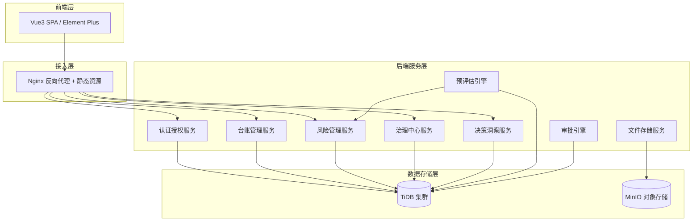

---

## 2. 核心模块详细设计

### 2.1 模块1：用户与权限管理

#### 2.1.1 模块功能概述

本模块实现基于三角色体系的认证与权限管理：

| 角色 | 标识 | 说明 | 核心权限 |
|------|------|------|---------|
| 普通运维者 | `operator` | 自助服务视图 | 我的资产、我的任务、软件服务 |
| 开源治理专员 | `specialist` | 运维者权限 + 缺陷管理 | 运维者权限 + 缺陷记录、人员管理 |
| 管理者 | `admin` | 统筹规划视图 | 全量台账管理、风险管理、治理中心、决策洞察 |

**核心能力：**
- JWT无状态认证（不依赖Redis）
- 基于角色的路由级权限控制
- 部门/团队层级管理
- 用户密码BCrypt加密存储

#### 2.1.2 流程图 - 用户认证流程

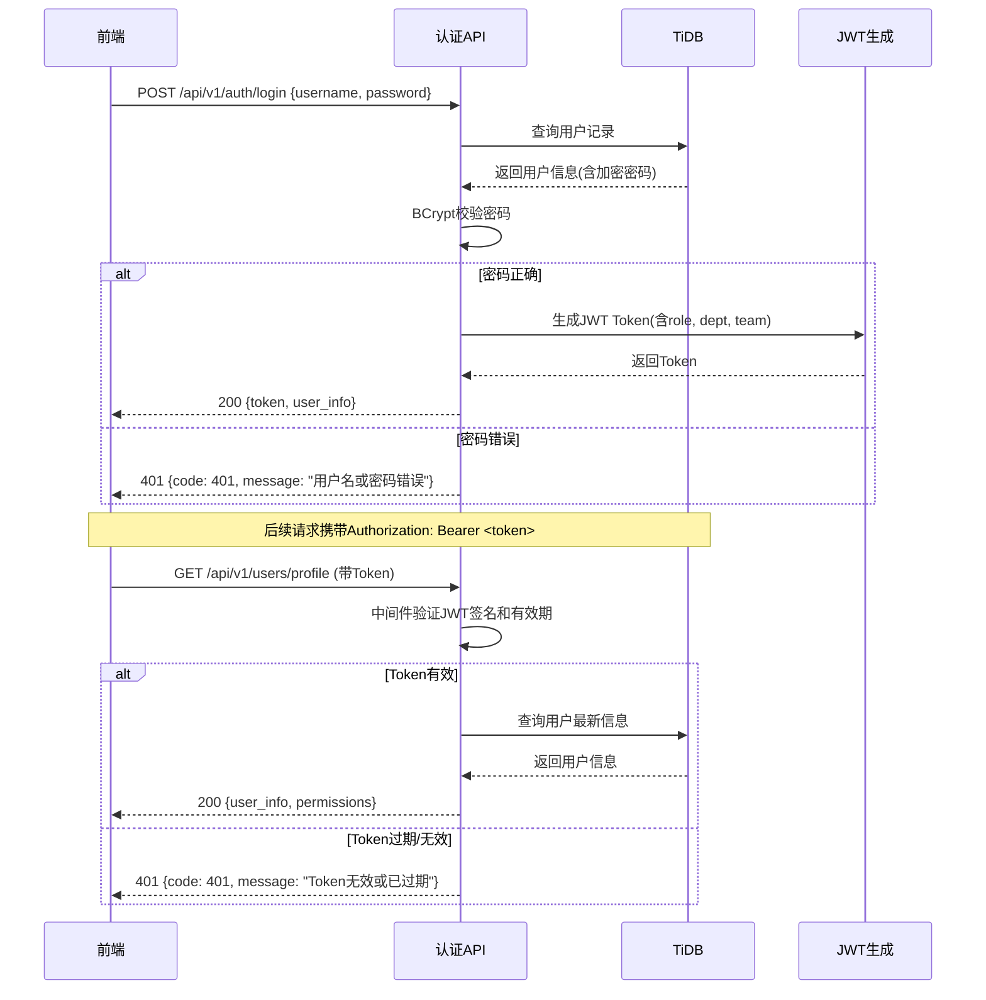

#### 2.1.3 数据字典

| 字段名 | 类型 | 说明 | 约束 |
|--------|------|------|------|
| id | bigint | 主键 | AUTO_INCREMENT, PRIMARY KEY |
| username | varchar(50) | 登录用户名 | UNIQUE, NOT NULL |
| password | varchar(128) | BCrypt加密密码 | NOT NULL |
| nickname | varchar(50) | 显示名称 | NOT NULL |
| role | varchar(20) | 角色: operator/specialist/admin | NOT NULL |
| department | varchar(100) | 所属部门 | NOT NULL |
| team | varchar(100) | 所属团队 | NOT NULL |
| email | varchar(100) | 邮箱 | 可为空 |
| phone | varchar(20) | 手机号 | 可为空 |
| status | tinyint | 状态: 0-禁用, 1-正常 | DEFAULT 1 |
| create_time | timestamp | 创建时间 | DEFAULT CURRENT_TIMESTAMP |
| update_time | timestamp | 更新时间 | DEFAULT CURRENT_TIMESTAMP ON UPDATE |

#### 2.1.4 数据表定义

```sql
-- 用户表
CREATE TABLE `sys_user` (
  `id` bigint(20) NOT NULL AUTO_INCREMENT COMMENT '主键',
  `username` varchar(50) NOT NULL COMMENT '登录用户名',
  `password` varchar(128) NOT NULL COMMENT 'BCrypt加密密码',
  `nickname` varchar(50) NOT NULL COMMENT '显示名称',
  `role` varchar(20) NOT NULL COMMENT '角色: operator-运维者, specialist-治理专员, admin-管理者',
  `department` varchar(100) NOT NULL COMMENT '所属部门',
  `team` varchar(100) NOT NULL COMMENT '所属团队',
  `email` varchar(100) DEFAULT NULL COMMENT '邮箱',
  `phone` varchar(20) DEFAULT NULL COMMENT '手机号',
  `status` tinyint(1) NOT NULL DEFAULT '1' COMMENT '状态: 0-禁用, 1-正常',
  `create_time` timestamp DEFAULT CURRENT_TIMESTAMP COMMENT '创建时间',
  `create_by` varchar(20) DEFAULT NULL COMMENT '创建者',
  `update_time` timestamp DEFAULT CURRENT_TIMESTAMP ON UPDATE CURRENT_TIMESTAMP COMMENT '更新时间',
  `update_by` varchar(20) DEFAULT NULL COMMENT '更新者',
  PRIMARY KEY (`id`) /*T![clustered_index] CLUSTERED */,
  UNIQUE KEY `uk_username` (`username`),
  KEY `idx_role` (`role`),
  KEY `idx_department` (`department`)
) ENGINE=InnoDB DEFAULT CHARSET=utf8mb4 COLLATE=utf8mb4_bin COMMENT='系统用户表';

-- 部门表
CREATE TABLE `sys_department` (
  `id` bigint(20) NOT NULL AUTO_INCREMENT COMMENT '主键',
  `name` varchar(100) NOT NULL COMMENT '部门名称',
  `parent_id` bigint(20) DEFAULT '0' COMMENT '父部门ID, 0表示顶级',
  `sort_order` int(11) DEFAULT '0' COMMENT '排序号',
  `status` tinyint(1) NOT NULL DEFAULT '1' COMMENT '状态: 0-禁用, 1-正常',
  `create_time` timestamp DEFAULT CURRENT_TIMESTAMP COMMENT '创建时间',
  PRIMARY KEY (`id`) /*T![clustered_index] CLUSTERED */,
  KEY `idx_parent_id` (`parent_id`)
) ENGINE=InnoDB DEFAULT CHARSET=utf8mb4 COLLATE=utf8mb4_bin COMMENT='部门表';

-- 团队表
CREATE TABLE `sys_team` (
  `id` bigint(20) NOT NULL AUTO_INCREMENT COMMENT '主键',
  `name` varchar(100) NOT NULL COMMENT '团队名称',
  `department_id` bigint(20) NOT NULL COMMENT '所属部门ID',
  `leader_id` bigint(20) DEFAULT NULL COMMENT '团队负责人ID',
  `status` tinyint(1) NOT NULL DEFAULT '1' COMMENT '状态: 0-禁用, 1-正常',
  `create_time` timestamp DEFAULT CURRENT_TIMESTAMP COMMENT '创建时间',
  PRIMARY KEY (`id`) /*T![clustered_index] CLUSTERED */,
  KEY `idx_department_id` (`department_id`)
) ENGINE=InnoDB DEFAULT CHARSET=utf8mb4 COLLATE=utf8mb4_bin COMMENT='团队表';

-- 角色权限表（字典表，固化三角色权限范围）
CREATE TABLE `sys_role_permission` (
  `id` bigint(20) NOT NULL AUTO_INCREMENT COMMENT '主键',
  `role` varchar(20) NOT NULL COMMENT '角色标识',
  `resource` varchar(100) NOT NULL COMMENT '资源路径/接口',
  `action` varchar(20) NOT NULL COMMENT '操作: view/create/update/delete/approve',
  `create_time` timestamp DEFAULT CURRENT_TIMESTAMP COMMENT '创建时间',
  PRIMARY KEY (`id`) /*T![clustered_index] CLUSTERED */,
  UNIQUE KEY `uk_role_resource_action` (`role`, `resource`, `action`)
) ENGINE=InnoDB DEFAULT CHARSET=utf8mb4 COLLATE=utf8mb4_bin COMMENT='角色权限表';
```

#### 2.1.5 接口设计

| 接口 | 方法 | 路径 | 权限 | 说明 |
|------|------|------|------|------|
| 登录 | POST | `/api/v1/auth/login` | 公开 | 用户登录获取Token |
| 登出 | POST | `/api/v1/auth/logout` | 已登录 | 登出(客户端清除Token) |
| 获取当前用户 | GET | `/api/v1/users/profile` | 已登录 | 获取当前用户信息和权限 |
| 修改密码 | PUT | `/api/v1/users/password` | 已登录 | 修改自身密码 |
| 用户列表 | GET | `/api/v1/users` | admin | 分页查询用户列表 |
| 创建用户 | POST | `/api/v1/users` | admin | 创建新用户 |
| 更新用户 | PUT | `/api/v1/users/:id` | admin | 更新用户信息 |
| 禁用/启用用户 | PUT | `/api/v1/users/:id/status` | admin | 切换用户状态 |
| 部门列表 | GET | `/api/v1/departments` | specialist/admin | 获取部门树 |
| 团队列表 | GET | `/api/v1/teams` | specialist/admin | 获取团队列表 |

**请求/响应示例：**

```
POST /api/v1/auth/login
Request Body:
{
  "username": "operator",
  "password": "123456"
}

Response (200):
{
  "code": 0,
  "message": "success",
  "data": {
    "token": "eyJhbGciOiJIUzI1NiIs...",
    "user": {
      "id": 1,
      "username": "operator",
      "nickname": "张三",
      "role": "operator",
      "department": "技术研发部",
      "team": "基础架构组",
      "email": "zhangsan@company.com"
    }
  }
}
```

#### 2.1.6 交互流程图

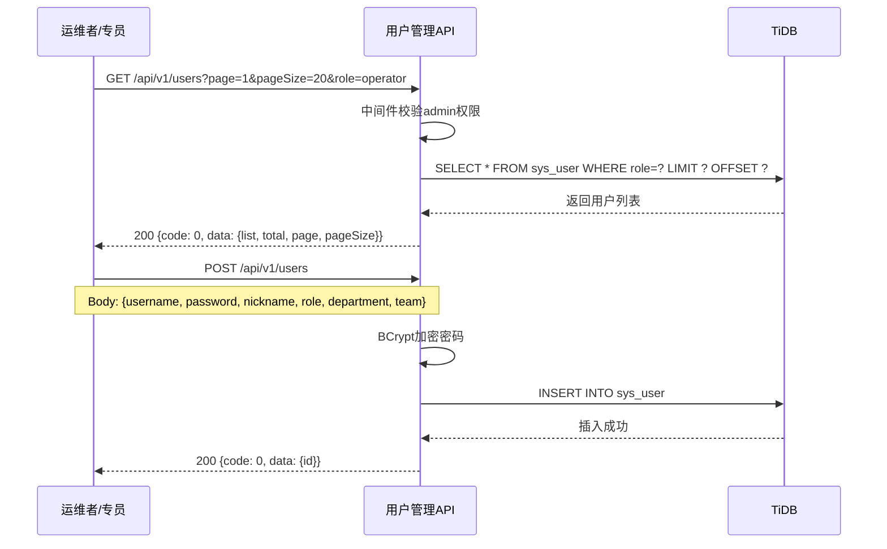

---

### 2.2 模块2：台账管理

#### 2.2.1 模块功能概述

台账管理模块是平台的核心数据底座，管理四类资产：

| 子模块 | 对应数据表 | 说明 |
|--------|-----------|------|
| 开源基础软件 | `project` | 中间件、数据库等大型开源基础软件 |
| 开源依赖包 | `component_snapshot` | 代码级第三方组件、SDK依赖 |
| 自研项目 | `project_inner` | 企业内部自研项目及其依赖关系 |
| 可信仓库 | `trusted_package` | 经安全扫描认证的制品包 |
| 源码备份 | `source_backup` | MinIO存储的源码备份记录 |

#### 2.2.2 流程图 - 资产CRUD与SCA导入

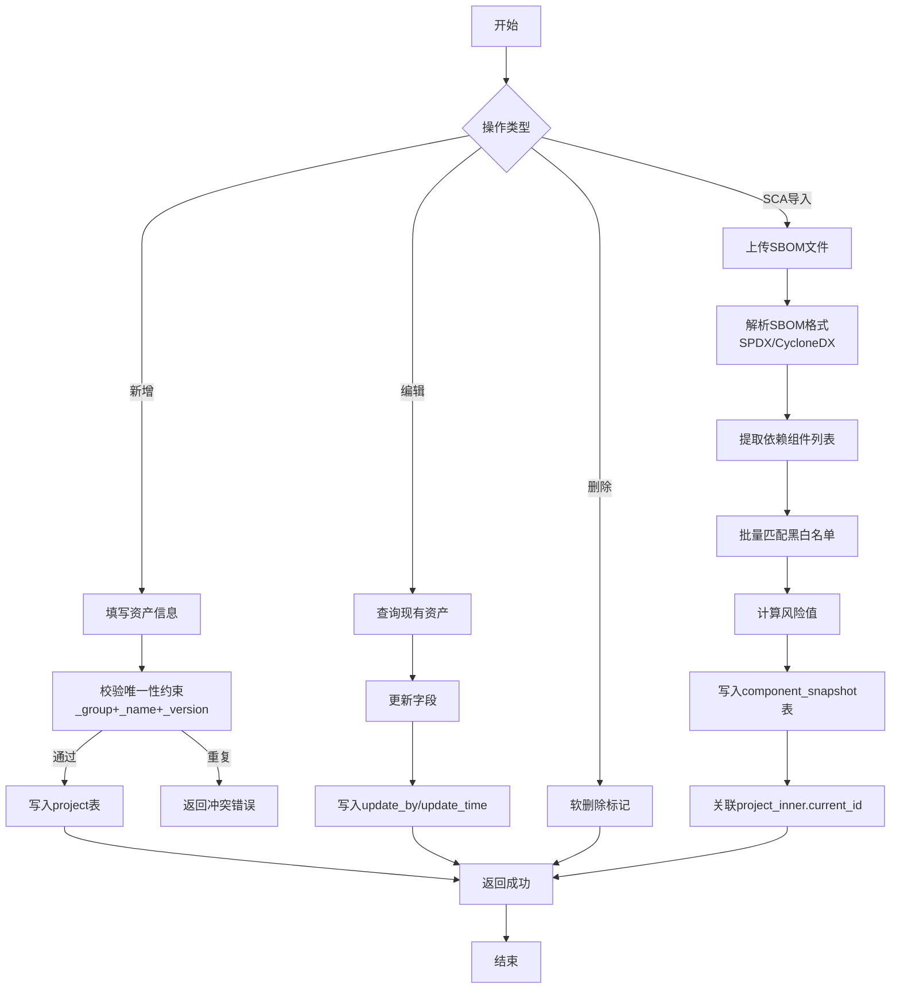

#### 2.2.3 数据字典

##### 2.2.3.1 开源基础软件表 (project)

| 字段名 | 类型 | 说明 | 约束 |
|--------|------|------|------|
| id | bigint | 主键 | AUTO_INCREMENT, PRIMARY KEY |
| ACTIVE | int(1) | 状态: 0-关闭, 1-正常 | DEFAULT 1 |
| AUTHOR | varchar(50) | 作者 | 可为空 |
| PUBLISHER | varchar(100) | 供应商 | 可为空 |
| _group | varchar(50) | 项目组织 | 可为空 |
| _name | varchar(50) | 项目名称 | NOT NULL |
| _version | varchar(50) | 版本号 | DEFAULT '未知' |
| DESCRIPTION | varchar(1024) | 组件描述 | 可为空 |
| CLASSIFIER | varchar(20) | 组件类型 | 可为空 |
| license | varchar(255) | 许可证 | 可为空 |
| PURL | varchar(255) | Package-URL | 可为空 |
| CPE | varchar(255) | Common Platform Enumeration | 可为空 |
| SWIDTAGID | varchar(255) | SWID标识 | 可为空 |
| DIRECT_DEPENDENCIES | mediumtext | SBOM依赖列表 | 可为空 |
| LAST_BOM_IMPORTED | datetime | 最后导入时间 | 可为空 |
| LAST_BOM_IMPORTED_FORMAT | varchar(50) | 导入工具格式 | 可为空 |
| LAST_RISKSCORE | decimal(4,3) | 最后风险评分 | DEFAULT 0 |
| UUID | varchar(36) | UUID唯一标识 | UNIQUE |
| type | varchar(20) | 语言类型: java/Python/go | NOT NULL |
| applicable_level | varchar(50) | 适用等级 A/B/C/D | NOT NULL |
| maint_dept | varchar(200) | 维护部门 | NOT NULL |
| use_dept | varchar(200) | 使用部门 | NOT NULL |
| country | varchar(50) | 开源来源国家 | NOT NULL |
| create_time | timestamp | 创建时间 | DEFAULT CURRENT_TIMESTAMP |
| create_by | varchar(20) | 创建者 | 可为空 |
| update_time | timestamp | 更新时间 | DEFAULT CURRENT_TIMESTAMP |
| update_by | varchar(20) | 更新者 | 可为空 |

##### 2.2.3.2 自研项目表 (project_inner)

| 字段名 | 类型 | 说明 | 约束 |
|--------|------|------|------|
| id | bigint | 主键 | AUTO_INCREMENT, PRIMARY KEY |
| pro_code | varchar(60) | 项目编码 | NOT NULL |
| active | tinyint(1) | 状态: 0-关闭, 1-正常 | DEFAULT 1 |
| type | varchar(20) | 语言类型: java/Python/go | NOT NULL |
| is_boundary | tinyint(1) | 是否边界系统: 1-是, 0-否 | DEFAULT 0 |
| group_name | varchar(20) | 业务组 | 可为空 |
| dept_name | varchar(64) | 部门 | 可为空 |
| module_code | varchar(64) | 模块编码 | NOT NULL |
| branch | varchar(80) | Git分支名 | NOT NULL |
| current_ID | varchar(64) | 本次数据标识ID | NOT NULL |
| create_by | varchar(20) | 创建者 | 可为空 |
| update_by | varchar(20) | 最后修改人 | 可为空 |
| create_time | timestamp | 创建时间 | DEFAULT CURRENT_TIMESTAMP |
| update_time | timestamp | 更新时间 | DEFAULT ON UPDATE |

##### 2.2.3.3 开源依赖包表 (component_snapshot)

| 字段名 | 类型 | 说明 | 约束 |
|--------|------|------|------|
| id | bigint | 主键 | AUTO_INCREMENT, PRIMARY KEY |
| current_id | varchar(64) | 关联source_check表 | NOT NULL |
| PARENT_COMPONENT_ID | bigint | 上层依赖组件ID | 可为空 |
| AUTHOR | varchar(50) | 作者 | 可为空 |
| PUBLISHER | varchar(100) | 供应商 | 可为空 |
| _group | varchar(50) | 组件组织 | 可为空 |
| _name | varchar(100) | 组件名称 | NOT NULL |
| _version | varchar(50) | 版本号 | DEFAULT '未知' |
| DESCRIPTION | varchar(1024) | 组件描述 | 可为空 |
| CLASSIFIER | varchar(20) | 组件类型 | 可为空 |
| FILENAME | varchar(255) | 文件名 | 可为空 |
| EXTENSION | varchar(255) | 扩展信息 | 可为空 |
| INTERNAL | int(1) | 是否内部: 0-否, 1-是 | 可为空 |
| MD5 | varchar(32) | MD5校验值 | 可为空 |
| SHA1 | varchar(40) | SHA1校验值 | 可为空 |
| SHA_256 | varchar(64) | SHA256校验值 | 可为空 |
| ... | ... | 其他HASH校验值(SHA384/SHA512/SHA3/BLAKE) | 可为空 |
| NOTES | mediumtext | 详细参考 | 可为空 |
| PURL | varchar(255) | Package-URL | 可为空 |
| PURLCOORDINATES | varchar(255) | Package-URL Coordinates | 可为空 |
| CPE | varchar(255) | CPE标识 | 可为空 |
| SWIDTAGID | varchar(255) | SWID标识 | 可为空 |
| DIRECT_DEPENDENCIES | mediumtext | SBOM依赖列表 | 可为空 |
| EXTERNAL_REFERENCES | mediumblob | 扩展说明 | 可为空 |
| COPYRIGHT | varchar(1024) | 许可证说明 | 可为空 |
| LICENSE | varchar(255) | 许可证 | 可为空 |
| LICENSE_ID | bigint | 关联license表ID | 可为空 |
| LAST_RISKSCORE | decimal(4,3) | 最后风险评分 | DEFAULT 0 |
| PROJECT_ID | bigint | 关联project_inner表ID | 可为空 |

#### 2.2.4 数据表定义

```sql
-- 开源基础软件表 (已有, 补充说明)
-- 见任务描述中提供的 project 表DDL

-- 自研项目表 (已有, 补充说明)
-- 见任务描述中提供的 project_inner 表DDL

-- 开源依赖包表 (已有, 补充说明)
-- 见任务描述中提供的 component_snapshot 表DDL

-- 可信包表
CREATE TABLE `trusted_package` (
  `id` bigint(20) NOT NULL AUTO_INCREMENT COMMENT '主键',
  `name` varchar(100) NOT NULL COMMENT '组件名称',
  `version` varchar(50) NOT NULL COMMENT '版本号',
  `category` varchar(20) NOT NULL COMMENT '分类: middleware-中间件, database-数据库, dependency-依赖包, tool-工具',
  `scan_status` varchar(20) NOT NULL DEFAULT 'pending' COMMENT '扫描状态: pending-待扫描, passed-通过, warning-警告, failed-失败',
  `scan_date` datetime DEFAULT NULL COMMENT '扫描日期',
  `download_count` int(11) DEFAULT '0' COMMENT '下载次数',
  `size` varchar(50) DEFAULT NULL COMMENT '文件大小',
  `checksum` varchar(128) DEFAULT NULL COMMENT 'SHA256校验值',
  `minio_path` varchar(255) DEFAULT NULL COMMENT 'MinIO存储路径',
  `description` varchar(1024) DEFAULT NULL COMMENT '描述',
  `publisher` varchar(100) DEFAULT NULL COMMENT '发布者',
  `status` tinyint(1) NOT NULL DEFAULT '1' COMMENT '状态: 0-下架, 1-上架',
  `create_time` timestamp DEFAULT CURRENT_TIMESTAMP COMMENT '创建时间',
  `create_by` varchar(20) DEFAULT NULL COMMENT '创建者',
  `update_time` timestamp DEFAULT CURRENT_TIMESTAMP ON UPDATE CURRENT_TIMESTAMP COMMENT '更新时间',
  `update_by` varchar(20) DEFAULT NULL COMMENT '更新者',
  PRIMARY KEY (`id`) /*T![clustered_index] CLUSTERED */,
  UNIQUE KEY `uk_name_version` (`name`, `version`),
  KEY `idx_category` (`category`),
  KEY `idx_scan_status` (`scan_status`)
) ENGINE=InnoDB DEFAULT CHARSET=utf8mb4 COLLATE=utf8mb4_bin COMMENT='可信包表';

-- 源码备份记录表
CREATE TABLE `source_backup` (
  `id` bigint(20) NOT NULL AUTO_INCREMENT COMMENT '主键',
  `component_name` varchar(100) NOT NULL COMMENT '组件名称',
  `component_version` varchar(50) NOT NULL COMMENT '组件版本',
  `status` varchar(20) NOT NULL DEFAULT 'pending' COMMENT '备份状态: pending-待备份, running-备份中, completed-完成, failed-失败',
  `storage_path` varchar(255) DEFAULT NULL COMMENT 'MinIO存储路径',
  `size` varchar(50) DEFAULT NULL COMMENT '文件大小',
  `trigger_type` varchar(20) DEFAULT 'auto' COMMENT '触发方式: auto-自动, manual-手动',
  `error_msg` varchar(512) DEFAULT NULL COMMENT '错误信息',
  `create_time` timestamp DEFAULT CURRENT_TIMESTAMP COMMENT '创建时间',
  `create_by` varchar(20) DEFAULT NULL COMMENT '创建者',
  `update_time` timestamp DEFAULT CURRENT_TIMESTAMP ON UPDATE CURRENT_TIMESTAMP COMMENT '更新时间',
  PRIMARY KEY (`id`) /*T![clustered_index] CLUSTERED */,
  KEY `idx_component` (`component_name`, `component_version`),
  KEY `idx_status` (`status`)
) ENGINE=InnoDB DEFAULT CHARSET=utf8mb4 COLLATE=utf8mb4_bin COMMENT='源码备份记录表';

-- SCA解析记录表
CREATE TABLE `sca_parse_record` (
  `id` bigint(20) NOT NULL AUTO_INCREMENT COMMENT '主键',
  `file_name` varchar(255) NOT NULL COMMENT '上传文件名',
  `file_type` varchar(30) NOT NULL COMMENT '文件类型: SBOM-SPDX, SBOM-CycloneDX, source-package',
  `minio_path` varchar(255) DEFAULT NULL COMMENT 'MinIO存储路径',
  `status` varchar(20) NOT NULL DEFAULT 'parsing' COMMENT '状态: parsing-解析中, completed-完成, failed-失败',
  `component_count` int(11) DEFAULT '0' COMMENT '解析出的组件数量',
  `risk_count` int(11) DEFAULT '0' COMMENT '风险组件数量',
  `license_risk_count` int(11) DEFAULT '0' COMMENT '许可证风险数量',
  `result` varchar(1024) DEFAULT NULL COMMENT '解析结果摘要',
  `error_msg` varchar(512) DEFAULT NULL COMMENT '错误信息',
  `create_time` timestamp DEFAULT CURRENT_TIMESTAMP COMMENT '创建时间',
  `create_by` varchar(20) DEFAULT NULL COMMENT '上传者',
  `update_time` timestamp DEFAULT CURRENT_TIMESTAMP ON UPDATE CURRENT_TIMESTAMP COMMENT '更新时间',
  PRIMARY KEY (`id`) /*T![clustered_index] CLUSTERED */,
  KEY `idx_status` (`status`),
  KEY `idx_file_type` (`file_type`)
) ENGINE=InnoDB DEFAULT CHARSET=utf8mb4 COLLATE=utf8mb4_bin COMMENT='SCA解析记录表';

-- Webhook事件记录表
CREATE TABLE `webhook_event` (
  `id` bigint(20) NOT NULL AUTO_INCREMENT COMMENT '主键',
  `event_type` varchar(50) NOT NULL COMMENT '事件类型: package.published, package.updated, package.vulnerability',
  `component_name` varchar(100) DEFAULT NULL COMMENT '组件名称',
  `component_version` varchar(50) DEFAULT NULL COMMENT '组件版本',
  `sync_status` varchar(20) NOT NULL DEFAULT 'pending' COMMENT '同步状态: pending-待处理, success-成功, failed-失败',
  `metadata` mediumtext COMMENT '事件元数据(JSON)',
  `error_msg` varchar(512) DEFAULT NULL COMMENT '错误信息',
  `received_at` timestamp DEFAULT CURRENT_TIMESTAMP COMMENT '接收时间',
  PRIMARY KEY (`id`) /*T![clustered_index] CLUSTERED */,
  KEY `idx_event_type` (`event_type`),
  KEY `idx_sync_status` (`sync_status`)
) ENGINE=InnoDB DEFAULT CHARSET=utf8mb4 COLLATE=utf8mb4_bin COMMENT='Webhook事件记录表';
```

#### 2.2.5 接口设计

**开源基础软件：**

| 接口 | 方法 | 路径 | 权限 | 说明 |
|------|------|------|------|------|
| 列表查询 | GET | `/api/v1/assets/projects` | admin | 分页查询开源基础软件 |
| 详情查询 | GET | `/api/v1/assets/projects/:id` | admin | 查询软件详情 |
| 创建 | POST | `/api/v1/assets/projects` | admin | 新增开源基础软件 |
| 更新 | PUT | `/api/v1/assets/projects/:id` | admin | 更新软件信息 |
| 删除 | DELETE | `/api/v1/assets/projects/:id` | admin | 软删除 |
| 搜索 | GET | `/api/v1/assets/projects/search?keyword=xxx` | all | 按名称/组织模糊搜索 |

**开源依赖包：**

| 接口 | 方法 | 路径 | 权限 | 说明 |
|------|------|------|------|------|
| 列表查询 | GET | `/api/v1/assets/components` | admin | 分页查询依赖包 |
| 详情查询 | GET | `/api/v1/assets/components/:id` | admin | 查询依赖包详情 |
| 创建 | POST | `/api/v1/assets/components` | admin | 新增依赖包 |
| 更新 | PUT | `/api/v1/assets/components/:id` | admin | 更新依赖包 |
| 批量导入 | POST | `/api/v1/assets/components/import` | admin | 上传SBOM文件批量导入 |
| 批量导出 | GET | `/api/v1/assets/components/export` | admin | 导出依赖包列表 |

**自研项目：**

| 接口 | 方法 | 路径 | 权限 | 说明 |
|------|------|------|------|------|
| 列表查询 | GET | `/api/v1/assets/inner-projects` | all | 分页查询自研项目 |
| 详情查询 | GET | `/api/v1/assets/inner-projects/:id` | all | 查询项目详情(含依赖/许可证/漏洞) |
| 创建 | POST | `/api/v1/assets/inner-projects` | admin | 新增自研项目 |
| 更新 | PUT | `/api/v1/assets/inner-projects/:id` | admin | 更新项目信息 |
| 删除 | DELETE | `/api/v1/assets/inner-projects/:id` | admin | 软删除 |

**可信仓库：**

| 接口 | 方法 | 路径 | 权限 | 说明 |
|------|------|------|------|------|
| 列表查询 | GET | `/api/v1/assets/trusted-packages` | all | 分页查询可信包 |
| 详情查询 | GET | `/api/v1/assets/trusted-packages/:id` | all | 查询可信包详情 |
| 创建 | POST | `/api/v1/assets/trusted-packages` | admin | 上传可信包 |
| 删除 | DELETE | `/api/v1/assets/trusted-packages/:id` | admin | 下架可信包 |
| 下载 | GET | `/api/v1/assets/trusted-packages/:id/download` | all | 下载可信包(从MinIO) |
| Webhook回调 | POST | `/api/v1/assets/webhook/nexus` | 公开 | Nexus事件推送回调 |

**源码备份：**

| 接口 | 方法 | 路径 | 权限 | 说明 |
|------|------|------|------|------|
| 列表查询 | GET | `/api/v1/assets/backups` | admin | 分页查询备份记录 |
| 手动触发 | POST | `/api/v1/assets/backups/trigger` | admin | 手动触发源码备份 |

**SCA解析：**

| 接口 | 方法 | 路径 | 权限 | 说明 |
|------|------|------|------|------|
| 列表查询 | GET | `/api/v1/assets/sca-records` | admin | 分页查询SCA解析记录 |
| 上传解析 | POST | `/api/v1/assets/sca-records/upload` | admin | 上传SBOM/源码包进行解析 |
| 查询结果 | GET | `/api/v1/assets/sca-records/:id/result` | admin | 查询解析结果 |

#### 2.2.6 交互流程图

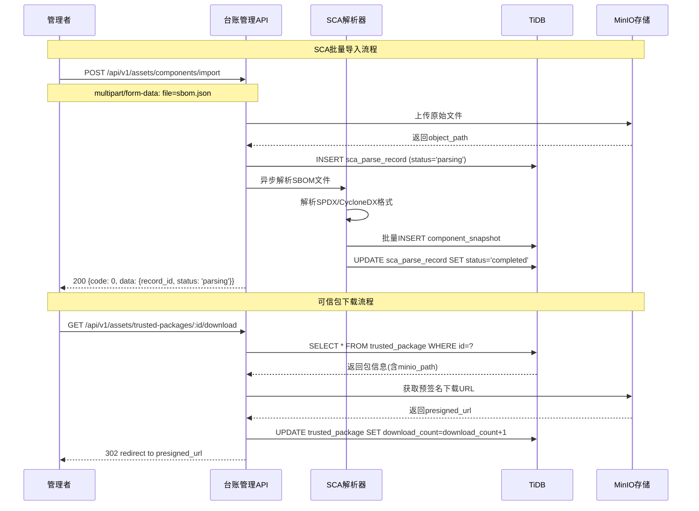

---

### 2.3 模块3：风险管理

#### 2.3.1 模块功能概述

风险管理模块是平台的安全核心，负责：

| 子模块 | 对应数据表 | 说明 |
|--------|-----------|------|
| 黑名单管理 | `component_core` | 维护禁止使用的组件及版本表达式 |
| 许可证信息库 | `license_info` | 公司认可的许可证清单及风险等级 |
| 缺陷台账 | `defect_ledger` | 所有安全漏洞、恶意代码、许可证违规记录 |
| 活跃度监测 | `activity_monitor` | GitHub/GitLab社区活跃度指标采集 |
| SCA自动化解析 | `sca_parse_record` | SBOM文件解析入库 |

#### 2.3.2 流程图 - 风险接入与分发

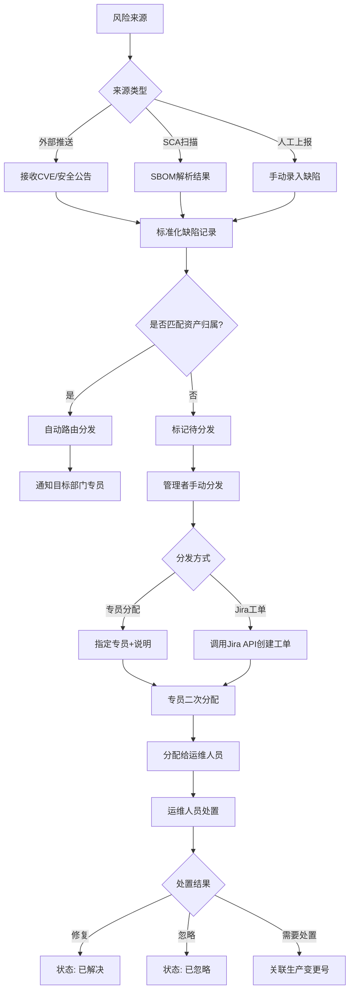

#### 2.3.3 数据字典

##### 2.3.3.1 黑名单表 (component_core)

| 字段名 | 类型 | 说明 | 约束 |
|--------|------|------|------|
| id | bigint | 主键 | AUTO_INCREMENT, PRIMARY KEY |
| _format | tinyint(2) | 格式类型: 1-maven, 2-pypi, 3-npm, 4-yum | NOT NULL, DEFAULT 1 |
| type | varchar(50) | 类型描述 | 可为空 |
| _name | varchar(50) | 包名 | NOT NULL |
| _group | varchar(50) | 包分组 | NOT NULL |
| version_exp | varchar(200) | 版本匹配表达式(如 <6.4.0, >=11.0.0) | NOT NULL |
| applicable_level | varchar(50) | 适用等级 | NOT NULL |
| support_team | varchar(50) | 技术支持团队 | NOT NULL |
| reason | varchar(400) | 添加理由 | 可为空 |
| advise | varchar(400) | 建议 | 可为空 |
| _enable | tinyint(1) | 是否启用: 1-启用, 0-禁用 | NOT NULL |
| alert_type | tinyint(2) | 告警类型: 1-阻断, 2-警告 | DEFAULT 1 |
| create_time | datetime | 创建时间 | DEFAULT CURRENT_TIMESTAMP |
| create_by | varchar(20) | 创建者 | 可为空 |
| update_time | datetime | 更新时间 | DEFAULT CURRENT_TIMESTAMP |
| update_by | varchar(20) | 更新者 | 可为空 |

#### 2.3.4 数据表定义

```sql
-- 黑名单表 (已有, 补充说明)
-- 见任务描述中提供的 component_core 表DDL

-- 许可证信息库
CREATE TABLE `license_info` (
  `id` bigint(20) NOT NULL AUTO_INCREMENT COMMENT '主键',
  `name` varchar(50) NOT NULL COMMENT '许可证简称(如MIT, Apache-2.0)',
  `full_name` varchar(200) NOT NULL COMMENT '许可证全称',
  `category` varchar(30) NOT NULL COMMENT '分类: permissive-宽松型, weak-copyleft-弱传染性, strong-copyleft-强传染性, special-特殊型',
  `risk_level` varchar(20) NOT NULL COMMENT '风险等级: low-低, medium-中, high-高, critical-严重',
  `description` varchar(1024) DEFAULT NULL COMMENT '许可证描述',
  `is_approved` tinyint(1) NOT NULL DEFAULT '0' COMMENT '是否公司认可: 0-否, 1-是',
  `usage_count` int(11) DEFAULT '0' COMMENT '使用次数',
  `create_time` timestamp DEFAULT CURRENT_TIMESTAMP COMMENT '创建时间',
  `update_time` timestamp DEFAULT CURRENT_TIMESTAMP ON UPDATE CURRENT_TIMESTAMP COMMENT '更新时间',
  PRIMARY KEY (`id`) /*T![clustered_index] CLUSTERED */,
  UNIQUE KEY `uk_name` (`name`),
  KEY `idx_risk_level` (`risk_level`)
) ENGINE=InnoDB DEFAULT CHARSET=utf8mb4 COLLATE=utf8mb4_bin COMMENT='许可证信息库';

-- 缺陷台账
CREATE TABLE `defect_ledger` (
  `id` bigint(20) NOT NULL AUTO_INCREMENT COMMENT '主键',
  `defect_no` varchar(50) NOT NULL COMMENT '缺陷编号(如DF-2024-0001)',
  `source` varchar(30) NOT NULL COMMENT '来源: external-push-外部推送, sca-scan-SCA扫描, manual-report-人工上报',
  `title` varchar(255) NOT NULL COMMENT '缺陷标题',
  `risk_type` varchar(30) NOT NULL COMMENT '风险类型: vulnerability-安全漏洞, malware-恶意代码, license-violation-许可证违规, supply-chain-供应链风险, other-其他',
  `risk_level` varchar(20) NOT NULL COMMENT '风险等级: low, medium, high, critical',
  `affected_component` varchar(100) NOT NULL COMMENT '受影响组件',
  `affected_version` varchar(50) DEFAULT NULL COMMENT '受影响版本',
  `cve_id` varchar(50) DEFAULT NULL COMMENT 'CVE编号',
  `description` mediumtext COMMENT '详细描述',
  `discovered_date` datetime NOT NULL COMMENT '发现日期',
  `status` varchar(20) NOT NULL DEFAULT 'pending' COMMENT '状态: pending-待分发, dispatched-已分发, processing-处理中, resolved-已解决, ignored-已忽略',
  `dispatch_type` varchar(20) DEFAULT NULL COMMENT '分发类型: specialist-专员分配, jira-Jira工单',
  `dispatch_dept` varchar(100) DEFAULT NULL COMMENT '分发目标部门',
  `dispatch_target` varchar(50) DEFAULT NULL COMMENT '分发目标人员',
  `dispatch_time` datetime DEFAULT NULL COMMENT '分发时间',
  `dispatcher` varchar(20) DEFAULT NULL COMMENT '分发人',
  `jira_key` varchar(50) DEFAULT NULL COMMENT 'Jira工单号',
  `assignee` varchar(50) DEFAULT NULL COMMENT '当前处理人',
  `resolve_time` datetime DEFAULT NULL COMMENT '解决时间',
  `create_time` timestamp DEFAULT CURRENT_TIMESTAMP COMMENT '创建时间',
  `update_time` timestamp DEFAULT CURRENT_TIMESTAMP ON UPDATE CURRENT_TIMESTAMP COMMENT '更新时间',
  PRIMARY KEY (`id`) /*T![clustered_index] CLUSTERED */,
  UNIQUE KEY `uk_defect_no` (`defect_no`),
  KEY `idx_status` (`status`),
  KEY `idx_risk_level` (`risk_level`),
  KEY `idx_source` (`source`),
  KEY `idx_affected_component` (`affected_component`)
) ENGINE=InnoDB DEFAULT CHARSET=utf8mb4 COLLATE=utf8mb4_bin COMMENT='缺陷台账';

-- 分发记录
CREATE TABLE `dispatch_record` (
  `id` bigint(20) NOT NULL AUTO_INCREMENT COMMENT '主键',
  `defect_id` bigint(20) NOT NULL COMMENT '关联缺陷ID',
  `defect_no` varchar(50) NOT NULL COMMENT '缺陷编号',
  `defect_title` varchar(255) NOT NULL COMMENT '缺陷标题',
  `risk_type` varchar(30) NOT NULL COMMENT '风险类型',
  `distribute_time` datetime NOT NULL COMMENT '分发时间',
  `distributor` varchar(20) NOT NULL COMMENT '分发人',
  `receive_dept` varchar(100) NOT NULL COMMENT '接收部门',
  `receive_person` varchar(50) NOT NULL COMMENT '接收人',
  `note` varchar(512) DEFAULT NULL COMMENT '分发说明',
  `status` varchar(20) NOT NULL DEFAULT 'pending' COMMENT '状态: pending-待处理, processing-处理中, completed-已完成, rejected-已驳回',
  `create_time` timestamp DEFAULT CURRENT_TIMESTAMP COMMENT '创建时间',
  PRIMARY KEY (`id`) /*T![clustered_index] CLUSTERED */,
  KEY `idx_defect_id` (`defect_id`),
  KEY `idx_receive_dept` (`receive_dept`),
  KEY `idx_receive_person` (`receive_person`)
) ENGINE=InnoDB DEFAULT CHARSET=utf8mb4 COLLATE=utf8mb4_bin COMMENT='分发记录';

-- 活跃度监测数据
CREATE TABLE `activity_monitor` (
  `id` bigint(20) NOT NULL AUTO_INCREMENT COMMENT '主键',
  `component_name` varchar(100) NOT NULL COMMENT '组件名称',
  `component_version` varchar(50) DEFAULT NULL COMMENT '组件版本',
  `stars` int(11) DEFAULT '0' COMMENT 'GitHub Stars数',
  `forks` int(11) DEFAULT '0' COMMENT 'Forks数',
  `open_issues` int(11) DEFAULT '0' COMMENT '未关闭Issue数',
  `closed_issues` int(11) DEFAULT '0' COMMENT '已关闭Issue数',
  `commits_last_month` int(11) DEFAULT '0' COMMENT '上月提交数',
  `contributors` int(11) DEFAULT '0' COMMENT '贡献者数量',
  `last_release` date DEFAULT NULL COMMENT '最近发布日期',
  `health_score` decimal(5,2) DEFAULT '0' COMMENT '健康度评分(0-100)',
  `trend_data` mediumtext COMMENT '趋势数据(JSON格式)',
  `sync_time` timestamp DEFAULT CURRENT_TIMESTAMP COMMENT '同步时间',
  PRIMARY KEY (`id`) /*T![clustered_index] CLUSTERED */,
  UNIQUE KEY `uk_component_version` (`component_name`, `component_version`),
  KEY `idx_health_score` (`health_score`)
) ENGINE=InnoDB DEFAULT CHARSET=utf8mb4 COLLATE=utf8mb4_bin COMMENT='活跃度监测数据';
```

#### 2.3.5 接口设计

**黑名单管理：**

| 接口 | 方法 | 路径 | 权限 | 说明 |
|------|------|------|------|------|
| 列表查询 | GET | `/api/v1/risk/blacklist` | admin | 分页查询黑名单 |
| 详情查询 | GET | `/api/v1/risk/blacklist/:id` | admin | 查询黑名单详情 |
| 创建 | POST | `/api/v1/risk/blacklist` | admin | 新增黑名单项 |
| 更新 | PUT | `/api/v1/risk/blacklist/:id` | admin | 更新黑名单项 |
| 删除 | DELETE | `/api/v1/risk/blacklist/:id` | admin | 删除黑名单项 |
| 批量导入 | POST | `/api/v1/risk/blacklist/import` | admin | Excel批量导入 |
| 匹配检查 | POST | `/api/v1/risk/blacklist/check` | all | 检查组件是否命中黑名单 |

**许可证信息库：**

| 接口 | 方法 | 路径 | 权限 | 说明 |
|------|------|------|------|------|
| 列表查询 | GET | `/api/v1/risk/licenses` | admin | 查询许可证列表 |
| 详情查询 | GET | `/api/v1/risk/licenses/:id` | admin | 查询许可证详情 |
| 创建 | POST | `/api/v1/risk/licenses` | admin | 新增许可证 |
| 更新 | PUT | `/api/v1/risk/licenses/:id` | admin | 更新许可证 |

**缺陷台账：**

| 接口 | 方法 | 路径 | 权限 | 说明 |
|------|------|------|------|------|
| 列表查询 | GET | `/api/v1/risk/defects` | admin | 分页查询缺陷列表 |
| 详情查询 | GET | `/api/v1/risk/defects/:id` | admin/specialist | 查询缺陷详情 |
| 创建 | POST | `/api/v1/risk/defects` | admin | 手动录入缺陷 |
| 分发 | POST | `/api/v1/risk/defects/:id/dispatch` | admin | 分发缺陷到部门/专员 |
| 状态更新 | PUT | `/api/v1/risk/defects/:id/status` | all | 更新缺陷状态 |
| 分发记录 | GET | `/api/v1/risk/dispatch-records` | admin | 查询分发记录列表 |

**活跃度监测：**

| 接口 | 方法 | 路径 | 权限 | 说明 |
|------|------|------|------|------|
| 列表查询 | GET | `/api/v1/risk/activity` | admin | 查询组件活跃度列表 |
| 详情查询 | GET | `/api/v1/risk/activity/:id` | admin | 查询组件活跃度趋势 |
| 手动同步 | POST | `/api/v1/risk/activity/sync` | admin | 手动触发活跃度同步 |
| 导出报告 | GET | `/api/v1/risk/activity/export` | admin | 导出活跃度评估报告 |

#### 2.3.6 交互流程图

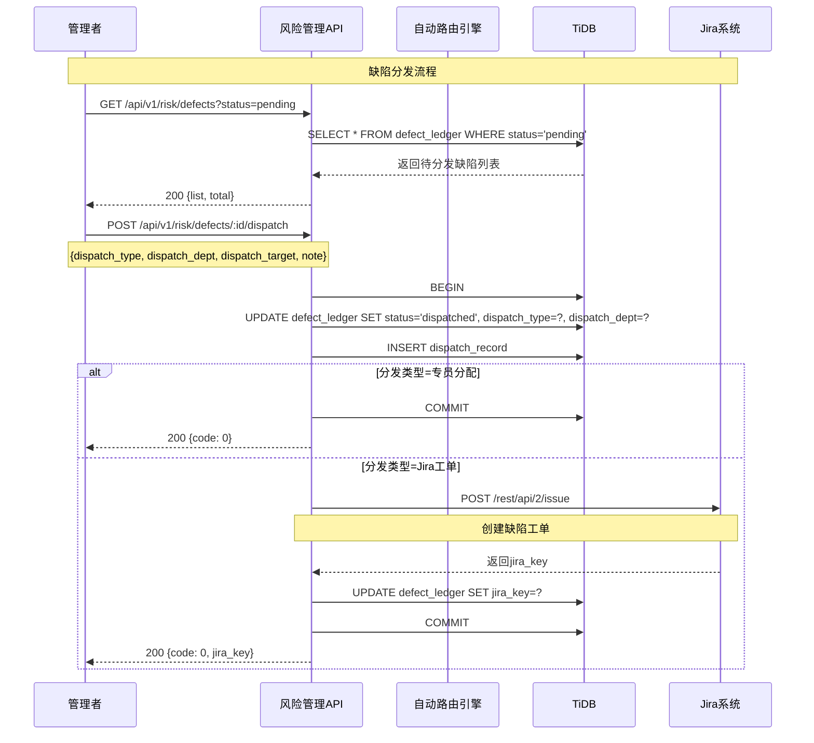

---

### 2.4 模块4：治理中心

#### 2.4.1 模块功能概述

治理中心管理开源软件全生命周期的审批流程：

| 子模块 | 说明 |
|--------|------|
| 引入审批 | 处理开源组件引入申请（含预评估） |
| 退出审批 | 处理开源组件退出申请 |
| 升级评审 | 处理组件版本升级申请 |
| 任务列表 | 全局任务视图与进度跟踪 |
| 策略配置 | 治理策略规则配置 |

#### 2.4.2 流程图 - 引入审批全流程

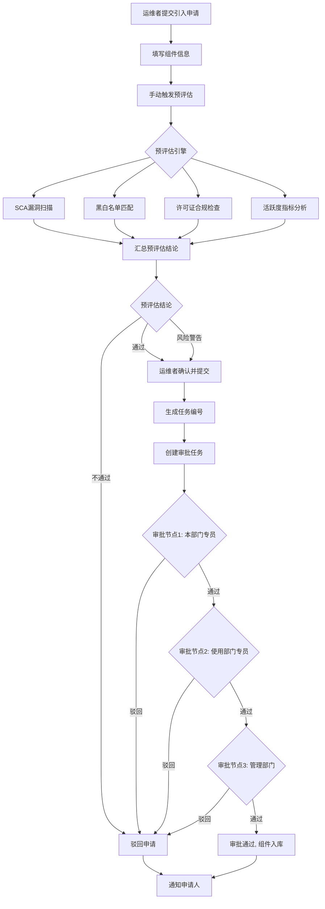

#### 2.4.3 数据字典

| 字段名 | 类型 | 说明 | 约束 |
|--------|------|------|------|
| id | bigint | 主键 | AUTO_INCREMENT, PRIMARY KEY |
| task_no | varchar(50) | 任务编号(如TASK-2024-0001) | UNIQUE, NOT NULL |
| type | varchar(20) | 任务类型: introduce/upgrade/withdraw/defect | NOT NULL |
| title | varchar(255) | 任务标题 | NOT NULL |
| applicant | varchar(50) | 申请人 | NOT NULL |
| applicant_dept | varchar(100) | 申请部门 | NOT NULL |
| status | varchar(20) | 状态: draft/pending/processing/completed/rejected | NOT NULL |
| priority | varchar(20) | 优先级: normal/urgent | DEFAULT 'normal' |
| current_step | varchar(50) | 当前审批步骤 | NOT NULL |
| component_name | varchar(100) | 组件名称 | 可为空 |
| component_version | varchar(50) | 组件版本 | 可为空 |
| license_type | varchar(100) | 许可证类型 | 可为空 |
| pre_eval_conclusion | varchar(20) | 预评估结论: pass/warning/reject | 可为空 |
| pre_eval_score | decimal(5,2) | 预评估评分(内部用, 不展示给前端) | 可为空 |
| pre_eval_report | mediumtext | 预评估报告(JSON) | 可为空 |
| description | mediumtext | 描述/原因 | 可为空 |
| approval_data | mediumtext | 审批节点数据(JSON) | 可为空 |
| external_link | varchar(255) | 外部工单链接 | 可为空 |
| deadline | date | 期望完成日期 | 可为空 |
| assigned_to | varchar(50) | 当前处理人 | 可为空 |
| create_time | timestamp | 创建时间 | DEFAULT CURRENT_TIMESTAMP |
| update_time | timestamp | 更新时间 | DEFAULT ON UPDATE |

#### 2.4.4 数据表定义

```sql
-- 任务/审批表
CREATE TABLE `governance_task` (
  `id` bigint(20) NOT NULL AUTO_INCREMENT COMMENT '主键',
  `task_no` varchar(50) NOT NULL COMMENT '任务编号(如TASK-2024-0001)',
  `type` varchar(20) NOT NULL COMMENT '任务类型: introduce-引入, upgrade-升级, withdraw-退出, defect-缺陷处置',
  `title` varchar(255) NOT NULL COMMENT '任务标题',
  `applicant` varchar(50) NOT NULL COMMENT '申请人',
  `applicant_dept` varchar(100) NOT NULL COMMENT '申请部门',
  `status` varchar(20) NOT NULL DEFAULT 'draft' COMMENT '状态: draft-草稿, pending-待审批, processing-处理中, completed-已完成, rejected-已驳回',
  `priority` varchar(20) NOT NULL DEFAULT 'normal' COMMENT '优先级: normal-普通, urgent-紧急',
  `current_step` varchar(50) NOT NULL DEFAULT '' COMMENT '当前审批步骤描述',
  
  -- 引入申请专属字段
  `component_name` varchar(100) DEFAULT NULL COMMENT '组件名称',
  `component_version` varchar(50) DEFAULT NULL COMMENT '组件版本',
  `license_type` varchar(100) DEFAULT NULL COMMENT '许可证类型',
  `introduce_reason` mediumtext COMMENT '引入原因',
  `use_scenario` mediumtext COMMENT '使用场景',
  `project_names` mediumtext COMMENT '关联项目列表(JSON数组)',
  
  -- 升级申请专属字段
  `current_version` varchar(50) DEFAULT NULL COMMENT '当前版本',
  `target_version` varchar(50) DEFAULT NULL COMMENT '目标版本',
  `test_report_link` varchar(255) DEFAULT NULL COMMENT '测试报告链接',
  `breaking_changes` mediumtext COMMENT '破坏性变更(JSON数组)',
  `security_fixes` mediumtext COMMENT '安全修复列表(JSON数组)',
  `new_features` mediumtext COMMENT '新特性列表(JSON数组)',
  `compatibility_risk` varchar(512) DEFAULT NULL COMMENT '兼容性风险',
  `rollback_plan` mediumtext COMMENT '回滚方案',
  
  -- 退出申请专属字段
  `exit_reason` mediumtext COMMENT '退出原因',
  `alternative_plan` mediumtext COMMENT '替代方案',
  `code_cleanup_plan` mediumtext COMMENT '代码清理计划',
  `affected_projects` mediumtext COMMENT '受影响项目(JSON数组)',
  
  -- 缺陷处置专属字段
  `risk_source` varchar(50) DEFAULT NULL COMMENT '风险来源: external-push-外部推送, sca-scan-内部SCA',
  `cve_id` varchar(50) DEFAULT NULL COMMENT 'CVE编号',
  `severity_level` varchar(20) DEFAULT NULL COMMENT '严重等级',
  `affected_assets` mediumtext COMMENT '受影响资产',
  `fix_plan` mediumtext COMMENT '修复方案',
  `need_fix` tinyint(1) DEFAULT NULL COMMENT '是否需要处置',
  `fix_reason` varchar(512) DEFAULT NULL COMMENT '不需要处置原因',
  `production_change_no` varchar(50) DEFAULT NULL COMMENT '生产变更号',
  `production_ticket_text` mediumtext COMMENT '工单文本',
  
  -- 预评估相关
  `pre_eval_conclusion` varchar(20) DEFAULT NULL COMMENT '预评估结论: pass-通过, warning-风险警告, reject-不通过',
  `pre_eval_score` decimal(5,2) DEFAULT NULL COMMENT '预评估评分(内部使用)',
  `pre_eval_report` mediumtext COMMENT '预评估报告(JSON)',
  
  -- 审批相关
  `approval_data` mediumtext COMMENT '审批节点数据(JSON)',
  `description` mediumtext COMMENT '任务描述',
  `external_link` varchar(255) DEFAULT NULL COMMENT '外部工单链接',
  `deadline` date DEFAULT NULL COMMENT '期望完成日期',
  `assigned_to` varchar(50) DEFAULT NULL COMMENT '当前处理人',
  
  `draft_data` mediumtext COMMENT '暂存数据(JSON)',
  
  `create_time` timestamp DEFAULT CURRENT_TIMESTAMP COMMENT '创建时间',
  `create_by` varchar(20) DEFAULT NULL COMMENT '创建者',
  `update_time` timestamp DEFAULT CURRENT_TIMESTAMP ON UPDATE CURRENT_TIMESTAMP COMMENT '更新时间',
  `update_by` varchar(20) DEFAULT NULL COMMENT '更新者',
  
  PRIMARY KEY (`id`) /*T![clustered_index] CLUSTERED */,
  UNIQUE KEY `uk_task_no` (`task_no`),
  KEY `idx_type` (`type`),
  KEY `idx_status` (`status`),
  KEY `idx_applicant` (`applicant`),
  KEY `idx_assigned_to` (`assigned_to`),
  KEY `idx_component_name` (`component_name`)
) ENGINE=InnoDB DEFAULT CHARSET=utf8mb4 COLLATE=utf8mb4_bin COMMENT='治理任务/审批表';

-- 审批节点记录表
CREATE TABLE `approval_node` (
  `id` bigint(20) NOT NULL AUTO_INCREMENT COMMENT '主键',
  `task_id` bigint(20) NOT NULL COMMENT '关联任务ID',
  `node_name` varchar(100) NOT NULL COMMENT '节点名称(如本部门专员审批)',
  `node_order` int(11) NOT NULL COMMENT '节点顺序',
  `approver` varchar(50) DEFAULT NULL COMMENT '审批人',
  `status` varchar(20) NOT NULL DEFAULT 'pending' COMMENT '状态: pending-待审批, approved-通过, rejected-驳回, not_required-不需要',
  `opinion` varchar(1024) DEFAULT NULL COMMENT '审批意见',
  `approved_at` datetime DEFAULT NULL COMMENT '审批时间',
  `create_time` timestamp DEFAULT CURRENT_TIMESTAMP COMMENT '创建时间',
  PRIMARY KEY (`id`) /*T![clustered_index] CLUSTERED */,
  KEY `idx_task_id` (`task_id`),
  KEY `idx_approver` (`approver`)
) ENGINE=InnoDB DEFAULT CHARSET=utf8mb4 COLLATE=utf8mb4_bin COMMENT='审批节点记录表';

-- 审批策略配置表
CREATE TABLE `approval_policy` (
  `id` bigint(20) NOT NULL AUTO_INCREMENT COMMENT '主键',
  `task_type` varchar(20) NOT NULL COMMENT '任务类型: introduce/upgrade/withdraw/defect',
  `grade` varchar(10) DEFAULT NULL COMMENT '适用等级: A/B/C/D, NULL表示全部',
  `nodes` mediumtext NOT NULL COMMENT '审批节点配置(JSON)',
  `auto_approve_threshold` decimal(5,2) DEFAULT NULL COMMENT '预评估自动通过阈值',
  `auto_reject_threshold` decimal(5,2) DEFAULT NULL COMMENT '预评估自动拒绝阈值',
  `sla_hours` int(11) DEFAULT NULL COMMENT 'SLA时限(小时)',
  `status` tinyint(1) NOT NULL DEFAULT '1' COMMENT '状态: 0-禁用, 1-启用',
  `create_time` timestamp DEFAULT CURRENT_TIMESTAMP COMMENT '创建时间',
  `update_time` timestamp DEFAULT CURRENT_TIMESTAMP ON UPDATE CURRENT_TIMESTAMP COMMENT '更新时间',
  PRIMARY KEY (`id`) /*T![clustered_index] CLUSTERED */,
  UNIQUE KEY `uk_task_type_grade` (`task_type`, `grade`)
) ENGINE=InnoDB DEFAULT CHARSET=utf8mb4 COLLATE=utf8mb4_bin COMMENT='审批策略配置表';

-- 违规审计记录表
CREATE TABLE `violation_record` (
  `id` bigint(20) NOT NULL AUTO_INCREMENT COMMENT '主键',
  `component_name` varchar(100) NOT NULL COMMENT '组件名称',
  `component_version` varchar(50) DEFAULT NULL COMMENT '组件版本',
  `project_name` varchar(100) DEFAULT NULL COMMENT '所属项目',
  `introduced_by` varchar(50) DEFAULT NULL COMMENT '引入人',
  `department` varchar(100) DEFAULT NULL COMMENT '所属部门',
  `violation_type` varchar(50) NOT NULL COMMENT '违规类型: unauthorized-未走流程引入, unreported-未报备使用, blacklist-hit-命中黑名单',
  `risk_level` varchar(20) NOT NULL COMMENT '风险等级',
  `status` varchar(20) NOT NULL DEFAULT 'pending' COMMENT '状态: pending-待处理, handling-处理中, resolved-已解决',
  `discovered_date` date NOT NULL COMMENT '发现日期',
  `create_time` timestamp DEFAULT CURRENT_TIMESTAMP COMMENT '创建时间',
  PRIMARY KEY (`id`) /*T![clustered_index] CLUSTERED */,
  KEY `idx_status` (`status`),
  KEY `idx_violation_type` (`violation_type`)
) ENGINE=InnoDB DEFAULT CHARSET=utf8mb4 COLLATE=utf8mb4_bin COMMENT='违规审计记录表';
```

#### 2.4.5 接口设计

**任务管理：**

| 接口 | 方法 | 路径 | 权限 | 说明 |
|------|------|------|------|------|
| 我的任务列表 | GET | `/api/v1/governance/tasks/my` | all | 查询当前用户的任务 |
| 全局任务列表 | GET | `/api/v1/governance/tasks` | admin | 查询所有任务(支持筛选) |
| 详情查询 | GET | `/api/v1/governance/tasks/:id` | all | 查询任务详情(含审批节点) |
| 暂存 | PUT | `/api/v1/governance/tasks/:id/draft` | all | 暂存任务数据 |
| 提交 | POST | `/api/v1/governance/tasks/:id/submit` | all | 提交任务进入审批流 |
| 创建任务 | POST | `/api/v1/governance/tasks` | all | 创建新任务 |

**审批操作：**

| 接口 | 方法 | 路径 | 权限 | 说明 |
|------|------|------|------|------|
| 审批 | POST | `/api/v1/governance/tasks/:id/approve` | specialist/admin | 审批任务(通过/驳回) |
| 审批历史 | GET | `/api/v1/governance/tasks/:id/approval-history` | all | 查询审批历史 |

**引入审批：**

| 接口 | 方法 | 路径 | 权限 | 说明 |
|------|------|------|------|------|
| 引入列表 | GET | `/api/v1/governance/introductions` | admin | 引入申请列表 |
| 预评估 | POST | `/api/v1/governance/introductions/:id/pre-eval` | all | 触发预评估 |
| 预评估结果 | GET | `/api/v1/governance/introductions/:id/pre-eval` | all | 查询预评估结果 |
| 终评 | POST | `/api/v1/governance/introductions/:id/final-eval` | admin | 业务终评 |

**退出审批：**

| 接口 | 方法 | 路径 | 权限 | 说明 |
|------|------|------|------|------|
| 退出列表 | GET | `/api/v1/governance/withdrawals` | admin | 退出申请列表 |
| 审批 | POST | `/api/v1/governance/withdrawals/:id/approve` | admin | 退出审批 |

**升级评审：**

| 接口 | 方法 | 路径 | 权限 | 说明 |
|------|------|------|------|------|
| 升级列表 | GET | `/api/v1/governance/upgrades` | admin | 升级申请列表 |
| 预评估 | POST | `/api/v1/governance/upgrades/:id/pre-eval` | all | 触发升级预评估 |
| 审批 | POST | `/api/v1/governance/upgrades/:id/approve` | admin | 升级审批 |

**文档生成：**

| 接口 | 方法 | 路径 | 权限 | 说明 |
|------|------|------|------|------|
| 生成Word文档 | POST | `/api/v1/governance/tasks/:id/export-doc` | all | 生成审批流程Word文档 |

#### 2.4.6 交互流程图

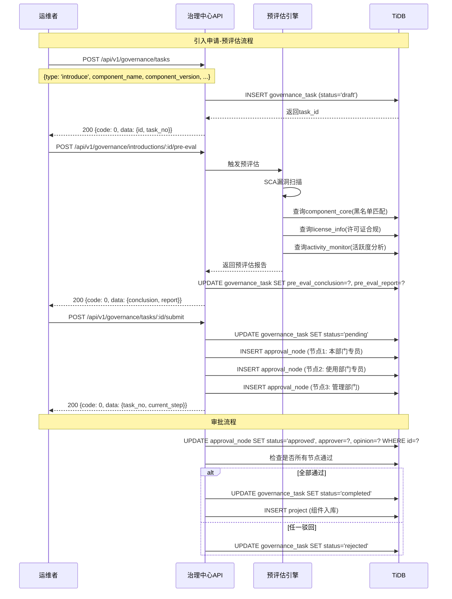

---

### 2.5 模块5：决策与洞察

#### 2.5.1 模块功能概述

决策与洞察模块提供数据可视化和统计分析能力，支撑管理层决策：

| 子模块 | 页面 | 核心指标 |
|--------|------|---------|
| 治理效能看板 | 违规拦截统计 | 月度拦截次数趋势 |
| 治理效能看板 | 缺陷修复效能 | 部门MTTR、逾期数 |
| 治理效能看板 | 资产健康度分布 | 正常/停更/无维护占比 |
| 治理效能看板 | 治理工作量统计 | 各部门引入/升级数量 |
| 供应链安全洞察 | 核心依赖 Top N | 使用频率最高的组件 |
| 供应链安全洞察 | 版本碎片化 Top N | 版本最混乱的组件 |
| 供应链安全洞察 | 高风险项目 Top N | 漏洞最多的自研项目 |

#### 2.5.2 流程图 - 统计报表生成

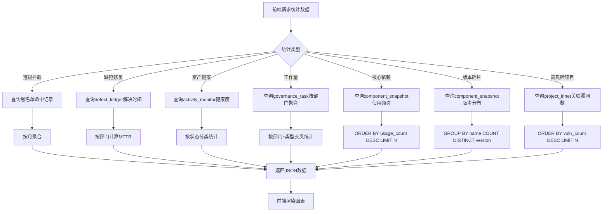

#### 2.5.3 接口设计

| 接口 | 方法 | 路径 | 权限 | 说明 |
|------|------|------|------|------|
| 违规拦截统计 | GET | `/api/v1/decision/block-stats` | admin | 获取月度拦截次数趋势 |
| 缺陷修复效能 | GET | `/api/v1/decision/repair-efficiency` | admin | 获取部门MTTR和逾期统计 |
| 资产健康度分布 | GET | `/api/v1/decision/health-distribution` | admin | 获取资产健康状态分布 |
| 治理工作量统计 | GET | `/api/v1/decision/workload` | admin | 获取各部门工作量统计 |
| 核心依赖 Top N | GET | `/api/v1/decision/core-dependencies?n=10` | admin | 获取使用最频繁的组件 |
| 版本碎片化 Top N | GET | `/api/v1/decision/version-fragmentation?n=10` | admin | 获取版本最混乱的组件 |
| 高风险项目 Top N | GET | `/api/v1/decision/high-risk-projects?n=10` | admin | 获取漏洞最多的项目 |

**SQL实现示例：**

```sql
-- 违规拦截统计（按月聚合）
SELECT 
  DATE_FORMAT(create_time, '%Y-%m') AS month,
  COUNT(*) AS count
FROM violation_record
WHERE create_time >= DATE_SUB(NOW(), INTERVAL 6 MONTH)
GROUP BY DATE_FORMAT(create_time, '%Y-%m')
ORDER BY month;

-- 缺陷修复效能（按部门计算MTTR）
SELECT 
  dispatch_dept AS department,
  AVG(TIMESTAMPDIFF(HOUR, dispatch_time, resolve_time) / 24) AS avg_mttr_days,
  SUM(CASE WHEN resolve_time > deadline THEN 1 ELSE 0 END) AS overdue_count
FROM defect_ledger
WHERE status = 'resolved' AND resolve_time IS NOT NULL
GROUP BY dispatch_dept;

-- 资产健康度分布
SELECT 
  CASE 
    WHEN health_score >= 80 THEN 'normal'
    WHEN health_score >= 50 THEN 'stale'
    ELSE 'abandoned'
  END AS status,
  COUNT(*) AS count,
  ROUND(COUNT(*) * 100.0 / (SELECT COUNT(*) FROM activity_monitor), 2) AS percentage
FROM activity_monitor
GROUP BY status;

-- 核心依赖 Top N
SELECT 
  _name AS name,
  COUNT(DISTINCT project_id) AS project_count,
  COUNT(*) AS usage_count
FROM component_snapshot
WHERE project_id IS NOT NULL
GROUP BY _name
ORDER BY usage_count DESC
LIMIT 10;

-- 版本碎片化 Top N
SELECT 
  _name AS name,
  COUNT(DISTINCT _version) AS version_count,
  GROUP_CONCAT(DISTINCT _version ORDER BY _version SEPARATOR ',') AS versions
FROM component_snapshot
GROUP BY _name
HAVING version_count >= 2
ORDER BY version_count DESC
LIMIT 10;

-- 高风险项目 Top N
SELECT 
  pi.pro_code AS project_name,
  pi.dept_name AS department,
  COUNT(DISTINCT dl.id) AS vulnerability_count,
  MAX(CASE dl.risk_level
    WHEN 'critical' THEN 4
    WHEN 'high' THEN 3
    WHEN 'medium' THEN 2
    WHEN 'low' THEN 1
    ELSE 0
  END) AS max_risk_level
FROM project_inner pi
LEFT JOIN defect_ledger dl ON dl.affected_component LIKE CONCAT('%', pi.pro_code, '%')
  AND dl.status IN ('pending', 'dispatched', 'processing')
GROUP BY pi.id, pi.pro_code, pi.dept_name
ORDER BY vulnerability_count DESC, max_risk_level DESC
LIMIT 10;
```

#### 2.5.4 交互流程图

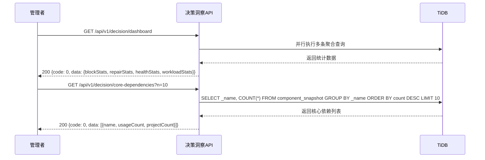

---

## 3. 审批流程设计

### 3.1 引入申请审批流程

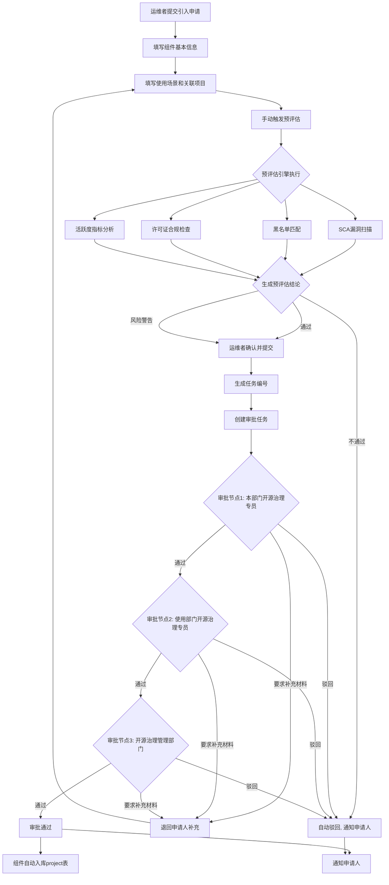

### 3.2 升级评审流程

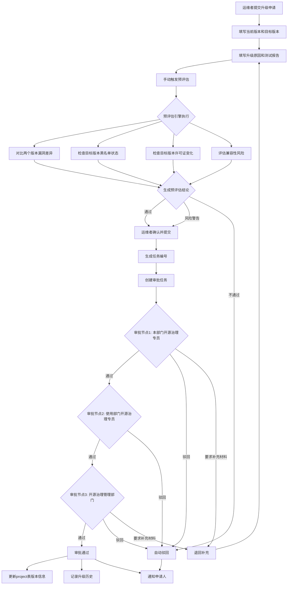

### 3.3 退出审批流程

```mermaid
flowchart TD
    A[运维者提交退出申请] --> B[填写退出组件信息]
    B --> C[填写退出原因]
    C --> D[填写替代方案]
    D --> E[填写代码清理计划]
    E --> F[填写受影响项目列表]
    F --> G[提交申请]
    
    Note over G: 退出申请无需预评估
    
    G --> H[生成任务编号]
    H --> I[创建审批任务]
    
    I --> J{审批节点1: 本部门开源治理专员}
    J -->|通过| K{审批节点2: 使用部门开源治理专员}
    J -->|驳回| Z[驳回, 通知申请人]
    J -->|要求补充材料| Y[退回补充]
    
    K -->|通过| L{审批节点3: 开源治理管理部门}
    K -->|驳回| Z
    
    L -->|通过| M[审批通过]
    L -->|驳回| Z
    L -->|要求补充材料| Y
    
    M --> N[更新project表状态为deprecated]
    M --> O[清理关联依赖]
    M --> P[通知申请人]
    Z --> P
    Y --> C
```

### 3.4 缺陷处置流程

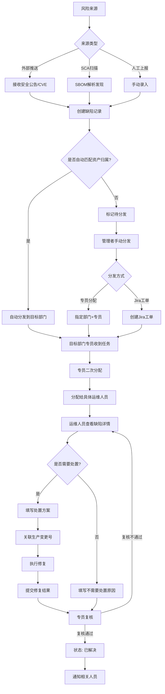

### 3.5 可信组件申请使用流程

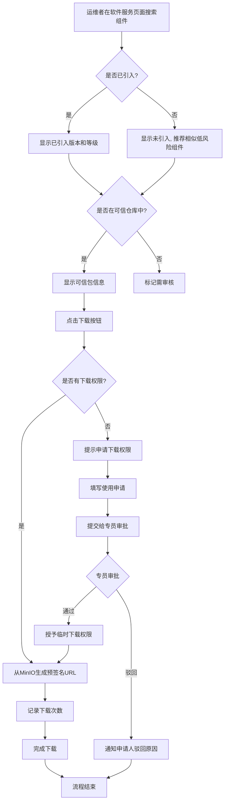

---

## 4. 数据库设计

### 4.1 完整表结构汇总

| 序号 | 表名 | 说明 | 所属模块 |
|------|------|------|---------|
| 1 | `sys_user` | 系统用户表 | 用户与权限 |
| 2 | `sys_department` | 部门表 | 用户与权限 |
| 3 | `sys_team` | 团队表 | 用户与权限 |
| 4 | `sys_role_permission` | 角色权限表 | 用户与权限 |
| 5 | `project` | 开源基础软件表 | 台账管理 |
| 6 | `project_inner` | 自研项目表 | 台账管理 |
| 7 | `component_snapshot` | 开源依赖包表 | 台账管理 |
| 8 | `trusted_package` | 可信包表 | 台账管理 |
| 9 | `source_backup` | 源码备份记录表 | 台账管理 |
| 10 | `sca_parse_record` | SCA解析记录表 | 台账管理 |
| 11 | `webhook_event` | Webhook事件记录表 | 台账管理 |
| 12 | `component_core` | 黑名单表 | 风险管理 |
| 13 | `license_info` | 许可证信息库 | 风险管理 |
| 14 | `defect_ledger` | 缺陷台账 | 风险管理 |
| 15 | `dispatch_record` | 分发记录表 | 风险管理 |
| 16 | `activity_monitor` | 活跃度监测数据表 | 风险管理 |
| 17 | `governance_task` | 治理任务/审批表 | 治理中心 |
| 18 | `approval_node` | 审批节点记录表 | 治理中心 |
| 19 | `approval_policy` | 审批策略配置表 | 治理中心 |
| 20 | `violation_record` | 违规审计记录表 | 治理中心 |

### 4.2 索引设计

**核心索引策略：**

```sql
-- 唯一性约束索引
ALTER TABLE `project` ADD UNIQUE INDEX `PROJECT_UQ_IDX` (`_group`, `_name`, `_version`);
ALTER TABLE `project` ADD UNIQUE INDEX `PROJECT_UUID_IDX` (`UUID`);
ALTER TABLE `trusted_package` ADD UNIQUE INDEX `uk_name_version` (`name`, `version`);
ALTER TABLE `governance_task` ADD UNIQUE INDEX `uk_task_no` (`task_no`);
ALTER TABLE `defect_ledger` ADD UNIQUE INDEX `uk_defect_no` (`defect_no`);

-- 高频查询索引
ALTER TABLE `governance_task` ADD INDEX `idx_type_status` (`type`, `status`);
ALTER TABLE `governance_task` ADD INDEX `idx_assigned_to_status` (`assigned_to`, `status`);
ALTER TABLE `defect_ledger` ADD INDEX `idx_status_source` (`status`, `source`);
ALTER TABLE `component_snapshot` ADD INDEX `idx_project_id` (`project_id`);
ALTER TABLE `component_snapshot` ADD INDEX `idx_current_id` (`current_id`);
ALTER TABLE `approval_node` ADD INDEX `idx_task_id_order` (`task_id`, `node_order`);

-- 全文搜索索引（TiDB支持）
ALTER TABLE `project` ADD FULLTEXT INDEX `ft_project_search` (`_name`, `_group`, `DESCRIPTION`);
ALTER TABLE `component_snapshot` ADD FULLTEXT INDEX `ft_component_search` (`_name`, `_group`, `DESCRIPTION`);
```

### 4.3 表关系图

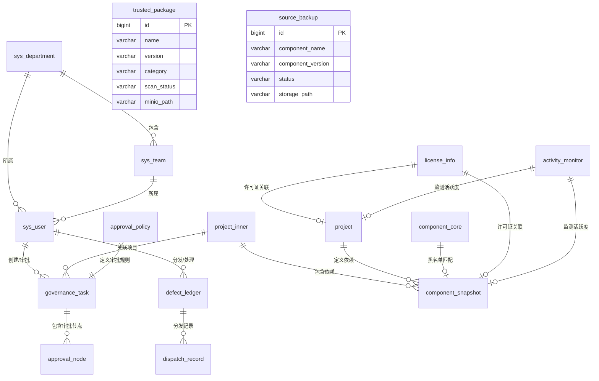

### 4.4 数据库初始化脚本

```sql
-- 初始化许可证信息库
INSERT INTO `license_info` (`name`, `full_name`, `category`, `risk_level`, `description`, `is_approved`) VALUES
('MIT', 'MIT License', 'permissive', 'low', '最宽松的开源许可证之一，允许自由使用、修改、分发', 1),
('Apache-2.0', 'Apache License 2.0', 'permissive', 'low', 'Apache基金会开源许可证，提供专利授权', 1),
('BSD-2-Clause', 'BSD 2-Clause License', 'permissive', 'low', 'BSD简化版许可证', 1),
('BSD-3-Clause', 'BSD 3-Clause License', 'permissive', 'low', 'BSD标准版许可证', 1),
('ISC', 'ISC License', 'permissive', 'low', 'ISC互联网系统协会许可证', 1),
('MPL-2.0', 'Mozilla Public License 2.0', 'weak-copyleft', 'medium', 'Mozilla公共许可证，文件级传染性', 1),
('LGPL-2.1', 'GNU Lesser GPL 2.1', 'weak-copyleft', 'medium', 'GNU宽松通用公共许可证', 1),
('GPL-2.0', 'GNU General Public License 2.0', 'strong-copyleft', 'high', 'GPL标准许可证，强传染性', 0),
('GPL-3.0', 'GNU General Public License 3.0', 'strong-copyleft', 'high', 'GPL最新版本许可证，强传染性', 0),
('AGPL-3.0', 'GNU Affero GPL 3.0', 'strong-copyleft', 'critical', '网络使用也需开源，最强传染性', 0),
('SSPL-1.0', 'Server Side Public License', 'special', 'medium', 'MongoDB专用许可证', 1);

-- 初始化审批策略
INSERT INTO `approval_policy` (`task_type`, `grade`, `nodes`, `auto_approve_threshold`, `auto_reject_threshold`, `sla_hours`) VALUES
('introduce', 'A', '[{"name":"本部门开源治理专员","order":1},{"name":"使用部门开源治理专员","order":2},{"name":"开源治理管理部门","order":3}]', 85, 40, 72),
('introduce', 'B', '[{"name":"本部门开源治理专员","order":1},{"name":"使用部门开源治理专员","order":2},{"name":"开源治理管理部门","order":3}]', 80, 40, 96),
('introduce', 'C', '[{"name":"本部门开源治理专员","order":1},{"name":"使用部门开源治理专员","order":2}]', 75, 40, 120),
('introduce', 'D', '[{"name":"本部门开源治理专员","order":1}]', 70, 40, 168),
('upgrade', NULL, '[{"name":"本部门开源治理专员","order":1},{"name":"使用部门开源治理专员","order":2},{"name":"开源治理管理部门","order":3}]', 80, 40, 72),
('withdraw', NULL, '[{"name":"本部门开源治理专员","order":1},{"name":"使用部门开源治理专员","order":2},{"name":"开源治理管理部门","order":3}]', NULL, NULL, 168),
('defect', 'critical', '[{"name":"使用部门意见","order":1},{"name":"运维部门意见","order":2},{"name":"管理员审批","order":3}]', NULL, NULL, 24),
('defect', 'high', '[{"name":"使用部门意见","order":1},{"name":"运维部门意见","order":2},{"name":"管理员审批","order":3}]', NULL, NULL, 48),
('defect', NULL, '[{"name":"使用部门意见","order":1},{"name":"运维部门意见","order":2}]', NULL, NULL, 72);
```

---

## 5. 接口设计规范

### 5.1 RESTful 标准

**URL规范：**
- 使用小写字母和连字符：`/api/v1/assets/software-library`
- 资源名使用复数：`/api/v1/users`、`/api/v1/tasks`
- 嵌套资源不超过两层：`/api/v1/tasks/:id/approval-history`

**HTTP方法：**
| 方法 | 操作 | 幂等性 |
|------|------|--------|
| GET | 查询资源 | 是 |
| POST | 创建资源 | 否 |
| PUT | 全量更新 | 是 |
| PATCH | 部分更新 | 是 |
| DELETE | 删除资源 | 是 |

### 5.2 统一响应格式

```go
// 成功响应
{
  "code": 0,
  "message": "success",
  "data": { ... }
}

// 分页响应
{
  "code": 0,
  "message": "success",
  "data": {
    "list": [ ... ],
    "total": 100,
    "page": 1,
    "pageSize": 20
  }
}

// 错误响应
{
  "code": 40001,
  "message": "用户名或密码错误",
  "data": null
}
```

### 5.3 统一错误码

| 错误码 | 说明 | HTTP状态码 |
|--------|------|-----------|
| 0 | 成功 | 200 |
| 40001 | 用户名或密码错误 | 401 |
| 40002 | Token无效或已过期 | 401 |
| 40003 | 权限不足 | 403 |
| 40004 | 资源不存在 | 404 |
| 40005 | 参数校验失败 | 400 |
| 40006 | 资源冲突(唯一约束) | 409 |
| 40007 | 操作被拒绝(状态不允许) | 400 |
| 50001 | 数据库操作失败 | 500 |
| 50002 | MinIO操作失败 | 500 |
| 50003 | 文件上传失败 | 500 |
| 50004 | 外部系统调用失败 | 502 |

### 5.4 分页参数规范

```
GET /api/v1/assets/projects?page=1&pageSize=20&keyword=nginx&type=middleware&grade=A
```

| 参数 | 类型 | 必填 | 默认值 | 说明 |
|------|------|------|--------|------|
| page | int | 否 | 1 | 页码 |
| pageSize | int | 否 | 20 | 每页数量, 最大100 |
| keyword | string | 否 | - | 模糊搜索关键词 |
| sortBy | string | 否 | create_time | 排序字段 |
| sortOrder | string | 否 | desc | 排序方向: asc/desc |

### 5.5 文件上传规范

```
POST /api/v1/assets/sca-records/upload
Content-Type: multipart/form-data

file: (binary)
type: "SBOM-CycloneDX" | "SBOM-SPDX" | "source-package"
```

响应：
```json
{
  "code": 0,
  "message": "上传成功",
  "data": {
    "id": 1,
    "file_name": "sbom.json",
    "status": "parsing",
    "minio_path": "sca-uploads/2024/03/sbom-abc123.json"
  }
}
```

### 5.6 预评估接口详细设计

```
POST /api/v1/governance/introductions/:id/pre-eval
Request Body:
{
  "component_name": "Apache Pulsar",
  "component_version": "3.1.2",
  "license_type": "Apache-2.0",
  "use_scenario": "订单系统消息队列"
}

Response (200):
{
  "code": 0,
  "message": "success",
  "data": {
    "conclusion": "pass",
    "report": {
      "sca_scan": {
        "vulnerabilities": [
          {"cve_id": "CVE-2024-001", "severity": "medium", "description": "..."}
        ],
        "total_count": 1
      },
      "blacklist_match": {
        "hit": false,
        "details": []
      },
      "license_check": {
        "license": "Apache-2.0",
        "risk_level": "low",
        "is_approved": true,
        "compliance_advice": "符合公司许可证要求"
      },
      "activity_analysis": {
        "health_score": 92,
        "stars": 4200,
        "commits_last_month": 45,
        "last_release": "2024-03-01",
        "status": "healthy"
      },
      "conclusion": "pass",
      "advice": "各项指标符合标准，建议审批通过"
    }
  }
}
```

### 5.7 审批接口详细设计

```
POST /api/v1/governance/tasks/:id/approve
Request Body:
{
  "action": "approve",    // "approve" | "reject"
  "opinion": "同意引入，组件安全评估通过",
  "node_id": 1            // 审批节点ID
}

Response (200):
{
  "code": 0,
  "message": "success",
  "data": {
    "task_no": "TASK-2024-0001",
    "status": "processing",
    "current_step": "使用部门开源治理专员审批中"
  }
}
```

---

## 6. 安全设计

### 6.1 认证授权

#### 6.1.1 JWT认证方案

```
Header:
{
  "alg": "HS256",
  "typ": "JWT"
}

Payload:
{
  "sub": "user_id",
  "username": "operator",
  "role": "operator",
  "department": "技术研发部",
  "team": "基础架构组",
  "iat": 1719000000,
  "exp": 1719086400    // 24小时过期
}
```

**JWT配置：**
```go
type JWTConfig struct {
    Secret     string        // HMAC密钥, 从环境变量读取
    Expiration time.Duration // Token有效期, 默认24小时
    Issuer     string        // 签发者标识
}
```

#### 6.1.2 认证中间件流程

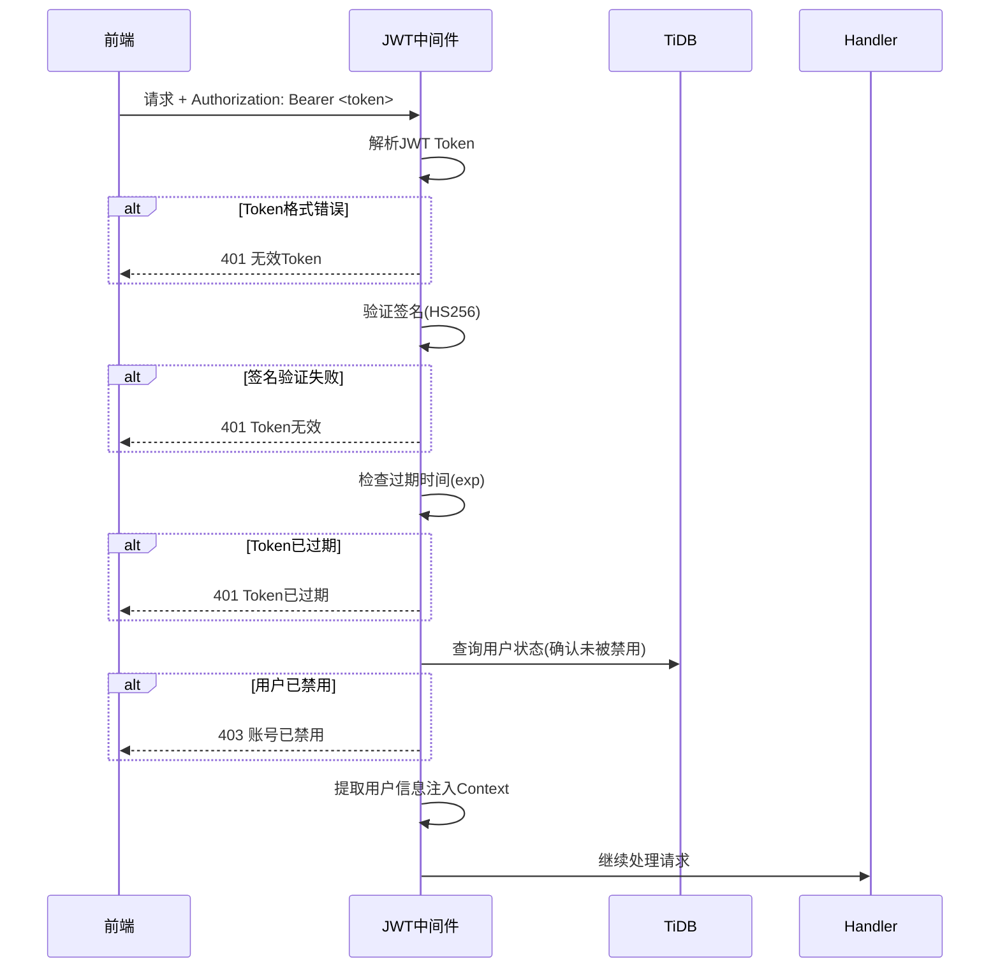

#### 6.1.3 权限中间件

```go
// 权限检查中间件
func RequirePermission(resource string, action string) gin.HandlerFunc {
    return func(c *gin.Context) {
        user := GetUserFromContext(c)
        
        // admin角色拥有所有权限
        if user.Role == "admin" {
            c.Next()
            return
        }
        
        // 检查角色权限
        hasPermission := checkRolePermission(user.Role, resource, action)
        if !hasPermission {
            c.AbortWithStatusJSON(403, gin.H{
                "code":    40003,
                "message": "权限不足",
            })
            return
        }
        c.Next()
    }
}
```

### 6.2 数据加密

| 数据类型 | 加密方式 | 说明 |
|---------|---------|------|
| 用户密码 | BCrypt (cost=12) | 不可逆加密 |
| JWT密钥 | HMAC-SHA256 | 从环境变量读取 |
| HTTPS | TLS 1.3 | 传输层加密 |
| MinIO通信 | HTTPS + 服务端加密 | 存储加密 |

### 6.3 安全防护

**XSS防护：** 对所有用户输入进行HTML转义
**SQL注入防护：** 使用GORM参数化查询
**CSRF防护：** JWT认证天然免疫CSRF
**速率限制：** 对登录接口实现IP级别限流（内存计数，不用Redis）

```go
// 内存限流器实现（不用Redis）
type RateLimiter struct {
    mu      sync.Mutex
    counters map[string]*rateCounter
    window  time.Duration
    limit   int
}

type rateCounter struct {
    count    int
    resetAt  time.Time
}
```

### 6.4 审计日志

```sql
CREATE TABLE `sys_audit_log` (
  `id` bigint(20) NOT NULL AUTO_INCREMENT COMMENT '主键',
  `user_id` bigint(20) NOT NULL COMMENT '操作用户ID',
  `username` varchar(50) NOT NULL COMMENT '操作用户名',
  `action` varchar(50) NOT NULL COMMENT '操作类型: login/create/update/delete/approve/reject',
  `resource` varchar(100) NOT NULL COMMENT '操作资源',
  `resource_id` varchar(50) DEFAULT NULL COMMENT '资源ID',
  `ip_address` varchar(50) DEFAULT NULL COMMENT 'IP地址',
  `user_agent` varchar(255) DEFAULT NULL COMMENT 'User-Agent',
  `request_data` mediumtext COMMENT '请求数据(JSON)',
  `response_data` mediumtext COMMENT '响应数据(JSON)',
  `status` varchar(20) DEFAULT 'success' COMMENT '操作结果: success/failure',
  `error_msg` varchar(512) DEFAULT NULL COMMENT '错误信息',
  `create_time` timestamp DEFAULT CURRENT_TIMESTAMP COMMENT '操作时间',
  PRIMARY KEY (`id`) /*T![clustered_index] CLUSTERED */,
  KEY `idx_user_id` (`user_id`),
  KEY `idx_action` (`action`),
  KEY `idx_create_time` (`create_time`)
) ENGINE=InnoDB DEFAULT CHARSET=utf8mb4 COLLATE=utf8mb4_bin COMMENT='审计日志表';
```

---

## 7. 部署与运维

### 7.1 Go部署方案

#### 7.1.1 项目结构

```
osm-mngt-backend/
├── cmd/
│   └── server/
│       └── main.go              # 入口文件
├── internal/
│   ├── handler/                  # HTTP Handler
│   │   ├── auth_handler.go
│   │   ├── asset_handler.go
│   │   ├── risk_handler.go
│   │   ├── governance_handler.go
│   │   └── decision_handler.go
│   ├── service/                  # 业务逻辑层
│   │   ├── auth_service.go
│   │   ├── asset_service.go
│   │   ├── risk_service.go
│   │   ├── governance_service.go
│   │   ├── pre_eval_service.go  # 预评估服务
│   │   └── approval_service.go  # 审批引擎
│   ├── repository/               # 数据访问层
│   │   ├── user_repo.go
│   │   ├── project_repo.go
│   │   ├── component_repo.go
│   │   └── task_repo.go
│   ├── model/                    # 数据模型
│   │   ├── user.go
│   │   ├── project.go
│   │   ├── component.go
│   │   └── task.go
│   └── middleware/               # 中间件
│       ├── jwt.go
│       ├── permission.go
│       ├── cors.go
│       ├── logger.go
│       └── rate_limiter.go
├── pkg/
│   ├── minio/                    # MinIO客户端封装
│   ├── jwt/                      # JWT工具
│   └── response/                 # 统一响应格式
├── config/
│   ├── config.yaml               # 配置文件
│   └── config.local.yaml         # 本地开发配置
├── migrations/                   # 数据库迁移脚本
│   ├── 001_init_schema.sql
│   └── 002_init_data.sql
├── docs/                         # Swagger文档
├── Dockerfile
├── Makefile
└── go.mod
```

#### 7.1.2 Dockerfile

```dockerfile
FROM golang:1.21-alpine AS builder

WORKDIR /app
COPY go.mod go.sum ./
RUN go mod download

COPY . .
RUN CGO_ENABLED=0 GOOS=linux go build -ldflags="-s -w" -o osm-server ./cmd/server

FROM alpine:3.19
RUN apk --no-cache add ca-certificates tzdata

WORKDIR /app
COPY --from=builder /app/osm-server .
COPY --from=builder /app/config ./config

EXPOSE 8080
ENTRYPOINT ["./osm-server"]
```

#### 7.1.3 Makefile

```makefile
.PHONY: build run test lint migrate swagger

build:
	CGO_ENABLED=0 go build -ldflags="-s -w" -o bin/osm-server ./cmd/server

run:
	go run ./cmd/server

test:
	go test -v -cover ./...

lint:
	golangci-lint run

migrate:
	# 执行数据库迁移
	mysql -h ${DB_HOST} -P ${DB_PORT} -u ${DB_USER} -p${DB_PASS} ${DB_NAME} < migrations/001_init_schema.sql

swagger:
	swag init -g ./cmd/server/main.go -o ./docs
```

### 7.2 TiDB连接配置

#### 7.2.1 配置文件

```yaml
# config.yaml
server:
  port: 8080
  mode: release  # debug | release | test

database:
  host: "tidb-cluster.example.com"
  port: 4000
  username: "osm_user"
  password: "${DB_PASSWORD}"  # 从环境变量读取
  database: "osm_mngt"
  charset: "utf8mb4"
  max_open_conns: 100
  max_idle_conns: 20
  conn_max_lifetime: "30m"
  log_level: "warn"

minio:
  endpoint: "minio.example.com:9000"
  access_key: "${MINIO_ACCESS_KEY}"
  secret_key: "${MINIO_SECRET_KEY}"
  use_ssl: true
  bucket_name: "osm-mngt"

jwt:
  secret: "${JWT_SECRET}"
  expiration: "24h"
  issuer: "osm-mngt"

log:
  level: "info"
  format: "json"  # json | console
  output: "stdout"
```

#### 7.2.2 GORM TiDB配置

```go
func InitDB(cfg *config.DatabaseConfig) (*gorm.DB, error) {
    dsn := fmt.Sprintf("%s:%s@tcp(%s:%d)/%s?charset=%s&parseTime=True&loc=Local",
        cfg.Username, cfg.Password, cfg.Host, cfg.Port, cfg.Database, cfg.Charset)
    
    db, err := gorm.Open(mysql.Open(dsn), &gorm.Config{
        DisableForeignKeyConstraintWhenMigrating: true,
        PrepareStmt: true,
        Logger: logger.New(
            log.New(os.Stdout, "\r\n", log.LstdFlags),
            logger.Config{
                LogLevel:                  logger.LogLevel(cfg.LogLevel),
                SlowThreshold:             time.Second,
                Colorful:                  false,
                IgnoreRecordNotFoundError: true,
            },
        ),
    })
    if err != nil {
        return nil, err
    }
    
    sqlDB, _ := db.DB()
    sqlDB.SetMaxOpenConns(cfg.MaxOpenConns)
    sqlDB.SetMaxIdleConns(cfg.MaxIdleConns)
    sqlDB.SetConnMaxLifetime(cfg.ConnMaxLifetime)
    
    // TiDB特有优化
    db.Exec("SET tidb_enable_clustered_index = 1")
    db.Exec("SET tidb_txn_mode = 'optimistic'")
    
    return db, nil
}
```

### 7.3 MinIO配置

#### 7.3.1 存储桶设计

```
osm-mngt (bucket)
├── trusted-packages/          # 可信包存储
│   ├── middleware/
│   ├── database/
│   ├── dependency/
│   └── tool/
├── source-backups/            # 源码备份
│   └── {component-name}/
│       └── {version}/
├── sca-uploads/               # SCA上传文件
│   └── {year}/
│       └── {month}/
├── attachments/               # 审批附件
│   └── {task-type}/
│       └── {task-no}/
└── reports/                   # 生成的报告
    └── {year}/
        └── {month}/
```

#### 7.3.2 MinIO客户端封装

```go
// pkg/minio/client.go
package minio

type Client struct {
    client *minio.Client
    bucket string
}

func NewClient(cfg *config.MinIOConfig) (*Client, error) {
    c, err := minio.New(cfg.Endpoint, &minio.Options{
        Creds:  credentials.NewStaticV4(cfg.AccessKey, cfg.SecretKey, ""),
        Secure: cfg.UseSSL,
    })
    if err != nil {
        return nil, err
    }
    
    // 确保bucket存在
    exists, _ := c.BucketExists(context.Background(), cfg.BucketName)
    if !exists {
        c.MakeBucket(context.Background(), cfg.BucketName, minio.MakeBucketOptions{})
    }
    
    return &Client{client: c, bucket: cfg.BucketName}, nil
}

// 上传文件
func (c *Client) Upload(ctx context.Context, objectName string, reader io.Reader, size int64, contentType string) error {
    _, err := c.client.PutObject(ctx, c.bucket, objectName, reader, size, minio.PutObjectOptions{
        ContentType: contentType,
    })
    return err
}

// 获取预签名下载URL
func (c *Client) PresignedDownload(ctx context.Context, objectName string, expiry time.Duration) (string, error) {
    reqParams := make(url.Values)
    url, err := c.client.PresignedGetObject(ctx, c.bucket, objectName, expiry, reqParams)
    if err != nil {
        return "", err
    }
    return url.String(), nil
}

// 删除文件
func (c *Client) Delete(ctx context.Context, objectName string) error {
    return c.client.RemoveObject(ctx, c.bucket, objectName, minio.RemoveObjectOptions{})
}
```

### 7.4 Nginx配置

```nginx
upstream osm_backend {
    server 127.0.0.1:8080;
    # server 127.0.0.1:8081;  # 多实例时可添加
}

server {
    listen 80;
    server_name osm-mngt.example.com;
    return 301 https://$server_name$request_uri;
}

server {
    listen 443 ssl http2;
    server_name osm-mngt.example.com;
    
    ssl_certificate     /etc/nginx/ssl/cert.pem;
    ssl_certificate_key /etc/nginx/ssl/key.pem;
    ssl_protocols       TLSv1.2 TLSv1.3;
    ssl_ciphers         HIGH:!aNULL:!MD5;
    
    # 前端静态资源
    location / {
        root /var/www/osm-mngt/frontend;
        try_files $uri $uri/ /index.html;
    }
    
    # 后端API
    location /api/ {
        proxy_pass http://osm_backend;
        proxy_set_header Host $host;
        proxy_set_header X-Real-IP $remote_addr;
        proxy_set_header X-Forwarded-For $proxy_add_x_forwarded_for;
        proxy_set_header X-Forwarded-Proto $scheme;
        
        # 大文件上传支持
        client_max_body_size 100M;
        proxy_read_timeout 300s;
    }
    
    # 文件下载代理
    location /files/ {
        internal;  # 仅内部访问
        proxy_pass http://osm_backend;
    }
}
```

### 7.5 部署架构

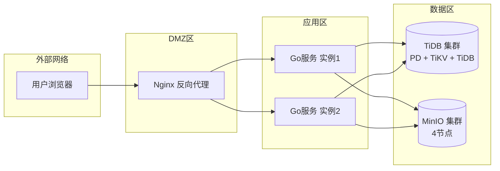

### 7.6 运维监控

#### 7.6.1 健康检查接口

```go
// GET /api/v1/health
func HealthCheck(c *gin.Context) {
    // 检查数据库连接
    db, _ := c.Get("db")
    sqlDB, _ := db.(*gorm.DB).DB()
    if err := sqlDB.Ping(); err != nil {
        c.JSON(503, gin.H{"status": "unhealthy", "db": "error"})
        return
    }
    
    // 检查MinIO连接
    minioClient := GetMinioClient()
    if _, err := minioClient.BucketExists(c.Request.Context(), config.Bucket); err != nil {
        c.JSON(503, gin.H{"status": "unhealthy", "minio": "error"})
        return
    }
    
    c.JSON(200, gin.H{"status": "healthy"})
}
```

#### 7.6.2 Prometheus指标暴露

```go
// GET /metrics
import "github.com/prometheus/client_golang/prometheus/promhttp"

r.GET("/metrics", gin.WrapH(promhttp.Handler()))

// 自定义指标
var (
    taskCounter = prometheus.NewCounterVec(
        prometheus.CounterOpts{
            Name: "osm_task_total",
            Help: "Total number of governance tasks",
        },
        []string{"type", "status"},
    )
    preEvalDuration = prometheus.NewHistogram(
        prometheus.HistogramOpts{
            Name:    "osm_pre_eval_duration_seconds",
            Help:    "Duration of pre-evaluation",
            Buckets: prometheus.DefBuckets,
        },
    )
)
```

---

## 8. 待确认事项

> 以下事项需要与前端团队和业务方进一步确认，以便完善后端设计。

### 8.1 审批流程相关

| 序号 | 问题 | 当前假设 | 影响范围 |
|------|------|---------|---------|
| 1 | 引入申请的具体审批节点和审批角色是什么？ | 假设三级审批：本部门专员 → 使用部门专员 → 管理部门 | 审批引擎、approval_policy表 |
| 2 | 升级评审是否需要与引入申请相同的审批节点？ | 假设审批流程相同 | 审批引擎复用 |
| 3 | 退出审批是否也需要三级审批？ | 假设需要三级审批 | 审批引擎 |
| 4 | 缺陷处置流程中"使用部门意见/运维部门意见/管理员审批"的具体角色映射？ | 假设使用部门=applicant_dept的专员，运维部门=分配目标部门专员 | 审批节点路由 |
| 5 | 审批被驳回后，申请人是否可以修改后重新提交？ | 假设可以，驳回后状态回到draft | 任务状态机 |
| 6 | 是否支持审批节点会签（多人同时审批）？ | 假设不支持，串行审批 | 审批引擎 |

### 8.2 缺陷状态流转相关

| 序号 | 问题 | 当前假设 | 影响范围 |
|------|------|---------|---------|
| 7 | 缺陷状态"待分发→已分发→处理中→已解决"的流转规则？ | 严格按此顺序流转 | defect_ledger状态机 |
| 8 | "已忽略"状态是否需要审批？ | 假设专员可直接标记忽略 | 权限控制 |
| 9 | 缺陷解决后是否需要复核？前端显示"待复核"状态 | 假设专员需要复核 | 状态流转 |
| 10 | 逾期未处理的缺陷是否有自动升级机制？ | 假设暂不实现，后续可扩展 | 定时任务 |

### 8.3 预评估算法相关

| 序号 | 问题 | 当前假设 | 影响范围 |
|------|------|---------|---------|
| 11 | 预评估的具体评分算法和权重？ | 假设：漏洞权重40%、黑名单20%、许可证20%、活跃度20% | pre_eval_service |
| 12 | 预评估结论"通过/风险警告/不通过"的具体阈值？ | 假设：≥70通过, 40-69警告, <40不通过 | pre_eval_service |
| 13 | SCA扫描如何获取漏洞数据？是否有外部漏洞库API？ | 假设有外部API或本地漏洞库 | 预评估引擎 |
| 14 | 活跃度指标从GitHub/GitLab获取的具体指标和计算方式？ | 假设：Stars、Forks、Commits、Contributors、LastRelease | activity_monitor |
| 15 | 活跃度数据如何获取？是否需要定时同步？ | 假设需要定时任务定期同步 | 定时任务 |

### 8.4 可信仓库权限相关

| 序号 | 问题 | 当前假设 | 影响范围 |
|------|------|---------|---------|
| 16 | 可信仓库下载是否需要权限控制？ | 假设所有已登录用户可下载 | 权限中间件 |
| 17 | 未引入的组件从可信仓库下载是否需要审批？ | 假设不需要，可信仓库已预审 | 业务逻辑 |
| 18 | Nexus Webhook的认证方式和安全策略？ | 假设通过Token验证 | webhook_handler |
| 19 | 可信包上传的审核流程？ | 假设admin直接上传，系统自动扫描 | trusted_package流程 |

### 8.5 其他不明确的地方

| 序号 | 问题 | 当前假设 | 影响范围 |
|------|------|---------|---------|
| 20 | 外部工单系统(Jira)的对接方式和API？ | 假设通过REST API对接 | governance_service |
| 21 | 审批流程文档生成的具体模板和内容要求？ | 假设使用go-docx生成Word | 文档生成服务 |
| 22 | 是否需要操作日志审计功能？ | 假设需要，记录所有关键操作 | sys_audit_log表 |
| 23 | 黑白名单版本表达式的支持格式？(semver区间、通配符等) | 假设支持semver格式：`<6.4.0`, `>=11.0.0`, `1.0.0 - 2.0.0` | blacklist匹配引擎 |
| 24 | SCA支持导入的SBOM格式范围？ | 假设支持SPDX JSON/XML和CycloneDX JSON/XML | sca_parser |
| 25 | 是否需要数据导出功能（Excel/PDF）？ | 假设需要，使用excelize库 | 各模块export接口 |
| 26 | 系统是否支持多租户？ | 假设单租户，按部门隔离数据 | 数据隔离策略 |
| 27 | 源码备份的触发机制？(手动/定时/事件驱动) | 假设支持手动触发和定时任务 | backup_service |
| 28 | 预评估是否异步执行？前端如何获取进度？ | 假设同步执行(简单场景)，复杂场景可改为轮询 | pre_eval接口 |

---

## 附录

### A. 前端-后端数据模型映射

| 前端类型 | 后端模型 | 映射说明 |
|---------|---------|---------|
| `UserInfo` | `sys_user` | 直接映射，password不返回 |
| `SoftwareAsset` | `project` | 前端type字段映射后端CLASSIFIER |
| `SelfDevelopedProject` | `project_inner` | 直接映射 |
| `ProjectDependency` | `component_snapshot` | 关联project_inner查询 |
| `BlacklistItem` | `component_core` | 直接映射 |
| `LicenseInfo` | `license_info` | 直接映射 |
| `DefectLedgerItem` | `defect_ledger` | 直接映射 |
| `Task` | `governance_task` | 统一任务模型 |
| `ApprovalNode` | `approval_node` | 直接映射 |
| `TrustedPackage` | `trusted_package` | 直接映射 |
| `BackupRecord` | `source_backup` | 直接映射 |
| `ScaParseRecord` | `sca_parse_record` | 直接映射 |
| `ActivityData` | `activity_monitor` | 直接映射 |
| `RiskRecord` | `defect_ledger` | 直接映射 |
| `TicketTracking` | `defect_ledger` + `governance_task` | 联合查询 |

### B. 版本匹配表达式规则

```
支持的表达式格式:
  - 精确匹配:  "1.2.3"
  - 范围匹配:  "<1.2.3", "<=1.2.3", ">1.2.3", ">=1.2.3"
  - 区间匹配:  "1.0.0 - 2.0.0" (包含两端)
  - 通配符:    "1.2.x", "1.x.x"
  - 组合匹配:  ">=1.0.0 <2.0.0" (空格分隔AND)

Go实现使用: github.com/Masterminds/semver/v3
```

### C. 项目启动命令

```bash
# 1. 安装依赖
go mod tidy

# 2. 执行数据库迁移
make migrate

# 3. 生成Swagger文档
make swagger

# 4. 启动服务
make run

# 或构建后运行
make build
./bin/osm-server --config config/config.yaml
```

### D. API文档访问

启动服务后，Swagger文档地址：
```
http://localhost:8080/swagger/index.html
```

---

> **文档维护说明**  
> - 本文档由后端设计团队编写，经前端团队确认后作为开发依据  
> - 待确认事项（第8节）需在开发启动前完成确认  
> - 数据库表结构变更需同步更新本文档和migration脚本  
> - 接口变更需同步更新Swagger注释